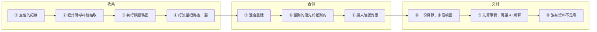

# 從多個來源重建微服務相依圖：一個 Pattern Language

> **2026-10-13：最新版改為 Word，見 `docs/papers/asianplop-2027-zh.docx`（原始檔 `docs/papers/src/plop.txt`）。** 那一版把 language 改名「相依圖重建」，並拿掉 DepWeaver 自己獨特的做法（三級信心、主動問人的差別）。本檔停在 10/12，不再更新。

**Recovering Microservice Dependency Graphs from Many Sources: A Pattern Language**（暫定標題，見「想問老師」第 1 點）

> **這是什麼**：AsianPLoP 投稿用的中文完整稿，**2026-10-12 依老師反饋整篇重寫**。
>
> **老師的反饋**：pattern 是通用的。上一版寫成「我自己的解法」，太獨特了。一個 pattern 必須是**論文有寫、業界在用、我也在用**的做法，這篇論文是把它整理出來和大家分享。
>
> **這一版怎麼改**：
> 1. **收錄標準改成三個條件**（§1.4）：每個 pattern 都要有已發表的論文、業界工具的官方文件，以及 DepWeaver 的實作。三者缺一就不收。候選怎麼篩、哪個沒過，見 §5。
> 2. **Pattern 換了一批**。上一版五個 pattern 都是從 DepWeaver 自己的事故往回推的，例如「誠實分母」「事實由程式寫」。這一版從「微服務相依圖大家怎麼建」出發，收了十個做法，DepWeaver 只是每個 pattern 的 Known Uses 之一。上一版有四個 pattern 在這一版找到通用版本，「誠實分母」找不到論文，所以拿掉（對照見 §5.2）。
> 3. **上一版的內容沒有丟掉**，搬到 COMPSAC 技術論文 `docs/compsac-paper-zh.md`：DepWeaver 自己的方法、事故與實驗數字都在那裡。兩篇的分工見 §8。上一版全文在 commit `77c0760`。
> 4. **Known Uses 固定分三列**：論文、業界、DepWeaver。讀者一眼就能看到這個做法是不是通用的。
>
> **證據查證**：2026-10-12 分兩路查證，一路查論文，一路查業界官方文件。每一項都附網址或 DOI。只查到二手描述的項目標「待確認」。

---

## 摘要

微服務系統的相依圖（哪個服務呼叫哪個服務、用了哪個資料庫、連到哪個外部主機）是部署排序、變更影響分析與測試規劃的基礎，但它很少被完整記錄下來。過去二十年，學界與業界各自發展出重建它的做法：讀部署描述、從程式碼抽呼叫點、從服務網格或分散式追蹤看實際發生的呼叫、打流量讓沒走過的路徑出現、把多個來源合起來、標出哪些是推測的、請熟悉系統的人確認對應、用同一份目錄產生所有視圖、讓分析程式算事實而 AI 只負責解釋，以及把「沒有資料」和「零」分開。

本文把這十個做法寫成一個 pattern language。收錄標準是三個條件同時成立：**有已發表的論文描述它、有業界工具在官方文件中採用它、我們自己的工具 DepWeaver 也實作了它**。十個 pattern 依建構順序排列，分成「收集」「合併」「交付」三組，每一個 pattern 套用之後都會產生下一個 pattern 要處理的情境。每個 pattern 的 Known Uses 都分三列列出論文、業界工具與 DepWeaver 的做法。

**關鍵詞**：pattern language、微服務、架構回復、相依圖、服務網格、分散式追蹤、靜態分析、人在迴圈、大型語言模型

---

## 1. 緒論

### 1.1 情境

你負責一個由幾十個服務組成的系統，或者你在做一個工具，要替這種系統自動畫出**相依圖**：服務之間誰呼叫誰、哪個服務用了哪個資料庫或佇列、哪些呼叫出了叢集。這張圖會被拿來做決定：部署順序怎麼排、改一個服務要通知誰、測試還缺哪裡。

沒有人能直接給你這張圖。架構文件在第一次發佈後就開始過時。程式碼散在幾十個 repo、好幾種語言裡。真正跑起來的流量又只走過其中一部分路徑。所以你得從好幾個地方拼出它，每個地方看得到的東西都不一樣。

### 1.2 這些來源各自看得到什麼

| 來源 | 例子 | 看得到 | 看不到 |
|---|---|---|---|
| **部署描述** | Kubernetes manifest、Docker Compose、Helm chart | 有哪些服務、誰被佈線到誰（環境變數裡的位址、`depends_on`） | 程式碼裡真的有沒有呼叫 |
| **程式碼與設定檔** | HTTP client、Feign、gRPC stub、資料庫連線設定 | 寫在那裡的呼叫，不管有沒有跑到 | 動態分派、沒有解析器的語言、宣告了但沒用的設定 |
| **執行期觀測**（見下） | 服務網格的呼叫計數、分散式追蹤 | 這段期間真的發生過的呼叫 | 沒被走到的路徑 |
| **人** | 熟悉系統的工程師 | 名字的對應、只有部署現場才知道的值 | 規模大時問不完 |

**「執行期觀測」是什麼**：系統跑起來之後，每個服務旁邊有一個代理（例如 Istio 服務網格的 sidecar），或者程式裡埋了追蹤用的程式庫（例如 OpenTelemetry）。服務之間的每一次呼叫都會被它記下「誰呼叫了誰、幾次、成功與否」，送到 Prometheus 或追蹤系統。這類資料在監控領域叫 telemetry（標準譯名「遙測」，本文不用這個詞），在架構回復的文獻裡，靠它的方法叫動態分析。它不是讀程式碼推出來的，是呼叫真的發生時被記下來的，所以精確；但只有真的被呼叫過的關係才會出現。

### 1.3 問題

> **沒有任何單一來源能完整重建相依圖。要從多個可靠度不同的來源拼出一張讀者可以據以決策的圖，該怎麼做？**

這不是一個新問題。學界的比較研究量過單一來源的不足：13 個靜態架構回復工具裡，單一最佳的 F1 是 0.86，四個合起來是 0.91（Schneider et al., EMSE 2025）。37 個重建工具裡，19 個純靜態、10 個純動態、8 個兩者都用（Bakhtin et al., ECSA 2023）。2026 年的文獻回顧直接寫：「沒有任何單一來源足夠」（Grinenko et al., WCH 2026）。業界的服務圖工具也一樣，從追蹤畫圖、從設定補缺口、讓使用者改名合併，各家做法很像。

**這篇論文不提新方法。** 它把這些已經在用的做法整理成 pattern：每個做法解什麼問題、有什麼代價、彼此怎麼接。

### 1.4 收錄標準：三個條件

PLoP 系列沿用 Christopher Alexander 的定義：pattern 是「某個情境下，一個反覆出現的問題的解法，解法平衡互相拉扯的力量」。重點在**反覆出現**：pattern 是社群已經在用、被證明可行的做法，不是某個人的發明。

本文對「反覆出現」的要求是三個條件同時成立：

| 條件 | 要什麼 | 為什麼 |
|---|---|---|
| **論文** | 至少兩篇已發表的論文描述或評估這個做法 | 證明它被研究過，而且知道它的限制 |
| **業界** | 至少兩個業界工具在**官方文件**裡採用這個做法 | 證明它在真實系統上可行，不是只存在於論文裡 |
| **DepWeaver** | 我們的工具也實作了它 | 我們能具體說明實作時遇到什麼，而不只是轉述 |

三個條件缺一就不收。§5 列出所有候選的篩選結果，包括沒過的。

### 1.5 每個 pattern 的格式

| 欄位 | 要回答的問題 |
|---|---|
| **名稱** | 中英文各一個。優先沿用業界或論文已經在用的名字 |
| **別名** | 其他工具與論文怎麼叫同一件事 |
| **一句話** | 沒時間讀全文的人該記住什麼 |
| **Context** | 你是誰、手上有什麼。要能接上前一個 pattern 套用後的情境 |
| **Problem** | 兩難是什麼。第一句是粗體的兩難句 |
| **Forces** | 哪些力量互相拉扯。每一條都寫不顧它會怎樣 |
| **Solution** | 因此該怎麼做 |
| **例子** | 用 §2 的商店說明 |
| **Resulting Context** | 套用之後的世界，以及接下來要處理的新問題 |
| **Consequences** | 好處與代價 |
| **Known Uses** | **固定三列**：論文、業界、DepWeaver |
| **Related Patterns** | 本 language 內外的關係 |

### 1.6 讀者

做「從多個來源拼出一張系統圖」的人，不限微服務：架構回復與相依分析工具、服務目錄、可觀測性平台的服務圖、基礎設施盤點、以及把這類分析結果交給 LLM 寫成報告的系統。

---

## 2. Running Example

全文用同一個線上商店：

```
web ──→ orders ──→ payment
 │        │
 │        ├──→ shipping ──→ queue
 │        └──→ orders-db
 ├──→ catalog ──→ catalog-db
 └──→ cart
```

各條關係在各個來源裡長這樣：

| 關係 | 部署描述 | 程式碼 | 執行期觀測 | 文件 |
|---|---|---|---|---|
| `web → orders` | `ORDERS_ADDR=orders:8080` | `OrderClient` | 95 次請求 | 有 |
| `orders → payment` | `PAYMENT_ADDR` | `PaymentClient.java:42` | 這段期間沒人付款，0 次 | 有 |
| `orders → shipping` | 沒有 | 沒有（用 enum 經 registry 動態解析） | 12 次 | 有 |
| `orders → orders-db` | `DB_URL` | JPA `@Entity` | 12 次 TCP 連線 | 有 |
| `catalog → catalog-db` | `DB_URL` | **沒有任何持久化程式碼** | 0 次 | 沒有 |
| `web → cart` | `CART_ADDR` | 是 Node，沒有解析器 | 這次沒有連上叢集 | 有，但文件叫它 `basket-service` |

這張表裡每一列都至少有一個來源說錯或沒說，後面的 pattern 會逐一處理。

---

## 3. 這個 Language 的全貌



| # | Pattern | 解決的問題 | 套用後產生的新問題 |
|---|---|---|---|
| ① | **宣告的拓樸** Declared Topology | 不知道系統有哪些服務、誰被接到誰 | 佈線不等於呼叫，程式碼裡到底有沒有用？ |
| ② | **程式碼呼叫點抽取** Call-Site Extraction | 想知道程式碼裡寫了哪些呼叫 | 動態分派與沒有解析器的語言看不到，寫了也不代表會跑 |
| ③ | **執行期服務圖** Runtime Service Map | 想知道哪些呼叫真的發生了 | 沒被走到的路徑不會出現 |
| ④ | **打流量把路走一遍** Exercise the Paths | 執行期圖只有被走到的路徑 | 流量永遠走不完；三個來源的說法不一致 |
| ⑤ | **混合重建** Hybrid Reconstruction | 每個來源都不完整 | 合起來之後分不出哪條是量到的、哪條是推的 |
| ⑥ | **量到的優先於推測的** Observed over Inferred | 合併後等級被抹平 | 有些名字在不同來源裡對不上，規則判斷不了 |
| ⑦ | **請人確認對應** Human-Confirmed Mapping | 名字對不上時規則只能猜 | 有了一張整理過的圖，但產物有好幾種 |
| ⑧ | **一份目錄、多個視圖** One Catalog, Many Views | 圖、數字、報告各自推導而互相矛盾 | 報告是 AI 寫的，它重述事實時會出錯 |
| ⑨ | **先算事實，再讓 AI 解釋** Compute, Then Explain | AI 重述事實會出錯 | 有些來源這次根本沒收集，算出來的是 0 |
| ⑩ | **沒有資料不是零** No Data Is Not Zero | 沒收集被當成 0 或 false | （終點） |

**讀法**：從頭照順序讀，是一個工具從零開始建的順序。已經有服務圖平台（例如已經接了 Kiali 或 Datadog）的團隊，③ 已經有了，可以從 ④ 開始讀；只做靜態分析的團隊會發現 ⑩ 最先痛，因為所有執行期欄位都是空的。

---

## 4. Patterns

### 第一組：收集

---

### ① 宣告的拓樸（Declared Topology）

**別名**：部署描述挖掘（deployment descriptor mining）、Infrastructure-as-Code 分析；Backstage 叫「宣告的關係」（`dependsOn`）；Docker Compose 叫啟動相依（startup dependency）。

**一句話**：先讀部署描述與宣告檔，拿到「有哪些服務、誰被接到誰」：服務清單當詞彙表，環境變數裡的位址與 `depends_on` 當候選的相依。

**Context**

你要開始畫一張相依圖。系統還沒跑、或你還沒有叢集的權限，但 repo 裡有部署描述：Kubernetes manifest、Docker Compose、Helm chart，有時還有服務目錄的宣告檔。這些檔案是給機器讀的，格式固定，而且部署工具每次都真的讀它們，所以它們不太會過時：寫錯了，系統就起不來。

**Problem**

> **你需要一份可靠的服務清單和一個起點，但程式碼太散、執行期資料還沒有，而文件可能已經過時。**

直接從程式碼開始，你會先遇到一個更基本的問題：哪些目錄是服務、它們叫什麼名字。模組目錄名、套件名、部署名常常不一樣，而後面所有來源都要對齊到同一組名字上。

**Forces**

- **部署描述可靠，但它講的是佈線，不是呼叫。** `ORDERS_ADDR=orders:8080` 表示有人把位址交給了 `web`，不表示 `web` 一定會呼叫它。
- **格式多樣。** Kubernetes、Compose、Helm 模板各有寫法；Helm 模板沒有渲染就不能解析。
- **宣告可能是給人看的。** 服務目錄的 `dependsOn` 是人手寫的，和部署描述不同，它不會因為寫錯而起不來。

**Solution**

因此：

1. 讀部署描述，把 workload 名稱（Deployment、StatefulSet、Compose service）收成**服務清單**，當成後面所有來源的詞彙表。
2. 把環境變數、ConfigMap 裡的位址，以及 `depends_on`、`links` 收成**候選相依**，標明「只是佈線」。
3. 反向代理設定（nginx `proxy_pass`、Ingress、Gateway 路由）是入口的邊表，也從這裡讀。
4. 不認得的格式（未渲染的模板）就略過並記錄，不要猜。

**例子**：商店的 manifest 給出六個服務、兩個資料庫，以及 `web` 拿到 `ORDERS_ADDR`、`CART_ADDR`，`orders` 拿到 `PAYMENT_ADDR`、`DB_URL`。`orders → shipping` 不在任何環境變數裡，所以這一步看不到它。

**Resulting Context**

你有一份服務清單和一組候選相依，可以畫出第一張草圖。但這張圖講的是「誰被接到誰」：`catalog` 拿到了 `DB_URL`，不代表它真的用資料庫；`orders → shipping` 根本不在佈線裡。要知道程式碼裡寫了什麼呼叫，得去讀程式碼。→ ②

**Consequences**

- ＋ 便宜、確定、不需要系統跑起來。
- ＋ 服務清單讓後面的來源有共同的名字可以對齊。
- － 佈線不等於使用；只讀這一層會畫出「宣告了但沒用」的邊。
- － 名字寫死在程式碼裡、沒有經過部署描述的呼叫，這一層完全看不到。

**Known Uses**

| | 誰 | 怎麼做 |
|---|---|---|
| **論文** | MicroDepGraph（Rahman, Panichella & Taibi, SSSME 2019, arXiv:1909.03249） | 分析 Docker Compose 檔取得服務相依；Schneider et al.（EMSE 2025）的比較研究也指出，要高 recall 還得「深入分析原始碼，不能只看部署檔」 |
| | Soldani, Khalili & Brogi, *Offline Mining of Microservice-based Architectures*, CLOSER 2022, doi:10.5220/0011061000003200 | 從 Kubernetes 部署描述挖出架構 |
| | Ibrahim, Bozhinoski & Pretschner, SAC 2019, doi:10.1145/3297280.3297401（待確認：只見二手描述） | 從 docker-compose 取得拓樸，用來產生攻擊圖 |
| **業界** | Docker Compose（<https://docs.docker.com/compose/how-tos/startup-order/>） | 「dependencies are determined by `depends_on`, `links`, `volumes_from`, and `network_mode`」，並依此排啟動順序 |
| | Backstage（<https://backstage.io/docs/features/software-catalog/well-known-relations/>） | `dependsOn` 關係「is commonly generated based on `spec.dependsOn`」 |
| | Helm（<https://helm.sh/docs/helm/helm_dependency/>） | 在 `Chart.yaml` 宣告所有相依 |
| **DepWeaver** | `ConfigExtractor` | 讀 Kubernetes manifest、Compose、nginx／Apache 反向代理設定；workload 名稱當 greenfield 的詞彙表；workload 自己 env 裡的服務位址畫成最低等級（只被提到） |

**Related Patterns**：接在後面 ②；被 ⑤ 使用（佈線是混合重建的來源之一）；被 ⑦ 使用（服務清單是請人對應時的候選來源）。

---

### ② 程式碼呼叫點抽取（Call-Site Extraction）

**別名**：靜態架構回復（static architecture recovery）、靜態相依分析；IntelliJ 叫 Endpoints 視圖；CAST 叫 source code map。

**一句話**：用解析器在程式碼裡比對已知的呼叫型態（HTTP client、Feign、gRPC stub、訊息佇列、持久化標記），每條抽到的關係都附檔案與行號。

**Context**

你有了服務清單與佈線（①），想知道每個服務的程式碼裡實際寫了哪些對外呼叫。程式碼在 repo 裡，可以不用部署就讀。

**Problem**

> **佈線只說誰被接到誰；要知道誰在程式碼裡真的呼叫誰，得讀程式碼。但呼叫的寫法千變萬化，而且寫在那裡的不一定會被執行。**

**Forces**

- **框架決定呼叫長什麼樣。** Spring 的 Feign、RestTemplate、Python 的 requests、Go 的 gRPC stub，每一種都要一條比對規則。
- **語言決定看不看得到。** 沒有解析器的語言，整個服務的呼叫都看不到。
- **目標主機常常不是字面值。** 它可能來自設定檔的佔位符、環境變數、或另一行拼出來的字串。
- **動態分派完全看不到。** 目標經 registry 或 enum 在執行期才決定。
- **寫了不等於會跑。** 死碼、只宣告沒引用的常數檔，都會變成假的邊。

**Solution**

因此：

1. 用語法解析器（例如 tree-sitter）而不是正規表示式，對每個框架的呼叫型態寫一條查詢。
2. 目標主機依序解析：字面值 → 設定檔的值 → 佔位符的預設值 → 最後才用變數名推測，而且推測的要另外標記。
3. 每條抽到的關係附**檔案與行號**。
4. 同時抽「使用的證據」：例如資料庫除了連線設定，還要找到持久化程式碼，才算真的在用。
5. 沒有解析器的語言要明說「這部分沒看」，不要讓它看起來像沒有相依。

**例子**：`PaymentClient.java:42` 抽到 `orders → payment`；`orders` 有 JPA `@Entity`，所以 `orders → orders-db` 有使用證據；`catalog` 只有 `DB_URL` 沒有持久化程式碼。`orders → shipping` 是 `call(Service.SHIPPING)`，看不到。`cart` 是 Node，沒有解析器。

**Resulting Context**

你知道了程式碼裡寫了什麼，而且每條都有行號。但兩種東西還是看不到：動態分派的呼叫（`orders → shipping`）與沒有解析器的語言（`cart`）。而看得到的那些，你也不知道這次有沒有真的發生：`orders → payment` 寫在那裡，可能從來沒被呼叫過。要知道哪些真的發生了，得看執行期。→ ③

**Consequences**

- ＋ 不需要部署，看得全，每條都有出處可以複驗。
- － 每個框架、每種語言都要維護規則，這是最需要維護的部分。
- － precision 會被死碼與宣告未使用的設定拉低。

**Known Uses**

| | 誰 | 怎麼做 |
|---|---|---|
| **論文** | Bushong, Das & Cerny, CLOSER 2022, doi:10.5220/0011032100003200 | 「based on static code analysis of the microservice mesh」重建整個系統的架構 |
| | Code2DFD（Schneider & Scandariato, JSS 202, 2023, doi:10.1016/j.jss.2023.111722） | 「parses source code and configuration files in search for keywords that are used as evidence」 |
| | Walker, Laird & Cerny, ICISA 2021, LNEE 739, doi:10.1007/978-981-33-6385-4_21 | 以程式碼分析自動重建微服務架構 |
| **業界** | CAST Imaging（<https://doc.castsoftware.com/imagingexpress/use-cases/explore/>） | 「transforms source code into an interactive map」，互動關係「based on existing static call between source code elements」 |
| | IntelliJ IDEA Endpoints（<https://www.jetbrains.com/help/idea/endpoints-tool-window.html>） | 彙整專案裡用到的 client 與 server API，並畫出微服務之間的互動圖 |
| | vFunction（<https://kb.vfunction.com/analysis/architectural-observability/dynamic-static-analysis>） | 「Static Analysis is obtained by analyzing the binaries (byte-code) of the application」 |
| **DepWeaver** | `TreeSitterExtractor` ＋ `.scm` 查詢檔 | Java／Python 用 tree-sitter 比對 Feign、RestTemplate、HTTP client、訊息佇列與 JPA／SQLAlchemy／Django 持久化標記；其他語言退回 LLM 讀片段；每條附 `檔案:行` |

**Related Patterns**：接在 ① 後面；接在後面 ③；被 ⑥ 使用（「有使用證據」這個等級就是從這裡來的）。

---

### ③ 執行期服務圖（Runtime Service Map）

**別名**：動態架構回復（dynamic architecture recovery）；Kiali 叫 topology graph；Datadog、AWS 叫 service map；Grafana Tempo 叫 service graph。

**一句話**：從服務網格的呼叫計數、分散式追蹤或網路連線，畫出這段期間真的發生過的呼叫，並記下次數。

**Context**

系統已經部署，而且有某種執行期觀測：服務網格（Istio、Linkerd）、分散式追蹤（OpenTelemetry、Jaeger）、或至少能看到網路連線。你想知道 ① 和 ② 畫出的邊裡，哪些真的在跑，以及有沒有它們都沒看到的。

**Problem**

> **靜態來源說的是「寫在那裡」，讀者真正想知道的是「真的在發生」。可是執行期只看得到被走過的路徑。**

**Forces**

- **精確但看不全。** 看到的就是真的發生過，但沒被呼叫的就不在上面。
- **協定決定看不看得到。** 服務網格對 HTTP／gRPC 有請求層級的指標；資料庫連線是不透明的 TCP，只能在連線層看到。
- **需要基礎設施。** 沒有服務網格或追蹤，這一層就沒有資料。
- **時間窗會影響結果。** 查詢期間沒流量的邊會消失，即使它昨天還在。

**Solution**

因此：

1. 從服務網格或追蹤系統查「來源服務 → 目標服務」的呼叫次數，每一對畫一條邊並記下次數。
2. 非 HTTP 的相依（資料庫、佇列）另外查連線層的計數。
3. 目的地在叢集外的呼叫另外查，那是外部相依。
4. 記下查詢的時間窗，讓讀者知道「這段期間」是哪一段。

**例子**：`web → orders` 95 次、`orders → shipping` 12 次（② 看不到的這裡看到了）、`orders → orders-db` 12 次 TCP 連線。`orders → payment` 0 次：這段期間沒人付款。

**Resulting Context**

你知道哪些呼叫真的發生了，連靜態看不到的動態分派也出現了。但 `orders → payment` 是 0：它不是不存在，只是這段期間沒人走到。執行期圖的完整度取決於流量有沒有把路走一遍。→ ④

**Consequences**

- ＋ precision 最高；能補到靜態看不到的動態分派。
- ＋ 次數本身有用：可以看出哪條是主要路徑。
- － 需要部署與觀測基礎設施。
- － 只看得到被走到的路徑；結果隨時間窗變化。

**Known Uses**

| | 誰 | 怎麼做 |
|---|---|---|
| **論文** | Aguilera et al., *Performance debugging for distributed systems of black boxes*, SOSP 2003, doi:10.1145/945445.945454 | 只從被動的訊息追蹤推出黑盒節點之間的呼叫路徑 |
| | Al Maruf, Bakhtin, Cerny & Taibi, SOSE 2022, doi:10.1109/SOSE55356.2022.00010 | 用微服務系統本來就在收集的日誌、追蹤與指標建立動態視圖 |
| | Tsubouchi et al., *Transtracer*, COMPSAC 2020, doi:10.1109/COMPSAC48688.2020.00-92 | 觀察 TCP socket 找出行程之間的網路相依 |
| **業界** | Kiali（<https://kiali.io/docs/faq/graph/>） | 「Kiali builds the graph from Istio's telemetry」 |
| | Grafana Tempo（<https://grafana.com/docs/tempo/latest/metrics-from-traces/service_graphs/>）、OpenTelemetry servicegraph connector | 從追蹤的父子 span 找出服務之間的請求 |
| | Datadog Service Map（<https://docs.datadoghq.com/tracing/services/services_map/>）、AWS X-Ray | 「draws the observed dependencies between these services in real time」 |
| **DepWeaver** | Prometheus 查詢 ＋ `RuntimeGraphBuilder` | 查 Istio 的 `istio_requests_total`（HTTP／gRPC）、服務網格內的 `istio_tcp_connections_opened_total`（資料庫）與目的地在網格外的流量（外部相依） |

**Related Patterns**：接在 ② 後面；接在後面 ④；被 ⑥ 使用（「量測到」等級的唯一來源）。

---

### ④ 打流量把路走一遍（Exercise the Paths）

**別名**：合成流量（synthetic traffic）、負載產生器（load generator）、synthetic monitoring；動態分析文獻叫 workload coverage。

**一句話**：用負載產生器、測試或合成監控主動驅動系統，讓執行期觀測看到平常沒走到的路徑；用「還沒被量到的邊」決定下一輪要打什麼。

**Context**

你有執行期服務圖（③），但它只有被走過的路徑。在測試環境裡，可能根本沒有真實使用者；在正式環境裡，罕見流程（退款、管理功能）可能一週才走一次。

**Problem**

> **執行期圖的完整度取決於流量，而你不能等真實使用者剛好把每條路都走過。**

**Forces**

- **流量要語意正確才會走到深處。** 登入要對的帳密、轉帳要一個存在的收款帳號；亂打只會停在第一個 4xx。
- **流量有副作用。** 在正式環境打寫入請求會產生真資料。
- **永遠走不完。** 路徑組合會爆炸，必須決定什麼時候停。
- **「回 200」不等於「走到了」。** 有些應用拒絕表單時也回 200。

**Solution**

因此：

1. 用負載產生器、端對端測試或合成監控腳本驅動系統，優先走主要的使用者流程。
2. 把靜態來源（①②）畫出、但執行期還沒量到的邊列成清單，用它決定下一輪流量要打什麼。
3. 每一輪之後重新查執行期觀測，看清單有沒有縮短。
4. 判斷「走到了沒」要看相依邊有沒有出現，而不是只看 HTTP 狀態碼。
5. 需要只有人知道的值（帳密、帳號）時，問人（→ ⑦），不要編。

**例子**：靜態說有 `orders → payment`，執行期 0 次 → 下一輪流量加一筆結帳 → `orders → payment` 出現。

**Resulting Context**

執行期圖補上了大部分路徑，但總有走不到的（需要外部系統配合的、需要特殊權限的）。現在你手上有三四個來源，它們對同一條邊的說法不一樣：程式碼說有、執行期說沒量到、文件說有但名字不同。要把它們合成一張圖。→ ⑤

**Consequences**

- ＋ 執行期圖的完整度從「碰運氣」變成可以有系統地提升。
- ＋ 「還沒量到的邊」清單本身就是一份測試缺口清單。
- － 要維護腳本；寫入類的流量要有測試環境或可回滾的資料。
- － 永遠不會到 100%，要有停止條件。

**Known Uses**

| | 誰 | 怎麼做 |
|---|---|---|
| **論文** | Cornelissen et al., *A Systematic Survey of Program Comprehension through Dynamic Analysis*, IEEE TSE 35(5), 2009, doi:10.1109/TSE.2009.28 | 指出動態分析「inherent incompleteness」，以及「the difficulty of determining which scenarios to execute… test suites can be used」 |
| | Grinenko et al., WCH 2026, CEUR-WS Vol-4278 | 動態重建「hinges on instrumentation, workload coverage」，工具必須「exercise representative workloads」 |
| | Smith et al., *Benchmarks for End-to-End Microservices Testing*, SOSE 2023, arXiv:2306.05895 | 以追蹤發現服務相依圖，用來檢查測試的覆蓋 |
| **業界** | Istio 的 Kiali 教學（<https://istio.io/latest/docs/tasks/observability/kiali/>） | 先教你用 `watch … curl` 迴圈送流量，因為「The graph represents traffic flowing through the service mesh for a period of time」 |
| | Online Boutique（<https://github.com/GoogleCloudPlatform/microservices-demo>） | 內建 loadgenerator：「Continuously sends requests imitating realistic user shopping flows」 |
| | AWS CloudWatch Application Map（<https://docs.aws.amazon.com/AmazonCloudWatch/latest/monitoring/ServiceMap.html>）、Datadog Synthetics | 合成監控（canary）的呼叫會出現在服務圖上 |
| **DepWeaver** | `TrafficRunner` ＋ Postman collection | LLM 依 API 表面與文件產生腳本；用「靜態有、執行期沒量到」的邊清單產生下一輪；先從 repo 挖範例請求、再用錯誤回應修正，真的推不出來的值才問人 |

**Related Patterns**：接在 ③ 後面；接在後面 ⑤；需要只有人知道的值時用 ⑦。

---

### 第二組：合併

---

### ⑤ 混合重建（Hybrid Reconstruction）

**別名**：靜態＋動態分析、多來源融合（information fusion）；ServiceNow 叫 pattern-based ＋ traffic-based mapping；vFunction 叫 dynamic ＋ static analysis。

**一句話**：把佈線、程式碼、執行期觀測與文件的結果，以「來源服務 → 目標服務」為鍵合成同一張圖，每條邊保留它來自哪些來源。

**Context**

你有好幾個來源（①②③，可能還有文件），每一個都看到一部分。讀者只想看一張圖。

**Problem**

> **每個來源都不完整，而且看不到的地方各不相同。只用一個，一定漏；全部合在一起，又要決定衝突時聽誰的。**

**Forces**

- **互補是真的。** 靜態看不到動態分派，執行期看不到沒走過的路徑；合起來確實比較完整，研究也量到了。
- **名字不一致。** 同一個服務在部署描述、程式碼、文件裡可能有三種寫法。
- **合併規則要簡單到能解釋。** 加權投票、機率模型很難向讀者解釋一條邊為什麼在圖上。
- **弱來源會帶進雜訊。** 文件的錯誤、宣告未使用的設定，合進來就成了假邊。

**Solution**

因此：

1. 先確定節點：以 ① 的服務清單為主，其他來源的名字對齊到它；對不上的另外處理（→ ⑦）。
2. 以（來源服務, 目標服務）為鍵合併各來源的邊。
3. 每條邊保留**所有**支撐它的來源與出處（檔案:行、指標名稱、文件段落）。
4. 弱來源只**補強**既有節點，不憑空新增部署裡不存在的服務。
5. 記錄哪些來源這次有收集、哪些沒有（→ ⑩）。

**例子**：五條邊合在一起：`orders → shipping` 來自執行期與文件；`orders → payment` 來自佈線與程式碼；`catalog → catalog-db` 只來自佈線。

**Resulting Context**

你有一張比任何單一來源都完整的圖，每條邊都知道自己從哪裡來。但畫出來的時候，五條邊長得一模一樣：讀者分不出 `web → orders`（量到 95 次）和 `catalog → catalog-db`（只有一個連線設定）哪條可信。→ ⑥

**Consequences**

- ＋ 完整度比單一來源高，這一點有量化研究支持。
- ＋ 出處保留下來，每條邊都可以回頭查證。
- － 需要名字對齊；對齊錯了會合錯。
- － 弱來源的雜訊會跟著進來，需要 ⑥ 讓讀者分得出來。

**Known Uses**

| | 誰 | 怎麼做 |
|---|---|---|
| **論文** | Mayer & Weinreich, SOSE 2018, doi:10.1109/SOSE.2018.00012 | 有些關係「may only become evident at runtime」，所以結合「static service information with infrastructure-related and aggregated runtime information」 |
| | Schneider et al., EMSE 30, art. 128, 2025, doi:10.1007/s10664-025-10686-2 | 單一最佳工具 F1 0.86；「a combination of four individual tools that achieves an F1-score of 0.91」 |
| | Bakhtin et al., ECSA 2023, doi:10.1007/978-3-031-66326-0_1；Zhang et al., *SARIF*, ESEC/FSE 2023, doi:10.1145/3611643.3616285 | 37 個工具中 8 個結合靜態與動態；SARIF 依各來源的相關性與品質融合相依、程式碼文字與目錄結構 |
| **業界** | ServiceNow Service Mapping（官方文件，pattern-based 與 traffic-based 兩頁） | traffic-based 補充 pattern-based 的對應，再把連線資訊補進服務圖 |
| | vFunction（<https://kb.vfunction.com/analysis/architectural-observability/dynamic-static-analysis>） | 靜態分析「overlaid on top of the Dynamic Analysis」 |
| | Kiali（<https://kiali.io/docs/features/topology/>）、AWS Application Map | 「combines real-time request traffic with your Istio configuration information」；沒有追蹤的服務由 Resource Explorer 依名稱與標籤補上 |
| **DepWeaver** | `RuntimeGraphBuilder` → `CodeGraphMerger` → `DocGraphMerger` → `K8sGraphBuilder` | 執行期先建骨架，依序疊上程式碼、文件、部署狀態；文件只補強不新增；每條邊有 `provenanceRefs` |

**Related Patterns**：使用 ①②③；接在後面 ⑥；名字對不上時用 ⑦。

---

### ⑥ 量到的優先於推測的（Observed over Inferred）

**別名**：推測節點（inferred services，Datadog）、推測區段（inferred segments，AWS X-Ray）、虛擬節點（virtual nodes，Grafana Tempo／OpenTelemetry）；學界叫 uncertainty in graph edges、partial models。

**一句話**：讓每條邊（或節點）帶一個「量到的」或「推測的」標記，畫成不同樣子；同一條邊有了更強的證據就取代推測的版本。

**Context**

你合出了一張多來源的圖（⑤），每條邊都有出處。讀者會拿它做決策，而且不會回頭看出處。

**Problem**

> **全部畫成一樣，讀者會以為每條都一樣真；只畫量到的，又會丟掉量不到但確實存在的相依。**

**Forces**

- **可靠度和完整度方向相反。** 量到的可靠但不全；推測的全但不可靠。
- **讀者要一眼看懂。** 分太多級看不懂，只有一級又什麼都分不出來。
- **同一條邊會被多個來源提到。** 不能畫成平行的好幾條，也不能讓弱的蓋掉強的。
- **視覺通道有限。** 線型、顏色、粗細要分給等級、關係類型與流量；研究指出同時編碼主屬性與不確定性的視覺變數會互相干擾。
- **誠實可能降低信任。** 標出「這是推測的」，讀者可能覺得整張圖不可靠。

**Solution**

因此：

1. 給每條邊一個**小而有序**的等級。最少兩級（量到的／推測的），可以在中間加一級（例如「程式碼有寫，但沒量到」）。
2. 等級和出處分開存：一條邊可以有多筆出處，但只有一個等級。
3. 合併時**更強的證據取代較弱的**：同一條邊被量到了，就不再顯示為推測。
4. 把最醒目的視覺通道（實線／虛線，或實框／虛框）給等級。
5. 下游（摘要、報告）只能照抄或降級，不能把推測的講成確定的。

**例子**：`web → orders` 實線；`orders → payment` 虛線（程式碼有、沒量到）；`catalog → catalog-db` 點線（只有連線設定）。下一輪流量量到 `orders → payment` 之後，它變成實線。

**Resulting Context**

讀者分得出哪條可以據以決策。等級上升本身也成了訊號：一條虛線變實線，代表流量終於走到了。但合併時有些名字根本對不上：文件裡的 `basket-service` 是不是 `cart`？規則判斷不了，等級也幫不上忙，因為它還沒有被合進任何一條邊。→ ⑦

**Consequences**

- ＋ 量不到的真相依還在圖上，但不會被誤認為已確認。
- ＋ 「取代」的規則簡單，不需要調參數。
- － 讀者要學會看圖例。
- － 等級多於兩級時，「中間那一級」算什麼需要領域判準（例如資料庫要同時有連線設定與持久化程式碼）。

**Known Uses**

| | 誰 | 怎麼做 |
|---|---|---|
| **論文** | Guo, Huang & Laidlaw, IEEE TVCG 21(10), 2015, doi:10.1109/TVCG.2015.2424872 | 以受控實驗比較在圖的邊上呈現不確定性的視覺變數（亮度、紋理、模糊、透明度） |
| | Famelis, Salay & Chechik, *Partial Models*, ICSE 2012 | 「Models are good at expressing information about software but not as good at expressing modelers' uncertainty」，過早選定一個答案會帶進錯誤資訊 |
| | Barham et al., *Constellation*, MSR-TR-2008-67（技術報告，非同儕審查） | 推得的相依附「a guaranteed confidence level」 |
| **業界** | AWS X-Ray（<https://docs.aws.amazon.com/xray/latest/devguide/xray-concepts.html>） | 用下游呼叫產生「inferred segments」；該服務自己送出資料後「replaces the inferred segment」——正是「量到的取代推測的」 |
| | AWS CloudWatch Application Map（<https://docs.aws.amazon.com/AmazonCloudWatch/latest/monitoring/ServiceMap.html>） | 沒有被量測的服務「displayed with a distinctive visual indicator (such as a dashed border or different color)」 |
| | Grafana Tempo、OpenTelemetry servicegraph connector、Datadog inferred services、Kiali idle edges | 沒有被量測的對端畫成 virtual node；Datadog 由對外請求「infers the presence of these dependencies」；Kiali 把查詢期間沒流量的邊另外呈現 |
| **DepWeaver** | `DependencyGraph.addEdge()`、`DotEmitter` | 三級：只被提到（點線）< 有使用證據（虛線）< 量測到（實線）；合併取最高 |

**和業界的差別**（這一點要誠實寫）：業界工具多半只分兩級（量到的／推測的），而且標在**節點**上居多；DepWeaver 在中間多一級「有使用證據」，標在**邊**上。學界在微服務架構回復裡**沒有找到**逐條邊標等級的論文，所以這個 pattern 的論文證據來自視覺化與建模，業界證據比較直接。

**Related Patterns**：接在 ⑤ 後面；接在後面 ⑦；容易和 ⑩ 混淆：等級講「多可信」，⑩ 講「有沒有查過」，兩者不能共用同一個欄位。

---

### ⑦ 請人確認對應（Human-Confirmed Mapping）

**別名**：Reflexion model 的 mapping；互動式去重（interactive deduplication）；Datadog 叫 service remapping；Dynatrace 叫 service merging rules；ServiceNow 叫手動加入／排除連線。

**一句話**：名字或對應在規則下判斷不了時，不要丟掉、也不要模糊比對；把它變成一個具體的問題（附候選）交給熟悉系統的人，答案存下來給下一次用。

**Context**

你合出了分級的圖（⑥），但有些東西合不進去：文件說 `basket-service`，圖上有 `cart`；程式碼殘餘邊的短名稱 `user` 同時符合 `user-service` 和 `user-db`；`hystrix` 在名單裡是函式庫，但部署描述裡它是一個真的服務。另外，④ 要驅動某條路徑時，需要一組只有部署現場才知道的值。

**Problem**

> **規則判斷不了的對應，自動處理只有兩條路：丟掉（藏起一條可能真的相依），或模糊比對（憑相似度發明一條邊）。兩條都錯，而知道答案的人就在旁邊。**

**Forces**

- **人知道答案，但人的時間很貴。** 一次問幾十題，沒有人會回答。
- **人也會答錯**，而且答錯的對應會被合進圖裡。
- **名字會重複出現。** 同一個專案下一次分析，同樣的名字又會對不上。
- **規模。** 大系統的名字對不完，只能挑規則真的判斷不了的問。

**Solution**

因此：

1. 先用所有規則對齊；只有規則真的判斷不了的才記成問題，不默默丟掉。
2. 每個問題附**排序過的候選**（排序只給人看，不做決定）與「新節點」「忽略」兩個選項。
3. 在人本來就在的地方問（對話、審查頁面），而且在工作告一段落時一次問，不要每題打斷。
4. 答案以確定性的規則解析；看不懂就保留問題，不猜。
5. 答案以專案為單位**存下來**，下一次只問新出現的名字；答錯要能清除。
6. 報告裡標出哪些邊是靠人的回答畫上去的。

**例子**：工具問：「`basket-service` 是哪一個？1 `cart` 2 `catalog`／new／ignore」，人答 1，文件那條邊合到 `cart` 上。下一次分析不再問。

**Resulting Context**

規則判斷不了的地方由人補上了，而且補過的不會再問。現在你有一張整理過、分好級的圖。接下來要交付的不只是圖：還有覆蓋率之類的數字、一份報告、之後可能還有問答。→ ⑧

**Consequences**

- ＋ 不再默默丟掉相依，也不憑相似度發明相依。
- ＋ 答案累積之後，同一個專案越問越少。
- － 依賴回答的人熟不熟系統；回答錯誤會進到圖裡。
- － 要有地方存答案、要能清除。

**Known Uses**

| | 誰 | 怎麼做 |
|---|---|---|
| **論文** | Murphy, Notkin & Sullivan, *Software Reflexion Models*, FSE 1995；IEEE TSE 27(4), 2001, doi:10.1109/32.917525 | 「an engineer defines a high-level model and specifies how the model maps to the source」，工具據此算出一致與不一致 |
| | Sarawagi & Bhamidipaty, *Interactive deduplication using active learning*, KDD 2002, doi:10.1145/775047.775087 | 互動式實體對應：挑出最難判斷的配對請使用者標記 |
| | Grinenko et al., WCH 2026；Granchelli et al., *MicroART*, ICSAW 2017（架構師修正步驟待確認） | 回顧指出 MicroART 等工具需要「validation and manual refinement of incomplete results」 |
| **業界** | ServiceNow Service Mapping（官方文件） | 「you can decide which connections to add or remove」，決定記錄為「Added manually」「Excluded manually」 |
| | Datadog service remapping（<https://docs.datadoghq.com/tracing/services/service_remapping_rules/>） | 「rename, merge, or split services」 |
| | Dynatrace service detection rules、Backstage | 用規則把資料合併到同一個服務；Backstage 由擁有元件的團隊維護關係 |
| **DepWeaver** | `AliasResolution`、Discord「Resolve names」表單 | 四個原本會默默丟掉的地方改成問題；候選以三個訊號排序；答 編號／服務 id／new／ignore；答案存 `aliases/<repo>.json`；報告列出操作者解析的名稱 |

**和業界的差別**：業界的做法多半是**事後由使用者寫規則**；DepWeaver 是**在分析進行中主動問**。ServiceNow 的「建議的連線讓人審查」最接近。

**Related Patterns**：接在 ⑥ 後面；接在後面 ⑧；④ 需要只有人知道的值時也用同樣的方式問。

---

### 第三組：交付

---

### ⑧ 一份目錄、多個視圖（One Catalog, Many Views）

**別名**：Software Catalog（Backstage）、拓樸模型（Dynatrace Smartscape）、中介模型（intermediate representation）、架構重建的 metamodel；傳統上就是 Model–View–Controller 的 model。

**一句話**：先建一個標準模型，所有產物（圖、數字、報告、問答、匯出）都從它產生；衍生計算只寫一次。

**Context**

你有一張整理過的圖（⑦）。要交付的東西有好幾種：圖、覆蓋率之類的指標、一份文字報告，之後可能有人追問細節、有別的工具要讀。它們由不同的程式產生，有的是畫圖程式、有的是計分程式、有的是 LLM。

**Problem**

> **每個產物各自從原始來源推導，推導邏輯就會分岔；讀者會看到報告說 A、圖畫 B，而且無從判斷誰對。**

**Forces**

- **每個產物都想要最順手的輸入。** 畫圖要結構，計分要清單，LLM 要文字。
- **推導邏輯重複就會分岔**，而且只在特定資料下才看得出來。
- **模型要承載所有視圖需要的欄位**，schema 會變胖、改動影響面大。
- **有些視圖很晚才發生。** 報告發出幾天後有人追問，原始資料可能已經不在了。

**Solution**

因此：

1. 每次分析**先建一個模型**，再從它產生所有視圖。
2. 每個視圖都是模型的函式；衍生計算（分數、分層、排序）只實作一次。
3. 模型可以存檔與讀回；晚到的視圖讀同一份模型，不重新收集。
4. 要交給 LLM 的事實也從模型產生。

**例子**：圖上 `orders → orders-db` 是實線，覆蓋率把它算成已量到，報告寫「量到 12 次連線」，三天後的問答也這樣答——因為它們讀的是同一個物件。

**Resulting Context**

圖、數字、問答不可能對同一條邊說不同的話。但有一種產物沒被管住：文字報告是 LLM 寫的。它拿到模型給的事實之後，會用自己的話再講一遍，講的時候會漏、會加、會換詞。→ ⑨

**Consequences**

- ＋ 產物之間的矛盾在結構上消失，不靠事後校對。
- ＋ 加新視圖不必重寫推導邏輯；存檔讓晚到的問題有據可答。
- － schema 是所有視圖的共同介面，改動要照顧所有人。
- － 模型沒收的資訊，所有視圖都拿不到。

**Known Uses**

| | 誰 | 怎麼做 |
|---|---|---|
| **論文** | Alshuqayran, Ali & Evans, ICSA 2018；MiSAR, IST 186, 2025, doi:10.1016/j.infsof.2025.107808 | 以 metamodel 加對應規則，把程式碼對到同一個架構模型 |
| | Rademacher, Sachweh & Zündorf, EMMSAD 2020, doi:10.1007/978-3-030-49418-6_21；Cerny et al., SOSE 2022, doi:10.1109/SOSE55356.2022.00011 | 重建的結果是系統模型，再「visualize selected system-centric perspectives」 |
| | Krasnovsky, *Model Discovery and Graph Simulation*, arXiv:2506.11176（ICSE 2026 NIER） | 從追蹤、服務網格與 manifest 建出「an explicit, analyzable model」 |
| **業界** | Backstage Software Catalog（<https://backstage.io/docs/features/software-catalog/>） | 「a centralized system that keeps track of ownership and metadata」，各工具圍繞 catalog 的實體組織 |
| | Dynatrace Smartscape（<https://docs.dynatrace.com/docs/shortlink/topology-model>） | 「the Dynatrace built-in topological model」，用在平台的所有部分 |
| | Datadog Service Map（<https://docs.datadoghq.com/tracing/services/services_map/>） | 節點「match those in your Catalog」 |
| **DepWeaver** | `DependencyGraph` | `buildGraph()` 之後，Mermaid／Graphviz、`CoverageAnalyzer`、報告事實段落、問答存檔都讀同一個物件；存檔供事後在 Discord thread 追問 |

**Related Patterns**：接在 ⑦ 後面；接在後面 ⑨；⑩ 的「這次沒收集哪些來源」存在模型裡，才能傳到每個視圖。

---

### ⑨ 先算事實，再讓 AI 解釋（Compute, Then Explain）

**別名**：analytics augmented generation（Satyrn）；program-aided language models（PAL）；Dynatrace 叫 hypermodal AI（causal AI 算、generative AI 解釋）；K8sGPT 叫 analyzer ＋ `--explain`。

**一句話**：能由程式從模型算出的事實（有哪些相依、量到幾次、覆蓋率多少）由程式產生；生成式 AI 只負責把事實講成人話、詮釋與建議，而且不讓它重述事實。

**Context**

你有一個標準模型（⑧），圖和數字都從它產生。現在要一份文字報告，而你打算讓 LLM 寫，因為只有它寫得出讀者願意讀的散文：這個服務扮演什麼角色、哪裡有風險、下一步先做什麼。

**Problem**

> **LLM 重述事實時會漏、會加、會換詞，收緊 prompt 通常只是換一種錯法；但完全不用 LLM，報告就只剩一張沒人讀的表。**

**Forces**

- **讀者要連貫的文字**，不想看兩種風格拼在一起。
- **改 prompt 很便宜，所以很誘人**：改一次看起來好了，換一個系統又錯。
- **LLM 自己算事實的準確度不夠。** 讓 LLM agent 自己重建微服務架構，最好的模型 F1 只有約 0.6。
- **詮釋需要事實。** 不給 LLM 看事實，它的詮釋會和事實矛盾。

**Solution**

因此：

1. 把報告的內容分成**事實**（有唯一正確答案、模型裡都有）與**詮釋**（角色、風險、建議）。
2. 事實由程式從模型產生，措辭固定，例如量到的是連線就寫「連線數」，不寫「請求數」。
3. 同一份事實清單也交給 LLM，讓它的詮釋有依據；但事實段落由程式那一份為準，LLM 若自己也寫了，丟掉它的版本。
4. 讓讀者看得出哪一段是程式產生的。

**例子**：報告的「基礎設施相依」一節由程式產生：「`orders → orders-db`：量測到，12 次連線；`catalog → catalog-db`：只被提到」。LLM 只寫「風險」：「catalog 的資料庫依賴沒有程式碼佐證，可能是殘留的設定」。

**Resulting Context**

報告裡的事實和圖一致，而且可以測試。但程式算事實時有一種情況要特別小心：某個來源這次**根本沒收集**（沒有叢集、追蹤沒開、抽取失敗）。程式的預設值會把它算成 0，LLM 會把 0 講成「目前沒有任何依賴」。→ ⑩

**Consequences**

- ＋ 事實段落保證和圖一致，不必反覆修 prompt。
- ＋ 事實錯就是模型錯，除錯方向明確。
- － 報告有一段是範本文字，風格不完全一致。
- － 事實與詮釋的界線要人劃；劃錯了，LLM 會在詮釋裡重述事實。

**Known Uses**

| | 誰 | 怎麼做 |
|---|---|---|
| **論文** | Sterbentz et al., *Satyrn*, EMNLP 2024, arXiv:2406.12069 | 「utilize standard analytic techniques to generate facts」再交給 LLM；正確主張超過 86%，直接讓 GPT-4 Code Interpreter 寫是 57% |
| | Gao et al., *PAL*, ICML 2023, PMLR 202；Torroba Hennigen et al., *SymGen*, arXiv:2311.09188 | LLM 寫程式、由直譯器算答案；或輸出指向資料欄位的符號，由程式代入 |
| | Liljas, Esposito, Lenarduzzi & Taibi, *Can Agents Reconstruct Microservice Architecture?*, ESEM 2026, doi:10.4230/LIPIcs.ESEM.2026.62 | 反向證據：LLM 自己重建架構時 GPT-4o F1 0.604，「insufficient for fully reliable reverse engineering」 |
| **業界** | Dynatrace Davis CoPilot（<https://www.dynatrace.com/news/blog/hypermodal-ai-dynatrace-expands-davis-ai-with-davis-copilot/>） | 「Predictive AI and causal AI provide deterministic answers」，並「provide context to Davis CoPilot」，由後者以自然語言解釋 |
| | K8sGPT（CNCF sandbox，<https://github.com/k8sgpt-ai/k8sgpt>） | 「SRE experience codified into its analyzers」，LLM 只在「explain the analysis results using --explain」時使用 |
| **DepWeaver** | `DependencyReportService.infrastructureSection()`、`spliceInfrastructureSection()` | 報告的基礎設施相依與操作者解析的名稱兩節由程式從模型產生，以下一節標題為錨點拼進 LLM 的報告，LLM 的同名段落丟掉 |

**證據強度**：Dynatrace 的出處是官方部落格與新聞稿，不是產品文件；K8sGPT 是開源專案。軟體架構領域**沒有找到**直接評估這個分工的論文，學術證據來自一般的 LLM 生成研究。

**Related Patterns**：接在 ⑧ 後面；接在後面 ⑩；和 PLoP 2023 的 *Prompt Pattern Catalog* 方向互補：那一組教你把 prompt 寫好，本 pattern 說有些事不該交給 prompt。

---

### ⑩ 沒有資料不是零（No Data Is Not Zero）

**別名**：No Data 狀態（Grafana、Datadog）、`Unknown` condition（Kubernetes）、三值邏輯（SQL NULL）、inconclusive verdict（runtime verification）。

**一句話**：「沒有收集」「查不到」和「量到零」是不同的狀態：狀態欄位預設「未知」，指標顯示「未量測」而不是 0%，步驟失敗時記錄失敗而不是回傳空結果。

**Context**

你的事實由程式從模型算出來（⑨）。但工具不是每次都在同樣條件下跑：有時沒有叢集、有時追蹤沒開、有時某個抽取步驟失敗了。工具通常設計成某一步失敗也不中斷，因為使用者寧願拿到不完整的報告。下游有兩種讀者會填空：程式的預設值（0、false、空清單），與 LLM。

**Problem**

> **沒收集的資料在程式裡變成 0 或 false，在 LLM 手上變成猜測；讀者把一次從未發生的量測當成結果。**

`0%` 看起來像「量了，很糟」；`deployed: false` 看起來像「查了，沒部署」；空的相依清單看起來像「找過了，沒有」。

**Forces**

- **二值欄位簡單**，三值會擴散到每一個讀取點。
- **空白會邀請填補**：空的段落在 LLM 看來像是漏寫了。
- **不中斷的設計會把失敗藏起來。**
- **讀者想要一個數字**：「未量測」看起來沒做完，「0%」看起來做完了，後者更容易被接受，這正是危險所在。

**Solution**

因此：

1. 狀態欄位用三值（是／否／未知），**預設是未知**；只有在證據明確時才設成否。
2. 「這次沒收集哪些來源」當成模型的中繼資料，傳到每一個視圖（⑧）。
3. 視圖遇到未知，寫一句話：為什麼未知、補什麼才會知道。
4. 絕不用 0、0/N、0% 代表未量測，尤其不要把這種佔位值交給 LLM。
5. 步驟失敗時記錄失敗與原因，不要回傳空結果。

**例子**：這次沒有連上叢集。覆蓋率顯示「未量測（本次沒有執行期觀測，連上叢集後重跑即可得到）」而不是 0/4；`cart` 的部署狀態是「未知：沒有查詢叢集」而不是「未部署」；交給 LLM 的字串是 `NOT MEASURED`。

**Resulting Context**

這是 language 的終點。讀者看到的每條邊知道從哪裡來（⑤）、有多可信（⑥）；名字對不上的由人確認過（⑦）；每個產物說同一件事（⑧）；事實不經 LLM 重述（⑨）；沒量到的明說沒量到（⑩）。

套用之後會出現另一組問題，留作後續：讀者拿到報告後會追問細節，自然語言的問題怎麼變成對模型的確定性查詢。

**Consequences**

- ＋ 讀者不會把沒發生的量測當成結果；失敗變得看得見。
- ＋ 靜態模式與完整模式可以交出同一套產物而不誤導。
- － 每一個讀取點都要處理三值。
- － 只要有一條路徑（例如某個 prompt）沒帶「這次沒收集什麼」，空白就會從那裡被填回來。這是整個 language 最脆弱的 pattern。

**Known Uses**

| | 誰 | 怎麼做 |
|---|---|---|
| **論文** | Bauer, Leucker & Schallhart, *Runtime Verification for LTL and TLTL*, ACM TOSEM 20(4), 2011 | 只看到部分執行時，判定結果是「true, false, inconclusive」三種 |
| | Bruns & Godefroid, CAV 1999, doi:10.1007/3-540-48683-6_25 | 對不完整的狀態空間用三值時序邏輯做模型檢查 |
| | Codd, ACM TODS 4(4), 1979（待確認：只見二手描述）；Rubin, *Inference and missing data*, Biometrika 63(3), 1976, doi:10.1093/biomet/63.3.581 | NULL 與三值邏輯；遺漏資料不能當成觀測值處理 |
| **業界** | Datadog monitors（<https://docs.datadoghq.com/monitors/configuration/>） | 讓使用者在「Empty result is replaced with zero」與「Monitor status is set to NO DATA」之間明確選擇 |
| | Grafana alerting（<https://grafana.com/docs/grafana/latest/alerting/fundamentals/alert-rule-evaluation/nodata-and-error-states/>）、Prometheus `absent()` | 「The No Data state occurs when the alert rule query runs successfully but returns no data points at all」 |
| | Kubernetes（<https://kubernetes.io/docs/concepts/workloads/pods/pod-lifecycle/>） | Pod 的 `Unknown` phase：「the state of the Pod could not be obtained」；condition 取 True／False／Unknown |
| **DepWeaver** | `DependencyGraph.Node.deployed`（可為 null 的 `Boolean`）、`EdgeLedger.fail()` | 部署狀態預設「未判定」；沒有叢集時覆蓋率顯示 Not measured、交給 LLM 的是 `NOT MEASURED`；抽取失敗記錄原因 |

**證據強度**：業界很強，監控與編排工具都把「沒有資料」當成一級狀態。學術證據來自邏輯與 runtime verification，軟體架構回復的論文裡**沒有找到**直接處理這件事的。

**Related Patterns**：接在 ⑨ 後面；容易和 ⑥ 混淆（「只被提到」是有弱證據，「未知」是完全沒查過）；依賴 ⑧（「這次沒收集什麼」存在模型裡）。

---

## 5. 篩選紀錄

### 5.1 三個條件的總表

查證日期 2026-10-12。強度是兩路查證各自的判斷：「強」表示有微服務或服務圖領域的直接證據，「中」表示證據來自相鄰領域或非正式來源，「弱」表示只有零星或間接的證據。

| # | Pattern | 論文 | 業界 | DepWeaver | 收不收 |
|---|---|---|---|---|---|
| ① | 宣告的拓樸 | 強 | 強 | ✔ | 收 |
| ② | 程式碼呼叫點抽取 | 強 | 強 | ✔ | 收 |
| ③ | 執行期服務圖 | 強 | 強 | ✔ | 收 |
| ④ | 打流量把路走一遍 | 中（微服務專屬的少） | 強 | ✔ | 收 |
| ⑤ | 混合重建 | 強 | 強 | ✔ | 收 |
| ⑥ | 量到的優先於推測的 | 中（微服務架構回復裡沒有逐邊標等級的論文） | 中（多為兩級、標在節點） | ✔ | 收，但寫明差別 |
| ⑦ | 請人確認對應 | 強（一般）／中（微服務） | 弱到中（多為事後寫規則） | ✔ | 收，但寫明差別 |
| ⑧ | 一份目錄、多個視圖 | 中到強 | 強 | ✔ | 收 |
| ⑨ | 先算事實，再讓 AI 解釋 | 中（沒有 SE 專屬論文） | 中（部落格、開源專案） | ✔ | 收 |
| ⑩ | 沒有資料不是零 | 弱（借自邏輯） | 強 | ✔ | 收 |
| ✗ | 誠實分母（覆蓋率的分母只算量得到的，排除要揭露） | **沒有找到**相依分析或架構回復的論文 | 只有程式覆蓋率工具（coverage.py）與臨床試驗準則（CONSORT），都不是服務圖 | ✔ | **不收**，移到 COMPSAC 論文當 DepWeaver 自己的設計 |

### 5.2 上一版五個 pattern 去哪了

| 上一版（10/09 簡報） | 這一版 | 改了什麼 |
|---|---|---|
| ① 信心分級的關係 | ⑥ 量到的優先於推測的 | 從「我們的三級」改成「業界的量到／推測二分」，三級變成 DepWeaver 的變體 |
| ② 單一標準模型、多個視圖 | ⑧ 一份目錄、多個視圖 | 名字改用業界的 catalog；Known Uses 加上微服務架構回復的 metamodel 論文 |
| ③ 事實由程式寫 | ⑨ 先算事實，再讓 AI 解釋 | 名字改用業界與論文的說法；加入 Dynatrace、K8sGPT 與 ESEM 2026 的反向證據 |
| ④ 誠實分母 | （不收） | 三個條件過不了；內容移到 COMPSAC 論文 §III-D |
| ⑤ 未量測不是零 | ⑩ 沒有資料不是零 | 名字改用監控工具的 No Data；學術證據補上 runtime verification |
| — | ①②③④⑤⑦ | 新加入：相依圖「怎麼收集、怎麼合併」這一段，是大家都在做、上一版沒有寫的 |

---

## 6. 相關研究

### 6.1 微服務架構回復的回顧

Cerny 等人（SOSE 2022）回顧了微服務架構重建與視覺化的技術；Bakhtin 等人（ECSA 2023）把 37 個重建工具依靜態、動態、混合分類；Grinenko 等人（WCH 2026）的主題式回顧指出，沒有單一來源足夠，而「可靠地融合異質證據」與「共用的中介表示」仍是未解的問題。本文的 ⑤⑥⑧ 是業界與學界目前處理這兩個問題的做法，整理成可以照著做的形式。

### 6.2 PLoP 系列裡最接近的 pattern 論文

在 AsianPLoP／PLoP／EuroPLoP 的論文集裡，**沒有找到**以架構回復或相依分析為主題的 pattern 論文，這是本文的定位空缺。主題上最接近的：

| 論文 | 出處 | 關係 |
|---|---|---|
| Service Mesh Patterns | EuroPLoP 2022 | ③ 的資料來源（Istio） |
| Patterns for Log Dissemination in Cloud-Native Environments | AsianPLoP 2025 | 雲原生的可觀測性 |
| Patterns for AI-Assisted Document Maintenance and Traceability | AsianPLoP 2026 | AI 產生文件的可追溯性，接近 ⑨ |
| A Prompt Pattern Catalog to Enhance Prompt Engineering with ChatGPT | PLoP 2023 | 和 ⑨ 方向互補 |

---

## 7. 討論與限制

### 7.1 適用範圍

這個 language 適用於：系統由多個獨立部署的元件組成、相依圖要從多個來源拼出來、而且有人會拿它做決策。只有單一來源的工具（例如純追蹤的服務圖）只需要 ③，⑤⑥ 沒有作用。

### 7.2 證據最弱的三個 pattern

- **⑥**：業界與論文都有「量到／推測」的區分，但微服務架構回復裡沒有論文逐邊標等級。投稿時要說清楚，三級是 DepWeaver 的變體，不是 pattern 本身的要求。
- **⑦**：「請人確認」很普遍，但業界多半是事後由使用者寫規則，不是工具在分析中主動問。這個 pattern 的 Solution 要寫成兩者都涵蓋。
- **⑨**：學術證據來自一般的 LLM 生成研究，業界證據是 Dynatrace 的部落格與開源的 K8sGPT。

### 7.3 威脅效度

- **DepWeaver 是每個 pattern 的 Known Uses 之一**，但不是唯一的。外部證據證明「別人也這樣做」，不能證明「照這個順序建構一定順利」。這個 language 的順序只在 DepWeaver 上走過一遍。
- **業界證據來自官方文件**，文件寫的不一定等於產品實際行為。
- **論文證據有幾項只查到二手描述**（標「待確認」），投稿前要讀原文。

---

## 8. 和 COMPSAC 論文的分工

COMPSAC 2026 的徵稿規定禁止同時投稿到別處，所以兩篇的內容必須明顯不同：

| | 這篇（AsianPLoP） | COMPSAC 那篇 |
|---|---|---|
| 主張 | 這十個做法是大家都在用的，原因與代價在這裡 | DepWeaver 這個方法有效 |
| DepWeaver 的角色 | 每個 pattern 的 Known Uses 之一，一兩句話 | 主角 |
| 實驗數字 | **不放**（只說 DepWeaver 怎麼做，不說量到多少） | 全部放 |
| 事故 | 不放 | 放（RQ4 的八個錯誤） |
| DepWeaver 自己的設計（三級信心、誠實分母、最後才問人） | ⑥⑦ 只當變體提一句 | 詳細寫 |

---

## 參考文獻

> 書目格式待依 ACM 單欄模板調整。標「待確認」者投稿前要讀原文。

**論文**

1. Aguilera, M. K. et al. Performance debugging for distributed systems of black boxes. SOSP 2003. doi:10.1145/945445.945454
2. Al Maruf, A., Bakhtin, A., Cerny, T., Taibi, D. Using Microservice Telemetry Data for System Dynamic Analysis. IEEE SOSE 2022. doi:10.1109/SOSE55356.2022.00010
3. Alshuqayran, N., Ali, N., Evans, R. Towards Micro Service Architecture Recovery: An Empirical Study. ICSA 2018；MiSAR, Information and Software Technology 186, 2025. doi:10.1016/j.infsof.2025.107808
4. Bakhtin, A. et al. Tools Reconstructing Microservice Architecture: A Systematic Mapping Study. ECSA 2023, LNCS 14590. doi:10.1007/978-3-031-66326-0_1
5. Barham, P. et al. Constellation: automated discovery of service and host dependencies in networked systems. MSR-TR-2008-67（技術報告）
6. Bauer, A., Leucker, M., Schallhart, C. Runtime Verification for LTL and TLTL. ACM TOSEM 20(4), 2011.
7. Bruns, G., Godefroid, P. Model Checking Partial State Spaces with 3-Valued Temporal Logics. CAV 1999, LNCS 1633. doi:10.1007/3-540-48683-6_25
8. Bushong, V., Das, D., Cerny, T. Reconstructing the Holistic Architecture of Microservice Systems using Static Analysis. CLOSER 2022. doi:10.5220/0011032100003200
9. Cerny, T. et al. Microservice Architecture Reconstruction and Visualization Techniques: A Review. IEEE SOSE 2022. doi:10.1109/SOSE55356.2022.00011
10. Codd, E. F. Extending the database relational model to capture more meaning. ACM TODS 4(4), 1979.（待確認）
11. Cornelissen, B. et al. A Systematic Survey of Program Comprehension through Dynamic Analysis. IEEE TSE 35(5), 2009. doi:10.1109/TSE.2009.28
12. Famelis, M., Salay, R., Chechik, M. Partial Models: Towards Modeling and Reasoning with Uncertainty. ICSE 2012.
13. Gao, L. et al. PAL: Program-aided Language Models. ICML 2023, PMLR 202.
14. Granchelli, G. et al. Towards Recovering the Software Architecture of Microservice-based Systems. ICSAW 2017. doi:10.1109/ICSAW.2017.48（架構師修正步驟待確認）
15. Grinenko et al. Methods for reconstructing microservice architectures: A thematic literature review. WCH'26, CEUR-WS Vol-4278. <https://ceur-ws.org/Vol-4278/paper10.pdf>
16. Guo, H., Huang, J., Laidlaw, D. H. Representing Uncertainty in Graph Edges: An Evaluation of Paired Visual Variables. IEEE TVCG 21(10), 2015. doi:10.1109/TVCG.2015.2424872
17. Ibrahim, A., Bozhinoski, S., Pretschner, A. Attack graph generation for microservice architecture. SAC 2019. doi:10.1145/3297280.3297401（待確認）
18. Krasnovsky. Model Discovery and Graph Simulation. arXiv:2506.11176（ICSE 2026 NIER）
19. Liljas, Esposito, Lenarduzzi, Taibi. Can Agents Reconstruct Microservice Architecture? ESEM 2026. doi:10.4230/LIPIcs.ESEM.2026.62
20. Mayer, B., Weinreich, R. An Approach to Extract the Architecture of Microservice-Based Software Systems. SOSE 2018. doi:10.1109/SOSE.2018.00012
21. Murphy, G. C., Notkin, D., Sullivan, K. J. Software Reflexion Models: Bridging the Gap between Design and Implementation. IEEE TSE 27(4), 2001. doi:10.1109/32.917525（會議版 FSE 1995）
22. Rademacher, F., Sachweh, S., Zündorf, A. A Modeling Method for Systematic Architecture Reconstruction of Microservice-Based Software Systems. EMMSAD 2020. doi:10.1007/978-3-030-49418-6_21
23. Rahman, M. I., Panichella, S., Taibi, D. A Curated Dataset of Microservices-Based Systems. SSSME 2019. arXiv:1909.03249
24. Rubin, D. B. Inference and missing data. Biometrika 63(3), 1976. doi:10.1093/biomet/63.3.581
25. Sarawagi, S., Bhamidipaty, A. Interactive deduplication using active learning. KDD 2002. doi:10.1145/775047.775087
26. Schneider, S., Scandariato, R. Automatic extraction of security-rich dataflow diagrams for microservice applications written in Java. JSS 202, 2023. doi:10.1016/j.jss.2023.111722
27. Schneider, S. et al. Comparison of static analysis architecture recovery tools for microservice applications. EMSE 30, art. 128, 2025. doi:10.1007/s10664-025-10686-2
28. Smith et al. Benchmarks for End-to-End Microservices Testing. SOSE 2023. arXiv:2306.05895
29. Soldani, J., Khalili, J., Brogi, A. Offline Mining of Microservice-based Architectures. CLOSER 2022. doi:10.5220/0011061000003200
30. Sterbentz et al. Satyrn: A Platform for Analytics Augmented Generation. EMNLP 2024. arXiv:2406.12069
31. Torroba Hennigen et al. Towards Verifiable Text Generation with Symbolic References (SymGen). arXiv:2311.09188
32. Tsubouchi et al. Transtracer. COMPSAC 2020. doi:10.1109/COMPSAC48688.2020.00-92
33. Walker, A., Laird, I., Cerny, T. On Automatic Software Architecture Reconstruction of Microservice Applications. ICISA 2021, LNEE 739. doi:10.1007/978-981-33-6385-4_21
34. Zhang et al. Software Architecture Recovery with Information Fusion. ESEC/FSE 2023. doi:10.1145/3611643.3616285

**業界官方文件**（2026-10-12 查閱）

35. AWS X-Ray concepts. <https://docs.aws.amazon.com/xray/latest/devguide/xray-concepts.html>
36. AWS CloudWatch Application Map. <https://docs.aws.amazon.com/AmazonCloudWatch/latest/monitoring/ServiceMap.html>
37. Backstage Software Catalog；Well-known relations. <https://backstage.io/docs/features/software-catalog/>、<https://backstage.io/docs/features/software-catalog/well-known-relations/>
38. CAST Imaging. <https://doc.castsoftware.com/imagingexpress/use-cases/explore/>
39. Datadog Service Map；Inferred services；Service remapping rules；Monitors. <https://docs.datadoghq.com/tracing/services/services_map/>、<https://docs.datadoghq.com/tracing/services/inferred_services/>、<https://docs.datadoghq.com/tracing/services/service_remapping_rules/>、<https://docs.datadoghq.com/monitors/configuration/>
40. Docker Compose startup order. <https://docs.docker.com/compose/how-tos/startup-order/>
41. Dynatrace topology model；Davis CoPilot（部落格）. <https://docs.dynatrace.com/docs/shortlink/topology-model>、<https://www.dynatrace.com/news/blog/hypermodal-ai-dynatrace-expands-davis-ai-with-davis-copilot/>
42. Grafana Tempo service graphs；Grafana No Data state. <https://grafana.com/docs/tempo/latest/metrics-from-traces/service_graphs/>、<https://grafana.com/docs/grafana/latest/alerting/fundamentals/alert-rule-evaluation/nodata-and-error-states/>
43. Helm dependency. <https://helm.sh/docs/helm/helm_dependency/>
44. IntelliJ IDEA Endpoints tool window. <https://www.jetbrains.com/help/idea/endpoints-tool-window.html>
45. Istio: Visualizing your mesh (Kiali). <https://istio.io/latest/docs/tasks/observability/kiali/>
46. K8sGPT. <https://github.com/k8sgpt-ai/k8sgpt>
47. Kiali graph FAQ；Topology. <https://kiali.io/docs/faq/graph/>、<https://kiali.io/docs/features/topology/>
48. Kubernetes Pod lifecycle. <https://kubernetes.io/docs/concepts/workloads/pods/pod-lifecycle/>
49. Online Boutique. <https://github.com/GoogleCloudPlatform/microservices-demo>
50. OpenTelemetry Collector servicegraph connector. <https://github.com/open-telemetry/opentelemetry-collector-contrib/blob/main/connector/servicegraphconnector/README.md>
51. Prometheus query functions（`absent()`）. <https://prometheus.io/docs/prometheus/latest/querying/functions/>
52. ServiceNow Service Mapping（pattern-based、traffic-based、手動確認連線三頁；traffic-based 那頁查到的是法文版，引用前換成英文版網址）
53. vFunction: Dynamic and static analysis. <https://kb.vfunction.com/analysis/architectural-observability/dynamic-static-analysis>

---

## 想問老師

1. **Language 的名字**。10/06 定案用 DepWeaver 當名字，理由是「這篇是 DepWeaver 的設計知識」。這一版改成「大家都在用的做法」，DepWeaver 只是 Known Uses 之一，用工具名當 language 名就不太對了；而 DepWeaver 這個名字會在 COMPSAC 那篇當主角。**建議**：這篇改用描述性的標題（暫定「從多個來源重建微服務相依圖」），DepWeaver 留給 COMPSAC。
2. **十個 pattern 會不會太多**。AsianPLoP regular paper 上限 20 頁，十個完整的 pattern 大約剛好。如果要縮，可以只寫「合併」與「交付」兩組（⑤–⑩），把「收集」那組（①–④）當成背景，用一張表交代。
3. **⑥ 和 ⑦ 的證據比較弱**（§7.2）。這樣的強度收進來可以嗎？還是要降成 proto-pattern？
4. **兩篇同時投的問題**。COMPSAC 禁止同時投稿，§8 的分工夠不夠清楚？要不要先寄信問 program chair？

---

## 投稿前待辦

1. 「待確認」的論文讀原文：Granchelli 2017（架構師修正步驟）、Ibrahim 2019、Codd 1979。
2. ServiceNow 的 traffic-based 頁面換成英文版網址。
3. 翻成英文並套 ACM 單欄模板。
4. AsianPLoP 2027 的徵稿還沒公告，比照往年，截止大約在 2026 年 12 月到 2027 年 1 月（推測）。
