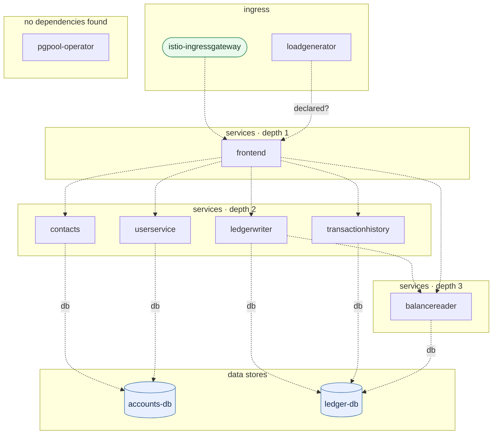

## stacks
- java/spring (FRAMEWORK, from pom.xml)
- python/web (FRAMEWORK, from pyproject.toml)
- javascript (GENERIC, from 11 .js/.mjs/.cjs/.jsx files; tree-sitter grammar)

## ledger sections
- config = 48
- http-server = 39
- jpa = 12
- name-constant = 20
- url = 8
- name-ref = 5
- http-client = 4
- import = 116
- persistence = 2
- k8s-service = 41
- k8s-workload = 40
- workload-env = 87
- env-address = 33
- k8s-namespace = 3
- k8s-gateway = 1
- ingress-route = 1
- service-root = 10
- module-deps = 4
- TOTAL = 474 | files with syntax errors = 0

## graph
- after merge: 11 nodes / 13 edges | after normalize: 11 nodes / 13 edges | unresolved code edges = 8
- persistence services: [balancereader, ledgerwriter, transactionhistory, contacts, userservice]

## nodes (kind, layer)
- accounts-db  [db, L4]
- balancereader  [service, L3]
- contacts  [service, L2]
- frontend  [service, L1]
- istio-ingressgateway  [gateway, L0]
- ledger-db  [db, L4]
- ledgerwriter  [service, L2]
- loadgenerator  [service, L0]
- pgpool-operator  [service, L5]
- transactionhistory  [service, L2]
- userservice  [service, L2]

## edges (type, confidence, provenance ref)
- balancereader -> ledger-db  (db, documented)  code: kubernetes-manifests/balance-reader.yaml
- contacts -> accounts-db  (db, documented)  code: kubernetes-manifests/contacts.yaml
- frontend -> balancereader  (sync-http, documented)  code: src/frontend/frontend.py:667
- frontend -> contacts  (sync-http, documented)  code: src/frontend/frontend.py:672
- frontend -> ledgerwriter  (sync-http, documented)  code: src/frontend/frontend.py:663
- frontend -> transactionhistory  (sync-http, documented)  code: src/frontend/frontend.py:669
- frontend -> userservice  (sync-http, documented)  code: src/frontend/frontend.py:665
- istio-ingressgateway -> frontend  (sync-http, documented)  code: extras/istio/frontend-ingress.yaml
- ledgerwriter -> balancereader  (sync-http, documented)  code: src/ledger/ledgerwriter/src/main/java/anthos/samples/bankofanthos/ledgerwriter/LedgerWriterController.java:86
- ledgerwriter -> ledger-db  (db, documented)  code: kubernetes-manifests/ledger-writer.yaml
- loadgenerator -> frontend  (sync-http, inferred)  code: kubernetes-manifests/loadgenerator.yaml
- transactionhistory -> ledger-db  (db, documented)  code: kubernetes-manifests/transaction-history.yaml
- userservice -> accounts-db  (db, documented)  code: kubernetes-manifests/userservice.yaml

## unresolved (source hint / raw target / file:line), first 40
- frontend  =>  null   @ src/frontend/frontend.py:364
- frontend  =>  null   @ src/frontend/frontend.py:541
- frontend  =>  http://{}/transactions   @ src/frontend/frontend.py:662
- frontend  =>  http://{}/users   @ src/frontend/frontend.py:664
- frontend  =>  http://{}/balances   @ src/frontend/frontend.py:666
- frontend  =>  http://{}/transactions   @ src/frontend/frontend.py:668
- frontend  =>  http://{}/login   @ src/frontend/frontend.py:670
- frontend  =>  http://   @ src/frontend/frontend.py:685

## alias questions (name [origin] seen in | candidates)
- none

## alias answers applied
- none

## mermaid

## 規則觸發
計數＝該規則改變了多少個不同的東西（邊、節點、名稱、檔案；同一個東西重複碰到算一次）；括號內最多列 5 個例子。
- rule 1: 11 (not-preadded ledgermonolith; node ledgerwriter; node accounts-db; node transactionhistory; node ledger-db)
- rule 2: 0
- rule 3: 0
- rule 4: 1 (table BALANCES_API_ADDR=balancereader)
- rule 5: 0
- rule 6: 0
- rule 7: 0
- rule 8: 4 (loopback metadata.google.internal; config-signal url; config-signal server.port; config-signal spring.datasource.platform)
- rule 9: 8 (jpa src/ledger/balancereader/src/main/java/anthos/samples/bankofanthos/balancereader/TransactionRepository.java; jpa src/ledger/balancereader/src/main/java/anthos/samples/bankofanthos/balancereader/Transaction.java; jpa src/ledger/ledgerwriter/src/main/java/anthos/samples/bankofanthos/ledgerwriter/TransactionRepository.java; jpa src/ledger/ledgerwriter/src/main/java/anthos/samples/bankofanthos/ledgerwriter/Transaction.java; jpa src/ledger/transactionhistory/src/main/java/anthos/samples/bankofanthos/transactionhistory/TransactionRepository.java)
- rule 10: 5 (drop populate-ledger-db (src/ledger/ledger-db/k8s/components/init-db-job); drop populate-accounts-db (src/accounts/accounts-db/k8s/components/init-db-job); drop populate-ledger-db (extras/cloudsql/populate-jobs); drop populate-accounts-db (extras/cloudsql/populate-jobs); drop blackbox-exporter (extras/prometheus/gmp))
- rule 11: 0
- rule 12: 0
- rule 13: 0
- rule 14: 10 (skip-configmap ledgerwriter->balancereader; skip-configmap ledgerwriter->transactionhistory; skip-configmap ledgerwriter->contacts; skip-configmap ledgerwriter->userservice; skip-configmap frontend->ledgerwriter)
- rule 15: 0
- rule 16: 0
- rule 17: 0
- rule 18: 0
- rule 19: 0
- rule 20: 6 (scoped BALANCES_API_ADDR=balancereader @ledgerwriter; scoped TRANSACTIONS_API_ADDR=ledgerwriter @frontend; scoped USERSERVICE_API_ADDR=userservice @frontend; scoped BALANCES_API_ADDR=balancereader @frontend; scoped HISTORY_API_ADDR=transactionhistory @frontend)
- rule 21: 0
- rule 22: 2 (dead src/frontend/frontend.py:420; dead src/frontend/frontend.py:421)
- rule 23: 0
- rule 24: 0
- rule 25: 0
- rule 26: 0
- rule 27: 0
- rule 28: 0
- rule 29: 0
- rule 30: 0
- rule 31: 1 (hidden .github/workflows/ui-tests/Dockerfile)
- rule 32: 0
- rule 33: 0
- rule 34: 0
- rule 35: 0
- rule 36: 2 (keep-dotted www.apache.org; keep-dotted kopf.on.startup() async def startup(**_))
- rule 37: 0
- rule 38: 0
- rule 39: 0
- rule 40: 0
- rule 41: 0
- rule 42: 0
- rule 43: 0
- rule 44: 0
- rule 45: 0
- rule 46: 0
- rule 47: 2 (urlref src/frontend/frontend.py:691 metadata_url; urlref src/frontend/frontend.py:707 metadata_url)
- rule 56: 2 (istio frontend-gateway -> frontend; edge istio-ingressgateway->frontend)
