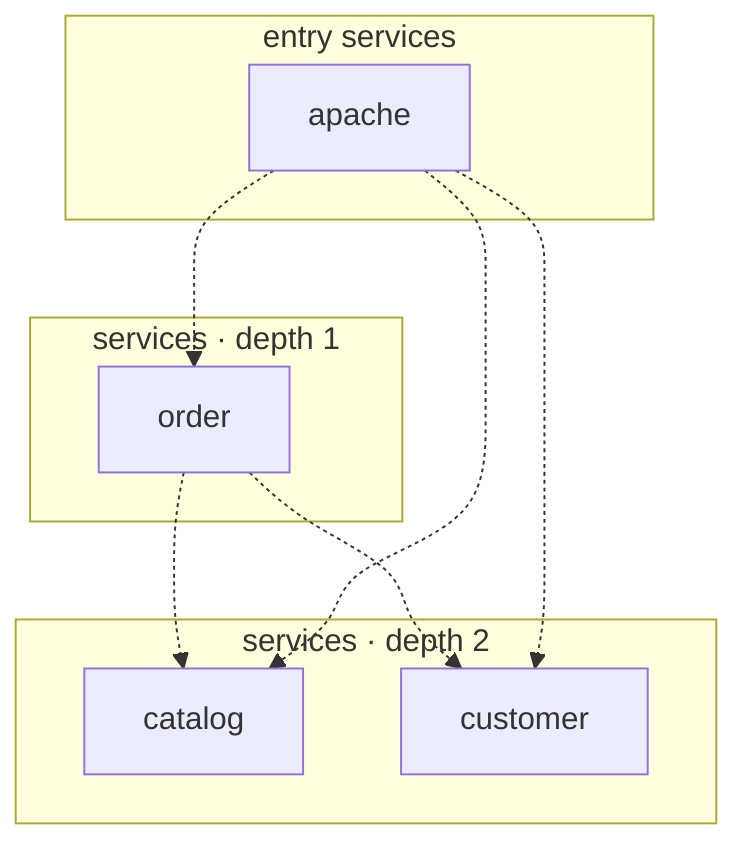

## stacks
- java/spring (FRAMEWORK, from pom.xml)

## ledger sections
- http-server = 20
- jpa = 5
- config = 5
- name-ref = 4
- url = 8
- k8s-workload = 4
- k8s-service = 4
- service-root = 4
- module-deps = 3
- TOTAL = 57 | files with syntax errors = 0

## graph
- after merge: 4 nodes / 5 edges | after normalize: 4 nodes / 5 edges | unresolved code edges = 0
- persistence services: [catalog, order, customer]

## nodes (kind, layer)
- apache  [service, L0]
- catalog  [service, L2]
- customer  [service, L2]
- order  [service, L1]

## edges (type, confidence, provenance ref)
- apache -> catalog  (sync-http, documented)  code: microservice-kubernetes-demo/apache/000-default.conf:17
- apache -> customer  (sync-http, documented)  code: microservice-kubernetes-demo/apache/000-default.conf:20
- apache -> order  (sync-http, documented)  code: microservice-kubernetes-demo/apache/000-default.conf:14
- order -> catalog  (sync-http, documented)  code: microservice-kubernetes-demo/microservice-kubernetes-demo-order/src/main/java/com/ewolff/microservice/order/clients/CatalogClient.java:36
- order -> customer  (sync-http, documented)  code: microservice-kubernetes-demo/microservice-kubernetes-demo-order/src/main/java/com/ewolff/microservice/order/clients/CustomerClient.java:38

## unresolved (source hint / raw target / file:line), first 40

## alias questions (name [origin] seen in | candidates)
- none

## alias answers applied
- none

## mermaid

## 規則觸發
計數＝該規則改變了多少個不同的東西（邊、節點、名稱、檔案；同一個東西重複碰到算一次）；括號內最多列 5 個例子。
- rule 1: 7 (align microservice-kubernetes-demo-catalog=catalog; align microservice-kubernetes-demo-order=order; align microservice-kubernetes-demo-customer=customer; node apache; node catalog)
- rule 2: 1 (aggregator microservice-kubernetes-demo)
- rule 3: 0
- rule 4: 2 (default catalog.service.host=catalog; default customer.service.host=customer)
- rule 5: 0
- rule 6: 3 (url http://order:8080/; url http://catalog:8080/; url http://customer:8080/)
- rule 7: 0
- rule 8: 1 (config-signal server.port)
- rule 9: 4 (jpa microservice-kubernetes-demo/microservice-kubernetes-demo-catalog/src/main/java/com/ewolff/microservice/catalog/Item.java; jpa microservice-kubernetes-demo/microservice-kubernetes-demo-order/src/main/java/com/ewolff/microservice/order/logic/Order.java; jpa microservice-kubernetes-demo/microservice-kubernetes-demo-order/src/main/java/com/ewolff/microservice/order/logic/OrderLine.java; jpa microservice-kubernetes-demo/microservice-kubernetes-demo-customer/src/main/java/com/ewolff/microservice/customer/Customer.java)
- rule 10: 0
- rule 11: 0
- rule 12: 0
- rule 13: 0
- rule 14: 0
- rule 15: 0
- rule 16: 0
- rule 17: 0
- rule 18: 0
- rule 19: 0
- rule 20: 0
- rule 21: 0
- rule 22: 0
- rule 23: 0
- rule 24: 0
- rule 25: 0
- rule 26: 0
- rule 27: 0
- rule 28: 0
- rule 29: 0
- rule 30: 0
- rule 31: 0
- rule 32: 0
- rule 33: 0
- rule 34: 0
- rule 35: 0
- rule 36: 0
- rule 37: 0
- rule 38: 0
- rule 39: 0
- rule 40: 0
- rule 41: 0
- rule 42: 0
- rule 43: 0
- rule 44: 0
- rule 45: 0
- rule 46: 0
