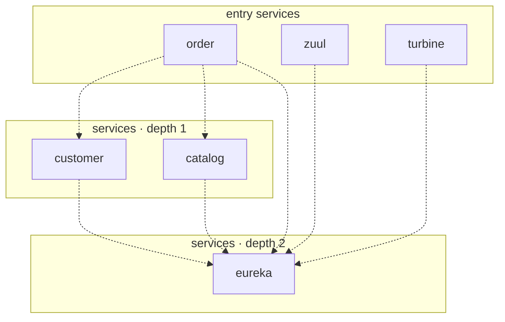

## stacks
- java/spring (FRAMEWORK, from pom.xml)

## ledger sections
- config = 31
- name-ref = 4
- url = 4
- jpa = 5
- http-server = 20
- compose-service = 6
- compose-dependency = 5
- service-root = 13
- module-deps = 6
- TOTAL = 94 | files with syntax errors = 0

## graph
- after merge: 6 nodes / 7 edges | after normalize: 6 nodes / 7 edges | unresolved code edges = 0
- persistence services: [order, catalog, customer]

## nodes (kind, layer)
- catalog  [service, L1]
- customer  [service, L1]
- eureka  [service, L2]
- order  [service, L0]
- turbine  [service, L0]
- zuul  [service, L0]

## edges (type, confidence, provenance ref)
- catalog -> eureka  (sync-http, documented)  code: docker/docker-compose.yml#depends_on
- customer -> eureka  (sync-http, documented)  code: docker/docker-compose.yml#depends_on
- order -> catalog  (sync-http, documented)  code: microservice-demo/microservice-demo-order/src/main/java/com/ewolff/microservice/order/clients/CatalogClient.java:44
- order -> customer  (sync-http, documented)  code: microservice-demo/microservice-demo-order/src/main/java/com/ewolff/microservice/order/clients/CustomerClient.java:43
- order -> eureka  (sync-http, documented)  code: docker/docker-compose.yml#depends_on
- turbine -> eureka  (sync-http, documented)  code: docker/docker-compose.yml#depends_on
- zuul -> eureka  (sync-http, documented)  code: docker/docker-compose.yml#depends_on

## unresolved (source hint / raw target / file:line), first 40

## alias questions (name [origin] seen in | candidates)
- none

## alias answers applied
- none

## mermaid

## 規則觸發
計數＝該規則改變了多少個不同的東西（邊、節點、名稱、檔案；同一個東西重複碰到算一次）；括號內最多列 5 個例子。
- rule 1: 0
- rule 2: 1 (aggregator microservice-demo)
- rule 3: 0
- rule 4: 2 (default catalog.service.host=catalog; default customer.service.host=customer)
- rule 5: 0
- rule 6: 0
- rule 7: 0
- rule 8: 9 (config-signal server.port; config-signal eureka.instance.leaseRenewalIntervalInSeconds; config-signal eureka.instance.metadataMap.instanceId; config-signal eureka.instance.preferIpAddress; config-signal eureka.client.registerWithEureka)
- rule 9: 4 (jpa microservice-demo/microservice-demo-order/src/main/java/com/ewolff/microservice/order/logic/Order.java; jpa microservice-demo/microservice-demo-order/src/main/java/com/ewolff/microservice/order/logic/OrderLine.java; jpa microservice-demo/microservice-demo-catalog/src/main/java/com/ewolff/microservice/catalog/Item.java; jpa microservice-demo/microservice-demo-customer/src/main/java/com/ewolff/microservice/customer/Customer.java)
- rule 10: 0
- rule 11: 10 (not-preadded customer-app; not-preadded java; not-preadded order-app; not-preadded catalog-app; node eureka)
- rule 12: 5 (links customer->eureka; links catalog->eureka; links order->eureka; links zuul->eureka; links turbine->eureka)
- rule 13: 0
- rule 14: 0
- rule 15: 0
- rule 16: 0
- rule 17: 0
- rule 18: 0
- rule 19: 0
- rule 20: 0
- rule 21: 0
- rule 22: 0
- rule 23: 0
- rule 24: 0
- rule 25: 0
- rule 26: 0
- rule 27: 0
- rule 28: 0
- rule 29: 0
- rule 30: 0
- rule 31: 0
- rule 32: 0
- rule 33: 0
- rule 34: 0
- rule 35: 5 (inferred customer->eureka; inferred catalog->eureka; inferred order->eureka; inferred zuul->eureka; inferred turbine->eureka)
- rule 36: 0
- rule 37: 0
- rule 38: 0
- rule 39: 0
- rule 40: 0
- rule 41: 0
- rule 42: 0
- rule 43: 0
- rule 44: 6 (map microservice-demo-order=order; map microservice-demo-eureka-server=eureka; map microservice-demo-turbine-server=turbine; map microservice-demo-catalog=catalog; map microservice-demo-zuul-server=zuul)
- rule 45: 0
- rule 46: 0
