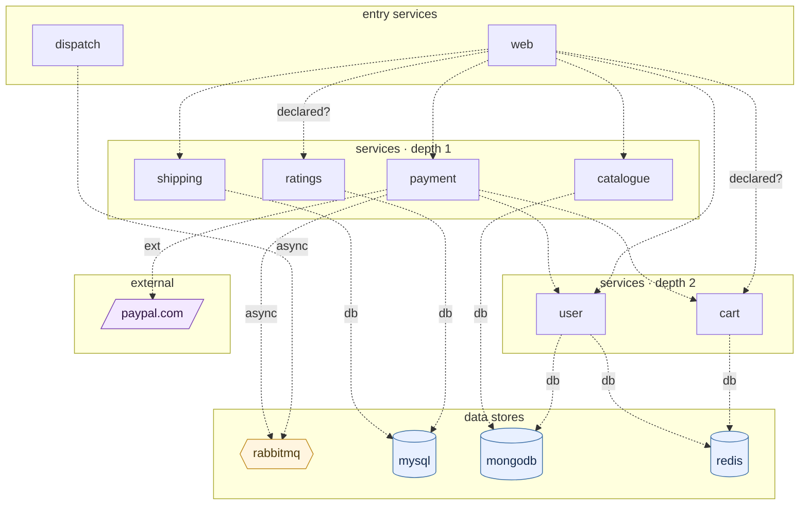

## stacks
- javascript (LLM, from 7 .js/.jsx/.ts/.tsx files)   <-- skipped (LLM tier)
- java (GENERIC, from pom.xml)
- python/web (FRAMEWORK, from requirements.txt)
- php (LLM, from 3 .php files)   <-- skipped (LLM tier)
- go (LLM, from 1 .go files)   <-- skipped (LLM tier)

## ledger sections
- url = 11
- config = 9
- http-server = 3
- compose-service = 17
- compose-dependency = 15
- k8s-workload = 13
- env-address = 1
- workload-env = 1
- service-root = 11
- TOTAL = 81 | files with syntax errors = 0

## graph
- after merge: 13 nodes / 17 edges | after normalize: 13 nodes / 17 edges | unresolved code edges = 1
- persistence services: []

## nodes (kind, layer)
- cart  [service, L2]
- catalogue  [service, L1]
- dispatch  [service, L0]
- mongodb  [db, L3]
- mysql  [db, L3]
- payment  [service, L1]
- paypal.com  [external, L4]
- rabbitmq  [queue, L3]
- ratings  [service, L1]
- redis  [db, L3]
- shipping  [service, L1]
- user  [service, L2]
- web  [service, L0]

## edges (type, confidence, provenance ref)
- cart -> redis  (db, documented)  code: docker-compose.yaml
- catalogue -> mongodb  (db, documented)  code: docker-compose.yaml
- dispatch -> rabbitmq  (async, documented)  code: docker-compose.yaml
- payment -> cart  (sync-http, documented)  code: payment/payment.py:120
- payment -> paypal.com  (external, documented)  code: payment/payment.py:25
- payment -> rabbitmq  (async, documented)  code: docker-compose.yaml
- payment -> user  (sync-http, documented)  code: payment/payment.py:68
- ratings -> mysql  (db, documented)  code: docker-compose.yaml
- shipping -> mysql  (db, documented)  code: docker-compose.yaml
- user -> mongodb  (db, documented)  code: docker-compose.yaml
- user -> redis  (db, documented)  code: docker-compose.yaml
- web -> cart  (sync-http, inferred)  code: web/default.conf.template:57
- web -> catalogue  (sync-http, documented)  code: docker-compose.yaml
- web -> payment  (sync-http, documented)  code: docker-compose.yaml
- web -> ratings  (sync-http, inferred)  code: web/default.conf.template:69
- web -> shipping  (sync-http, documented)  code: docker-compose.yaml
- web -> user  (sync-http, documented)  code: docker-compose.yaml

## unresolved (source hint / raw target / file:line), first 40
- shipping  =>  http://%s/shipping/   @ shipping/src/main/java/org/steveww/spark/Main.java:40

## alias questions (name [origin] seen in | candidates)
- none

## alias answers applied
- none

## mermaid

