## stacks
- java/spring (FRAMEWORK, from pom.xml)
- javascript (LLM, from 1 .js/.jsx/.ts/.tsx files)   <-- skipped (LLM tier)

## ledger sections
- http-server = 6
- name-ref = 6
- jpa = 1
- name-constant = 3
- http-client = 2
- url = 1
- config = 46
- compose-service = 10
- compose-dependency = 26
- service-root = 18
- module-deps = 18
- TOTAL = 137 | files with syntax errors = 0

## graph
- after merge: 20 nodes / 45 edges | after normalize: 19 nodes / 43 edges | unresolved code edges = 5
- persistence services: [cloud-simple-service]

## nodes (kind, layer)
- cloud-config-server  [service, L3]
- cloud-eureka-server  [service, L4]
- cloud-finagle-thrift-client  [service, L0]
- cloud-finagle-thrift-server  [service, L0]
- cloud-hystrix-dashboard  [service, L0]
- cloud-simple-service  [service, L3]
- cloud-simple-serviceb  [service, L2]
- cloud-simple-ui  [service, L2]
- configserver  [service, L4]
- discovery  [service, L5]
- gateway  [service, L1]
- github.com  [external, L6]
- simple-service  [service, L2]
- simple-service2  [service, L2]
- simple-serviceb  [service, L2]
- simple-ui  [service, L2]
- turbine  [service, L0]
- uaa-service  [service, L2]
- zipkin  [service, L3]

## edges (type, confidence, provenance ref)
- cloud-config-server -> cloud-eureka-server  (sync-http, inferred)  code: cloud-config-server/src/main/resources/application.yaml
- cloud-config-server -> github.com  (external, documented)  code: cloud-config-server/src/main/resources/application.yaml
- cloud-finagle-thrift-client -> zipkin  (sync-http, inferred)  code: cloud-finagle-thrift-client/src/main/resources/application.yaml
- cloud-finagle-thrift-server -> zipkin  (sync-http, inferred)  code: cloud-finagle-thrift-server/src/main/resources/application.yaml
- cloud-hystrix-dashboard -> cloud-config-server  (sync-http, inferred)  code: cloud-hystrix-dashboard/src/main/resources/bootstrap.yaml
- configserver -> discovery  (sync-http, inferred)  code: docker/docker-compose.yaml#depends_on
- gateway -> cloud-eureka-server  (sync-http, inferred)  code: cloud-api-gateway/src/main/resources/application.yaml
- gateway -> cloud-simple-service  (sync-http, documented)  code: cloud-api-gateway/src/main/resources/application.yaml
- gateway -> cloud-simple-serviceb  (sync-http, documented)  code: cloud-api-gateway/src/main/resources/application.yaml
- gateway -> cloud-simple-ui  (sync-http, documented)  code: cloud-api-gateway/src/main/resources/application.yaml
- gateway -> configserver  (sync-http, inferred)  code: docker/docker-compose.yaml#depends_on
- gateway -> discovery  (sync-http, inferred)  code: docker/docker-compose.yaml#depends_on
- gateway -> simple-service  (sync-http, inferred)  code: docker/docker-compose.yaml#depends_on
- gateway -> simple-service2  (sync-http, inferred)  code: docker/docker-compose.yaml#depends_on
- gateway -> simple-serviceb  (sync-http, inferred)  code: docker/docker-compose.yaml#depends_on
- gateway -> simple-ui  (sync-http, inferred)  code: docker/docker-compose.yaml#depends_on
- gateway -> uaa-service  (sync-http, documented)  code: cloud-api-gateway/src/main/resources/application.yaml
- gateway -> zipkin  (sync-http, inferred)  code: docker/docker-compose.yaml#depends_on
- simple-service -> cloud-config-server  (sync-http, inferred)  code: cloud-simple-service/src/main/resources/bootstrap.yaml
- simple-service -> cloud-eureka-server  (sync-http, inferred)  code: cloud-simple-service/src/main/resources/bootstrap.yaml
- simple-service -> configserver  (sync-http, inferred)  code: docker/docker-compose.yaml#depends_on
- simple-service -> discovery  (sync-http, inferred)  code: docker/docker-compose.yaml#depends_on
- simple-service -> zipkin  (sync-http, inferred)  code: docker/docker-compose.yaml#depends_on
- simple-service2 -> configserver  (sync-http, inferred)  code: docker/docker-compose.yaml#depends_on
- simple-service2 -> discovery  (sync-http, inferred)  code: docker/docker-compose.yaml#depends_on
- simple-service2 -> zipkin  (sync-http, inferred)  code: docker/docker-compose.yaml#depends_on
- simple-serviceb -> cloud-config-server  (sync-http, inferred)  code: cloud-simple-serviceB/src/main/resources/bootstrap.yaml
- simple-serviceb -> cloud-eureka-server  (sync-http, inferred)  code: cloud-simple-serviceB/src/main/resources/bootstrap.yaml
- simple-serviceb -> configserver  (sync-http, inferred)  code: docker/docker-compose.yaml#depends_on
- simple-serviceb -> discovery  (sync-http, inferred)  code: docker/docker-compose.yaml#depends_on
- simple-serviceb -> zipkin  (sync-http, inferred)  code: docker/docker-compose.yaml#depends_on
- simple-ui -> cloud-config-server  (sync-http, inferred)  code: cloud-simple-ui/src/main/resources/bootstrap.yaml
- simple-ui -> cloud-eureka-server  (sync-http, inferred)  code: cloud-simple-ui/src/main/resources/bootstrap.yaml
- simple-ui -> cloud-simple-service  (sync-http, documented)  code: cloud-simple-ui/src/main/java/cloud/simple/service/UserService.java:32
- simple-ui -> configserver  (sync-http, inferred)  code: docker/docker-compose.yaml#depends_on
- simple-ui -> discovery  (sync-http, inferred)  code: docker/docker-compose.yaml#depends_on
- simple-ui -> zipkin  (sync-http, inferred)  code: docker/docker-compose.yaml#depends_on
- turbine -> cloud-config-server  (sync-http, inferred)  code: cloud-hystrix-turbine/src/main/resources/bootstrap.yaml
- turbine -> cloud-eureka-server  (sync-http, inferred)  code: cloud-hystrix-turbine/src/main/resources/bootstrap.yaml
- turbine -> discovery  (sync-http, inferred)  code: docker/docker-compose.yaml#depends_on
- turbine -> gateway  (sync-http, inferred)  code: docker/docker-compose.yaml#depends_on
- zipkin -> configserver  (sync-http, inferred)  code: docker/docker-compose.yaml#depends_on
- zipkin -> discovery  (sync-http, inferred)  code: docker/docker-compose.yaml#depends_on

## unresolved (source hint / raw target / file:line), first 40
- simple-ui  =>  null   @ cloud-simple-ui/src/main/java/cloud/simple/service/UserService.java:32
- simple-ui  =>  http://   @ cloud-simple-ui/src/main/java/cloud/simple/service/UserService.java:32
- cloud-hystrix-dashboard  =>  http\://localhost\:8761/eureka/   @ cloud-hystrix-dashboard/src/main/resources/bootstrap.yaml:-1
- cloud-eureka-server  =>  http://${eureka.instance.hostname}:${server.port}/eureka/   @ cloud-eureka-server/src/main/resources/application.yaml:-1
- gateway  =>  ${PREFIX:}resource   @ cloud-api-gateway/src/main/resources/application.yaml:-1

## alias questions (name [origin] seen in | candidates)
- hystrix  [code]  a library name, but the code/deployment layer drew 2 edge(s) on it: hystrix -> gateway, hystrix -> discovery   | candidates: cloud-hystrix-dashboard
- cloud-simple-service  [graph]  looks like the same service as `simple-service` (one name is the other with a prefix or suffix); both stay on the graph until you say   | candidates: simple-service
- cloud-config-server  [graph]  looks like the same service as `configserver` (one name is the other with a prefix or suffix); both stay on the graph until you say   | candidates: configserver
- cloud-simple-serviceb  [graph]  looks like the same service as `simple-serviceb` (one name is the other with a prefix or suffix); both stay on the graph until you say   | candidates: simple-serviceb
- cloud-simple-ui  [graph]  looks like the same service as `simple-ui` (one name is the other with a prefix or suffix); both stay on the graph until you say   | candidates: simple-ui

## alias answers applied
- none

## mermaid

```mermaid
flowchart TB
%% DepWeaver — microservice dependency graph
%% solid arrow = observed at runtime (Istio) · dashed = declared in code/doc only
%% node shape: [service] ([gateway]) [(db)] {{queue}} [/external/]
  subgraph layer0 ["entry services"]
    direction LR
    turbine["turbine"]
    cloud_hystrix_dashboard["cloud-hystrix-dashboard"]
    cloud_finagle_thrift_client["cloud-finagle-thrift-client"]
    cloud_finagle_thrift_server["cloud-finagle-thrift-server"]
  end
  subgraph layer1 ["services · depth 1"]
    direction LR
    gateway["gateway"]
  end
  subgraph layer2 ["services · depth 2"]
    direction LR
    simple_service["simple-service"]
    simple_service2["simple-service2"]
    simple_serviceb["simple-serviceb"]
    simple_ui["simple-ui"]
    cloud_simple_serviceb["cloud-simple-serviceb"]
    cloud_simple_ui["cloud-simple-ui"]
    uaa_service["uaa-service"]
  end
  subgraph layer3 ["services · depth 3"]
    direction LR
    zipkin["zipkin"]
    cloud_simple_service["cloud-simple-service"]
    cloud_config_server["cloud-config-server"]
  end
  subgraph layer4 ["services · depth 4"]
    direction LR
    configserver["configserver"]
    cloud_eureka_server["cloud-eureka-server"]
  end
  subgraph layer5 ["services · depth 5"]
    direction LR
    discovery["discovery"]
  end
  subgraph layer6 ["external"]
    direction LR
    github_com[/"github.com"/]:::external
  end
  simple_ui -.-> cloud_simple_service
  cloud_hystrix_dashboard -. declared? .-> cloud_config_server
  turbine -. declared? .-> gateway
  turbine -. declared? .-> discovery
  configserver -. declared? .-> discovery
  gateway -. declared? .-> discovery
  gateway -. declared? .-> configserver
  gateway -. declared? .-> simple_service
  gateway -. declared? .-> simple_service2
  gateway -. declared? .-> simple_serviceb
  gateway -. declared? .-> simple_ui
  gateway -. declared? .-> zipkin
  simple_service -. declared? .-> discovery
  simple_service -. declared? .-> configserver
  simple_service -. declared? .-> zipkin
  simple_service2 -. declared? .-> discovery
  simple_service2 -. declared? .-> configserver
  simple_service2 -. declared? .-> zipkin
  simple_serviceb -. declared? .-> discovery
  simple_serviceb -. declared? .-> configserver
  simple_serviceb -. declared? .-> zipkin
  simple_ui -. declared? .-> discovery
  simple_ui -. declared? .-> configserver
  simple_ui -. declared? .-> zipkin
  zipkin -. declared? .-> discovery
  zipkin -. declared? .-> configserver
  cloud_config_server -. ext .-> github_com
  cloud_config_server -. declared? .-> cloud_eureka_server
  cloud_finagle_thrift_client -. declared? .-> zipkin
  turbine -. declared? .-> cloud_config_server
  turbine -. declared? .-> cloud_eureka_server
  simple_service -. declared? .-> cloud_config_server
  simple_service -. declared? .-> cloud_eureka_server
  simple_ui -. declared? .-> cloud_config_server
  simple_ui -. declared? .-> cloud_eureka_server
  simple_serviceb -. declared? .-> cloud_config_server
  simple_serviceb -. declared? .-> cloud_eureka_server
  cloud_finagle_thrift_server -. declared? .-> zipkin
  gateway -.-> cloud_simple_service
  gateway -.-> cloud_simple_serviceb
  gateway -.-> cloud_simple_ui
  gateway -. declared? .-> cloud_eureka_server
  gateway -.-> uaa_service
classDef external fill:#f3e8ff,stroke:#7a3fb0,color:#2e1440;

```

