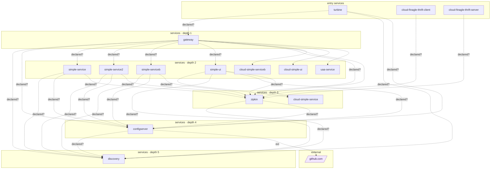

## stacks
- java/spring (FRAMEWORK, from pom.xml)
- javascript (GENERIC, from 1 .js/.mjs/.cjs/.jsx files; tree-sitter grammar)

## ledger sections
- http-server = 6
- name-ref = 6
- jpa = 1
- name-constant = 3
- http-client = 2
- url = 1
- config = 46
- compose-service = 10
- compose-dependency = 26
- service-root = 18
- module-deps = 18
- TOTAL = 137 | files with syntax errors = 0

## graph
- after merge: 17 nodes / 36 edges | after normalize: 16 nodes / 33 edges | unresolved code edges = 5
- persistence services: [cloud-simple-service]

## nodes (kind, layer)
- cloud-finagle-thrift-client  [service, L0]
- cloud-finagle-thrift-server  [service, L0]
- cloud-simple-service  [service, L3]
- cloud-simple-serviceb  [service, L2]
- cloud-simple-ui  [service, L2]
- configserver  [service, L4]
- discovery  [service, L5]
- gateway  [service, L1]
- github.com  [external, L6]
- simple-service  [service, L2]
- simple-service2  [service, L2]
- simple-serviceb  [service, L2]
- simple-ui  [service, L2]
- turbine  [service, L0]
- uaa-service  [service, L2]
- zipkin  [service, L3]

## edges (type, confidence, provenance ref)
- cloud-finagle-thrift-client -> zipkin  (sync-http, inferred)  code: cloud-finagle-thrift-client/src/main/resources/application.yaml
- cloud-finagle-thrift-server -> zipkin  (sync-http, inferred)  code: cloud-finagle-thrift-server/src/main/resources/application.yaml
- configserver -> discovery  (sync-http, inferred)  code: docker/docker-compose.yaml#depends_on
- configserver -> github.com  (external, documented)  code: cloud-config-server/src/main/resources/application.yaml
- gateway -> cloud-simple-service  (sync-http, documented)  code: cloud-api-gateway/src/main/resources/application.yaml
- gateway -> cloud-simple-serviceb  (sync-http, documented)  code: cloud-api-gateway/src/main/resources/application.yaml
- gateway -> cloud-simple-ui  (sync-http, documented)  code: cloud-api-gateway/src/main/resources/application.yaml
- gateway -> configserver  (sync-http, inferred)  code: docker/docker-compose.yaml#depends_on
- gateway -> discovery  (sync-http, inferred)  code: docker/docker-compose.yaml#depends_on
- gateway -> simple-service  (sync-http, inferred)  code: docker/docker-compose.yaml#depends_on
- gateway -> simple-service2  (sync-http, inferred)  code: docker/docker-compose.yaml#depends_on
- gateway -> simple-serviceb  (sync-http, inferred)  code: docker/docker-compose.yaml#depends_on
- gateway -> simple-ui  (sync-http, inferred)  code: docker/docker-compose.yaml#depends_on
- gateway -> uaa-service  (sync-http, documented)  code: cloud-api-gateway/src/main/resources/application.yaml
- gateway -> zipkin  (sync-http, inferred)  code: docker/docker-compose.yaml#depends_on
- simple-service -> configserver  (sync-http, inferred)  code: docker/docker-compose.yaml#depends_on
- simple-service -> discovery  (sync-http, inferred)  code: docker/docker-compose.yaml#depends_on
- simple-service -> zipkin  (sync-http, inferred)  code: docker/docker-compose.yaml#depends_on
- simple-service2 -> configserver  (sync-http, inferred)  code: docker/docker-compose.yaml#depends_on
- simple-service2 -> discovery  (sync-http, inferred)  code: docker/docker-compose.yaml#depends_on
- simple-service2 -> zipkin  (sync-http, inferred)  code: docker/docker-compose.yaml#depends_on
- simple-serviceb -> configserver  (sync-http, inferred)  code: docker/docker-compose.yaml#depends_on
- simple-serviceb -> discovery  (sync-http, inferred)  code: docker/docker-compose.yaml#depends_on
- simple-serviceb -> zipkin  (sync-http, inferred)  code: docker/docker-compose.yaml#depends_on
- simple-ui -> cloud-simple-service  (sync-http, documented)  code: cloud-simple-ui/src/main/java/cloud/simple/service/UserService.java:32
- simple-ui -> configserver  (sync-http, inferred)  code: docker/docker-compose.yaml#depends_on
- simple-ui -> discovery  (sync-http, inferred)  code: docker/docker-compose.yaml#depends_on
- simple-ui -> zipkin  (sync-http, inferred)  code: docker/docker-compose.yaml#depends_on
- turbine -> configserver  (sync-http, inferred)  code: cloud-hystrix-turbine/src/main/resources/bootstrap.yaml
- turbine -> discovery  (sync-http, inferred)  code: docker/docker-compose.yaml#depends_on
- turbine -> gateway  (sync-http, inferred)  code: docker/docker-compose.yaml#depends_on
- zipkin -> configserver  (sync-http, inferred)  code: docker/docker-compose.yaml#depends_on
- zipkin -> discovery  (sync-http, inferred)  code: docker/docker-compose.yaml#depends_on

## unresolved (source hint / raw target / file:line), first 40
- simple-ui  =>  null   @ cloud-simple-ui/src/main/java/cloud/simple/service/UserService.java:32
- simple-ui  =>  http://   @ cloud-simple-ui/src/main/java/cloud/simple/service/UserService.java:32
- hystrix  =>  http\://localhost\:8761/eureka/   @ cloud-hystrix-dashboard/src/main/resources/bootstrap.yaml:-1
- discovery  =>  http://${eureka.instance.hostname}:${server.port}/eureka/   @ cloud-eureka-server/src/main/resources/application.yaml:-1
- gateway  =>  ${PREFIX:}resource   @ cloud-api-gateway/src/main/resources/application.yaml:-1

## alias questions (name [origin] seen in | candidates)
- hystrix  [code]  a library name, but the code/deployment layer drew 3 edge(s) on it: hystrix -> configserver, hystrix -> gateway, hystrix -> discovery  (+1 more)   | candidates: -
- cloud-simple-service  [graph]  looks like the same service as `simple-service` (one name is the other with a prefix or suffix); both stay on the graph until you say   | candidates: simple-service
- cloud-simple-serviceb  [graph]  looks like the same service as `simple-serviceb` (one name is the other with a prefix or suffix); both stay on the graph until you say   | candidates: simple-serviceb
- cloud-simple-ui  [graph]  looks like the same service as `simple-ui` (one name is the other with a prefix or suffix); both stay on the graph until you say   | candidates: simple-ui

## alias answers applied
- none

## mermaid

## 規則觸發
計數＝該規則改變了多少個不同的東西（邊、節點、名稱、檔案；同一個東西重複碰到算一次）；括號內最多列 5 個例子。
- rule 1: 0
- rule 2: 10 (climb cloud-hystrix-dashboard/src/main/docker; climb cloud-config-server/src/main/docker; climb cloud-hystrix-turbine/src/main/docker; climb cloud-zipkin/src/main/docker; climb cloud-eureka-server/src/main/docker)
- rule 3: 9 (config-client hystrix; config-client turbine; config-client simple-service; config-client simple-ui; config-client simple-serviceb)
- rule 4: 2 (default config.port=8888; table eureka.instance.hostname=localhost)
- rule 5: 6 (key zipkin.http.host=localhost:9411; key eureka.instance.hostname=localhost; key zuul.routes.api-a.serviceid=cloud-simple-service; key zuul.routes.api-b.serviceid=cloud-simple-serviceB; key zuul.routes.api-ui.serviceid=cloud-simple-ui)
- rule 6: 0
- rule 7: 0
- rule 8: 7 (loopback localhost:9966; config-signal server.port; config-signal eureka.instance.leaseRenewalIntervalInSeconds; config-signal eureka.client.registerWithEureka; config-signal eureka.client.fetchRegistry)
- rule 9: 1 (jpa cloud-simple-service/src/main/java/cloud/simple/service/storage/UserStorageImpl.java)
- rule 10: 0
- rule 11: 17 (align cloud-simple-service=simple-service; not-preadded cloud-thrift-client; not-preadded cloud-uaa-service; not-preadded cloud-finagle-thrift-client; not-preadded cloud-thrift-server)
- rule 12: 27 (v1 docker/docker-compose.yaml; links hystrix->gateway; links hystrix->discovery; links turbine->gateway; links turbine->discovery)
- rule 13: 0
- rule 14: 0
- rule 15: 17 (edge hystrix->configserver :8888; edge configserver->discovery :8761; edge cloud-finagle-thrift-client->zipkin :9411; edge turbine->configserver :8888; edge turbine->discovery :8761)
- rule 16: 0
- rule 17: 0
- rule 18: 0
- rule 19: 0
- rule 20: 0
- rule 21: 0
- rule 22: 0
- rule 23: 0
- rule 24: 0
- rule 25: 0
- rule 26: 0
- rule 27: 0
- rule 28: 0
- rule 29: 0
- rule 30: 0
- rule 31: 0
- rule 32: 0
- rule 33: 0
- rule 34: 0
- rule 35: 26 (inferred hystrix->gateway; inferred hystrix->discovery; inferred turbine->gateway; inferred turbine->discovery; inferred configserver->discovery)
- rule 36: 0
- rule 37: 0
- rule 38: 0
- rule 39: 0
- rule 40: 0
- rule 41: 6 (lib cloud-finagle-commons-thrift; lib cloud-finagle-thrift-api; lib cloud-thrift-interface; no-edge cloud-finagle-commons-thrift/src/main/java/cloud/finagle/commons/ClusterFactory.java; no-edge cloud-thrift-interface/src/main/java/cloud/thrift/UserService.java)
- rule 42: 0
- rule 43: 0
- rule 44: 16 (image cloud-hystrix-dashboard=hystrix; map cloud-hystrix-dashboard=hystrix; image cloud-config-server=configserver; map cloud-config-server=configserver; image cloud-hystrix-turbine=turbine)
- rule 45: 0
- rule 46: 0
- rule 47: 1 (hostref cloud-simple-ui/src/main/java/cloud/simple/service/UserService.java:32 SERVICE_NAME)
