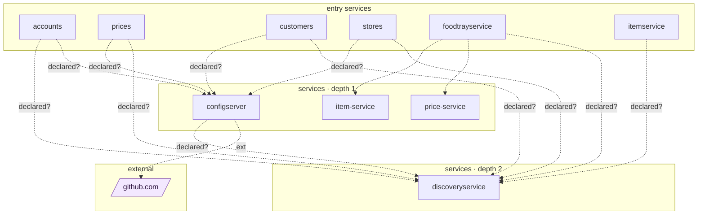

## stacks
- java/spring (FRAMEWORK, from pom.xml)

## ledger sections
- jpa = 10
- feign = 2
- http-server = 6
- config = 22
- compose-service = 5
- compose-dependency = 4
- service-root = 8
- module-deps = 8
- TOTAL = 65 | files with syntax errors = 0

## graph
- after merge: 11 nodes / 14 edges | after normalize: 11 nodes / 14 edges | unresolved code edges = 0
- persistence services: [accountservice, priceservice, storeservice, customerservice, itemservice]

## nodes (kind, layer)
- accounts  [service, L0]
- configserver  [service, L1]
- customers  [service, L0]
- discoveryservice  [service, L2]
- foodtrayservice  [service, L0]
- github.com  [external, L3]
- item-service  [service, L1]
- itemservice  [service, L0]
- price-service  [service, L1]
- prices  [service, L0]
- stores  [service, L0]

## edges (type, confidence, provenance ref)
- accounts -> configserver  (sync-http, inferred)  code: Docker/docker-compose.yml#depends_on
- accounts -> discoveryservice  (sync-http, inferred)  code: AccountService/src/main/resources/bootstrap.yml
- configserver -> discoveryservice  (sync-http, inferred)  code: ConfigService/src/main/resources/application.yml
- configserver -> github.com  (external, documented)  code: ConfigService/src/main/resources/application.yml
- customers -> configserver  (sync-http, inferred)  code: Docker/docker-compose.yml#depends_on
- customers -> discoveryservice  (sync-http, inferred)  code: CustomerService/src/main/resources/bootstrap.yml
- foodtrayservice -> discoveryservice  (sync-http, inferred)  code: FoodTrayService/src/main/resources/bootstrap.yml
- foodtrayservice -> item-service  (sync-http, documented)  code: FoodTrayService/src/main/java/com/github/joffryferrater/foodtrayservice/repository/ItemServiceRepository.java:15
- foodtrayservice -> price-service  (sync-http, documented)  code: FoodTrayService/src/main/java/com/github/joffryferrater/foodtrayservice/repository/PriceServiceRepository.java:15
- itemservice -> discoveryservice  (sync-http, inferred)  code: ItemService/src/main/resources/bootstrap.yml
- prices -> configserver  (sync-http, inferred)  code: Docker/docker-compose.yml#depends_on
- prices -> discoveryservice  (sync-http, inferred)  code: PriceService/src/main/resources/bootstrap.yml
- stores -> configserver  (sync-http, inferred)  code: Docker/docker-compose.yml#depends_on
- stores -> discoveryservice  (sync-http, inferred)  code: StoreService/src/main/resources/bootstrap.yml

## unresolved (source hint / raw target / file:line), first 40

## alias questions (name [origin] seen in | candidates)
- price-service  [graph]  looks like the same service as `prices` (one name is the other with a prefix or suffix); both stay on the graph until you say   | candidates: prices

## alias answers applied
- none

## mermaid

## 規則觸發
計數＝該規則改變了多少個不同的東西（邊、節點、名稱、檔案；同一個東西重複碰到算一次）；括號內最多列 5 個例子。
- rule 1: 0
- rule 2: 16 (climb AccountService/src/main/docker; climb ConfigService/src/main/docker; climb FoodTrayService/src/main/docker; climb DiscoveryService/src/main/docker; climb PriceService/src/main/docker)
- rule 3: 10 (config-client accounts; config-client foodtrayservice; config-client prices; config-client stores; config-client customers)
- rule 4: 0
- rule 5: 0
- rule 6: 0
- rule 7: 0
- rule 8: 1 (config-signal server.port)
- rule 9: 5 (jpa AccountService/src/main/java/com/github/joffryferrater/accountservice/models/Account.java; jpa PriceService/src/main/java/com/github/joffryferrater/priceservice/models/Price.java; jpa StoreService/src/main/java/com/github/joffryferrater/storeservice/models/Store.java; jpa CustomerService/src/main/java/com/github/joffryferrater/customerservice/models/Customer.java; jpa ItemService/src/main/java/com/github/joffryferrater/itemservice/models/Item.java)
- rule 10: 0
- rule 11: 8 (not-preadded foodtrayservice; not-preadded discoveryservice; not-preadded itemservice; node configserver; node accounts)
- rule 12: 5 (v1 Docker/docker-compose.yml; links accounts->configserver; links prices->configserver; links customers->configserver; links stores->configserver)
- rule 13: 0
- rule 14: 0
- rule 15: 7 (edge accounts->discoveryservice :8888; edge configserver->discoveryservice :8888; edge foodtrayservice->discoveryservice :8888; edge prices->discoveryservice :8888; edge stores->discoveryservice :8888)
- rule 16: 0
- rule 17: 0
- rule 18: 0
- rule 19: 0
- rule 20: 0
- rule 21: 0
- rule 22: 0
- rule 23: 0
- rule 24: 0
- rule 25: 0
- rule 26: 0
- rule 27: 0
- rule 28: 0
- rule 29: 0
- rule 30: 0
- rule 31: 0
- rule 32: 0
- rule 33: 0
- rule 34: 0
- rule 35: 4 (inferred accounts->configserver; inferred prices->configserver; inferred customers->configserver; inferred stores->configserver)
- rule 36: 0
- rule 37: 0
- rule 38: 0
- rule 39: 0
- rule 40: 0
- rule 41: 0
- rule 42: 0
- rule 43: 0
- rule 44: 10 (image accountservice=accounts; map accountservice=accounts; image configservice=configserver; map configservice=configserver; image priceservice=prices)
- rule 45: 0
- rule 46: 0
