## stacks
- java/spring (FRAMEWORK, from pom.xml)

## ledger sections
- jpa = 10
- feign = 2
- http-server = 6
- config = 22
- compose-service = 5
- compose-dependency = 4
- service-root = 8
- module-deps = 8
- TOTAL = 65 | files with syntax errors = 0

## graph
- after merge: 16 nodes / 14 edges | after normalize: 16 nodes / 14 edges | unresolved code edges = 0
- persistence services: [accountservice, priceservice, storeservice, customerservice, itemservice]

## nodes (kind, layer)
- accounts  [service, L0]
- accountservice  [service, L0]
- configserver  [service, L1]
- configservice  [service, L0]
- customers  [service, L0]
- customerservice  [service, L0]
- discoveryservice  [service, L1]
- foodtrayservice  [service, L0]
- github.com  [external, L2]
- item-service  [service, L1]
- itemservice  [service, L0]
- price-service  [service, L1]
- prices  [service, L0]
- priceservice  [service, L0]
- stores  [service, L0]
- storeservice  [service, L0]

## edges (type, confidence, provenance ref)
- accounts -> configserver  (sync-http, inferred)  code: Docker/docker-compose.yml#depends_on
- accountservice -> discoveryservice  (sync-http, inferred)  code: AccountService/src/main/resources/bootstrap.yml
- configservice -> discoveryservice  (sync-http, inferred)  code: ConfigService/src/main/resources/application.yml
- configservice -> github.com  (external, documented)  code: ConfigService/src/main/resources/application.yml
- customers -> configserver  (sync-http, inferred)  code: Docker/docker-compose.yml#depends_on
- customerservice -> discoveryservice  (sync-http, inferred)  code: CustomerService/src/main/resources/bootstrap.yml
- foodtrayservice -> discoveryservice  (sync-http, inferred)  code: FoodTrayService/src/main/resources/bootstrap.yml
- foodtrayservice -> item-service  (sync-http, documented)  code: FoodTrayService/src/main/java/com/github/joffryferrater/foodtrayservice/repository/ItemServiceRepository.java:15
- foodtrayservice -> price-service  (sync-http, documented)  code: FoodTrayService/src/main/java/com/github/joffryferrater/foodtrayservice/repository/PriceServiceRepository.java:15
- itemservice -> discoveryservice  (sync-http, inferred)  code: ItemService/src/main/resources/bootstrap.yml
- prices -> configserver  (sync-http, inferred)  code: Docker/docker-compose.yml#depends_on
- priceservice -> discoveryservice  (sync-http, inferred)  code: PriceService/src/main/resources/bootstrap.yml
- stores -> configserver  (sync-http, inferred)  code: Docker/docker-compose.yml#depends_on
- storeservice -> discoveryservice  (sync-http, inferred)  code: StoreService/src/main/resources/bootstrap.yml

## unresolved (source hint / raw target / file:line), first 40

## alias questions (name [origin] seen in | candidates)
- accountservice  [graph]  looks like the same service as `accounts` (one name is the other with a prefix or suffix); both stay on the graph until you say   | candidates: accounts
- priceservice  [graph]  looks like the same service as `prices` (one name is the other with a prefix or suffix); both stay on the graph until you say  (+1 more)   | candidates: prices
- storeservice  [graph]  looks like the same service as `stores` (one name is the other with a prefix or suffix); both stay on the graph until you say   | candidates: stores
- customerservice  [graph]  looks like the same service as `customers` (one name is the other with a prefix or suffix); both stay on the graph until you say   | candidates: customers

## alias answers applied
- none

## mermaid

```mermaid
flowchart TB
%% DepWeaver — microservice dependency graph
%% solid arrow = observed at runtime (Istio) · dashed = declared in code/doc only
%% node shape: [service] ([gateway]) [(db)] {{queue}} [/external/]
  subgraph layer0 ["entry services"]
    direction LR
    accountservice["accountservice"]
    configservice["configservice"]
    foodtrayservice["foodtrayservice"]
    priceservice["priceservice"]
    storeservice["storeservice"]
    customerservice["customerservice"]
    itemservice["itemservice"]
    accounts["accounts"]
    prices["prices"]
    customers["customers"]
    stores["stores"]
  end
  subgraph layer1 ["services · depth 1"]
    direction LR
    discoveryservice["discoveryservice"]
    item_service["item-service"]
    price_service["price-service"]
    configserver["configserver"]
  end
  subgraph layer2 ["external"]
    direction LR
    github_com[/"github.com"/]:::external
  end
  foodtrayservice -.-> item_service
  foodtrayservice -.-> price_service
  accountservice -. declared? .-> discoveryservice
  configservice -. declared? .-> discoveryservice
  configservice -. ext .-> github_com
  accounts -. declared? .-> configserver
  prices -. declared? .-> configserver
  customers -. declared? .-> configserver
  stores -. declared? .-> configserver
  foodtrayservice -. declared? .-> discoveryservice
  priceservice -. declared? .-> discoveryservice
  storeservice -. declared? .-> discoveryservice
  customerservice -. declared? .-> discoveryservice
  itemservice -. declared? .-> discoveryservice
classDef external fill:#f3e8ff,stroke:#7a3fb0,color:#2e1440;

```

