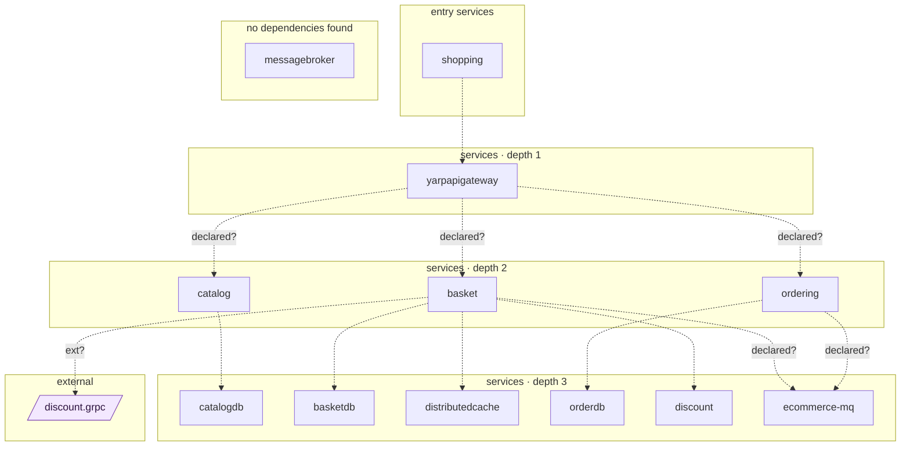

## stacks
- csharp (LLM, from 146 .cs files)   <-- skipped (LLM tier)
- javascript (LLM, from 2 .js/.jsx/.ts/.tsx files)   <-- skipped (LLM tier)

## ledger sections
- compose-service = 22
- compose-dependency = 11
- env-address = 8
- workload-env = 8
- service-root = 6
- TOTAL = 55 | files with syntax errors = 0

## graph
- after merge: 13 nodes / 12 edges | after normalize: 13 nodes / 12 edges | unresolved code edges = 0
- persistence services: []

## nodes (kind, layer)
- basket  [service, L2]
- basketdb  [service, L3]
- catalog  [service, L2]
- catalogdb  [service, L3]
- discount  [service, L3]
- discount.grpc  [external, L4]
- distributedcache  [service, L3]
- ecommerce-mq  [service, L3]
- messagebroker  [service, L5]
- orderdb  [service, L3]
- ordering  [service, L2]
- shopping  [service, L0]
- yarpapigateway  [service, L1]

## edges (type, confidence, provenance ref)
- basket -> basketdb  (sync-http, documented)  code: src/docker-compose.override.yml#depends_on
- basket -> discount  (sync-http, documented)  code: src/docker-compose.override.yml#depends_on
- basket -> discount.grpc  (external, inferred)  code: src/docker-compose.override.yml
- basket -> distributedcache  (sync-http, documented)  code: src/docker-compose.override.yml#depends_on
- basket -> ecommerce-mq  (sync-http, inferred)  code: src/docker-compose.override.yml
- catalog -> catalogdb  (sync-http, documented)  code: src/docker-compose.override.yml#depends_on
- ordering -> ecommerce-mq  (sync-http, inferred)  code: src/docker-compose.override.yml
- ordering -> orderdb  (sync-http, documented)  code: src/docker-compose.override.yml#depends_on
- shopping -> yarpapigateway  (sync-http, documented)  code: src/docker-compose.override.yml#depends_on
- yarpapigateway -> basket  (sync-http, inferred)  code: src/docker-compose.override.yml#depends_on
- yarpapigateway -> catalog  (sync-http, inferred)  code: src/docker-compose.override.yml#depends_on
- yarpapigateway -> ordering  (sync-http, inferred)  code: src/docker-compose.override.yml#depends_on

## unresolved (source hint / raw target / file:line), first 40

## alias questions (name [origin] seen in | candidates)
- none

## alias answers applied
- none

## mermaid

