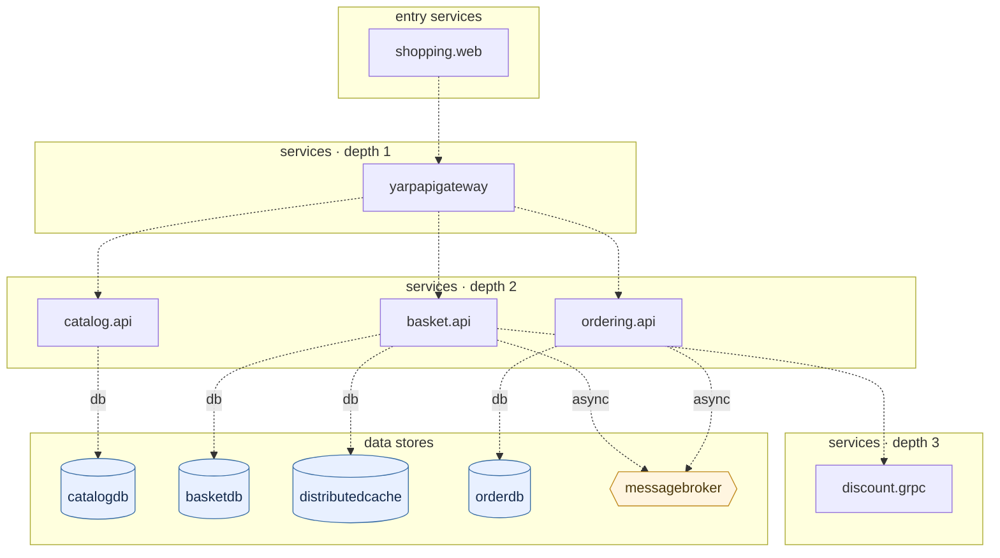

## stacks
- csharp (GENERIC, from 146 .cs files; thin regex surface, no tree-sitter grammar offline)
- javascript (LLM, from 2 .js/.jsx/.ts/.tsx files)   <-- skipped (LLM tier)

## ledger sections
- config = 26
- url = 6
- compose-service = 22
- compose-alias = 1
- compose-dependency = 11
- env-address = 8
- workload-env = 8
- service-root = 6
- TOTAL = 88 | files with syntax errors = 0

## graph
- after merge: 11 nodes / 11 edges | after normalize: 11 nodes / 11 edges | unresolved code edges = 0
- persistence services: []

## nodes (kind, layer)
- basket.api  [service, L2]
- basketdb  [db, L4]
- catalog.api  [service, L2]
- catalogdb  [db, L4]
- discount.grpc  [service, L3]
- distributedcache  [db, L4]
- messagebroker  [queue, L4]
- orderdb  [db, L4]
- ordering.api  [service, L2]
- shopping.web  [service, L0]
- yarpapigateway  [service, L1]

## edges (type, confidence, provenance ref)
- basket.api -> basketdb  (db, documented)  code: src/Services/Basket/Basket.API/Program.cs:23
- basket.api -> discount.grpc  (sync-http, documented)  code: src/Services/Basket/Basket.API/Program.cs:39
- basket.api -> distributedcache  (db, documented)  code: src/Services/Basket/Basket.API/Program.cs:32
- basket.api -> messagebroker  (async, documented)  code: src/docker-compose.override.yml#depends_on
- catalog.api -> catalogdb  (db, documented)  code: src/Services/Catalog/Catalog.API/Program.cs:20
- ordering.api -> messagebroker  (async, documented)  code: src/docker-compose.override.yml#depends_on
- ordering.api -> orderdb  (db, documented)  code: src/Services/Ordering/Ordering.API/DependencyInjection.cs:16
- shopping.web -> yarpapigateway  (sync-http, documented)  code: src/WebApps/Shopping.Web/Program.cs:9
- yarpapigateway -> basket.api  (sync-http, documented)  code: src/ApiGateways/YarpApiGateway/appsettings.json
- yarpapigateway -> catalog.api  (sync-http, documented)  code: src/ApiGateways/YarpApiGateway/appsettings.json
- yarpapigateway -> ordering.api  (sync-http, documented)  code: src/ApiGateways/YarpApiGateway/appsettings.json

## unresolved (source hint / raw target / file:line), first 40

## alias questions (name [origin] seen in | candidates)
- none

## alias answers applied
- none

## mermaid

