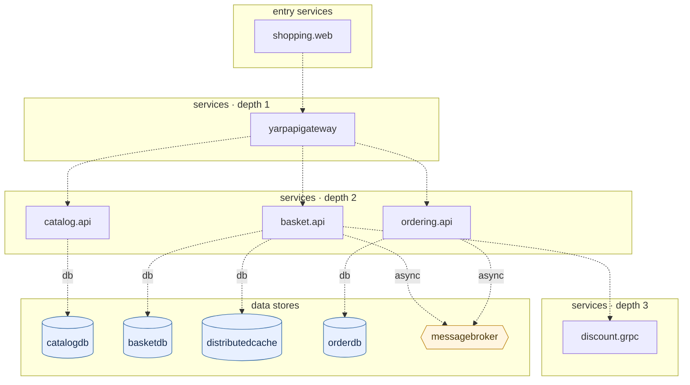

## stacks
- csharp (GENERIC, from 146 .cs files; tree-sitter grammar)
- javascript (GENERIC, from 2 .js/.mjs/.cjs/.jsx files; tree-sitter grammar)

## ledger sections
- config = 26
- http-client = 1
- persistence = 10
- url = 6
- compose-service = 22
- compose-alias = 1
- compose-dependency = 11
- env-address = 8
- workload-env = 8
- service-root = 6
- TOTAL = 99 | files with syntax errors = 2

## graph
- after merge: 11 nodes / 11 edges | after normalize: 11 nodes / 11 edges | unresolved code edges = 1
- persistence services: [basket.api, catalog.api, discount.grpc]

## nodes (kind, layer)
- basket.api  [service, L2]
- basketdb  [db, L4]
- catalog.api  [service, L2]
- catalogdb  [db, L4]
- discount.grpc  [service, L3]
- distributedcache  [db, L4]
- messagebroker  [queue, L4]
- orderdb  [db, L4]
- ordering.api  [service, L2]
- shopping.web  [service, L0]
- yarpapigateway  [service, L1]

## edges (type, confidence, provenance ref)
- basket.api -> basketdb  (db, documented)  code: src/Services/Basket/Basket.API/Program.cs:23
- basket.api -> discount.grpc  (sync-http, documented)  code: src/Services/Basket/Basket.API/Program.cs:39
- basket.api -> distributedcache  (db, documented)  code: src/Services/Basket/Basket.API/Program.cs:32
- basket.api -> messagebroker  (async, documented)  code: src/docker-compose.override.yml#depends_on
- catalog.api -> catalogdb  (db, documented)  code: src/Services/Catalog/Catalog.API/Program.cs:20
- ordering.api -> messagebroker  (async, documented)  code: src/docker-compose.override.yml#depends_on
- ordering.api -> orderdb  (db, documented)  code: src/Services/Ordering/Ordering.API/DependencyInjection.cs:16
- shopping.web -> yarpapigateway  (sync-http, documented)  code: src/WebApps/Shopping.Web/Program.cs:9
- yarpapigateway -> basket.api  (sync-http, documented)  code: src/ApiGateways/YarpApiGateway/appsettings.json
- yarpapigateway -> catalog.api  (sync-http, documented)  code: src/ApiGateways/YarpApiGateway/appsettings.json
- yarpapigateway -> ordering.api  (sync-http, documented)  code: src/ApiGateways/YarpApiGateway/appsettings.json

## unresolved (source hint / raw target / file:line), first 40
- basket.api  =>  null   @ src/Services/Basket/Basket.API/Data/CachedBasketRepository.cs:12

## alias questions (name [origin] seen in | candidates)
- none

## alias answers applied
- none

## mermaid

## 規則觸發
計數＝該規則改變了多少個不同的東西（邊、節點、名稱、檔案；同一個東西重複碰到算一次）；括號內最多列 5 個例子。
- rule 1: 0
- rule 2: 6 (name Shopping.Web=shopping-web; name YarpApiGateway=yarpapigateway; name Basket.API=basket-api; name Catalog.API=catalog-api; name Discount.Grpc=discount-grpc)
- rule 3: 0
- rule 4: 0
- rule 5: 0
- rule 6: 0
- rule 7: 8 (env catalog.api.ConnectionStrings__Database=catalogdb; env basket.api.ConnectionStrings__Database=basketdb; env basket.api.ConnectionStrings__Redis=distributedcache; env basket.api.GrpcSettings__DiscountUrl=discount.grpc; env basket.api.MessageBroker__Host=ecommerce-mq)
- rule 8: 9 (loopback localhost:6064; loopback localhost:6000; loopback localhost:6003; loopback localhost:6001; loopback localhost:5672)
- rule 9: 0
- rule 10: 0
- rule 11: 11 (node catalogdb; node basketdb; node distributedcache; node orderdb; node messagebroker)
- rule 12: 0
- rule 13: 0
- rule 14: 2 (edge basket.api->discount.grpc; edge shopping.web->yarpapigateway)
- rule 15: 0
- rule 16: 0
- rule 17: 0
- rule 18: 0
- rule 19: 0
- rule 20: 8 (scoped ApiSettings__GatewayAddress=yarpapigateway @shopping.web; scoped ConnectionStrings__Database=basketdb @basket.api; scoped ConnectionStrings__Redis=distributedcache @basket.api; scoped GrpcSettings__DiscountUrl=discount.grpc @basket.api; scoped ConnectionStrings__Database=catalogdb @catalog.api)
- rule 21: 0
- rule 22: 0
- rule 23: 0
- rule 24: 0
- rule 25: 0
- rule 26: 0
- rule 27: 0
- rule 28: 0
- rule 29: 0
- rule 30: 0
- rule 31: 0
- rule 32: 2 (connstr ConnectionStrings__Database; connstr connectionstrings:database)
- rule 33: 0
- rule 34: 0
- rule 35: 11 (documented catalog.api->catalogdb; documented basket.api->basketdb; documented basket.api->distributedcache; documented basket.api->discount.grpc; documented basket.api->messagebroker)
- rule 36: 4 (keep-dotted discount.grpc; dotted-name basket-api=basket.api; dotted-name catalog-api=catalog.api; dotted-name discount-grpc=discount.grpc)
- rule 37: 2 (hostname ecommerce-mq=messagebroker; resolve ecommerce-mq=messagebroker)
- rule 38: 12 (key ApiSettings:GatewayAddress; yarp http://catalog.api:8080; yarp http://ordering.api:8080; yarp http://basket.api:8080; yarp http://localhost:6000/)
- rule 39: 7 (kind basketdb=db; kind distributedcache=db; kind catalogdb=db; kind orderdb=db; kind messagebroker=queue)
- rule 40: 146 (cs-file src/WebApps/Shopping.Web/GlobalUsing.cs; cs-file src/WebApps/Shopping.Web/Models/Basket/ShoppingCartModel.cs; cs-file src/WebApps/Shopping.Web/Models/Basket/BasketCheckoutModel.cs; cs-file src/WebApps/Shopping.Web/Models/Catalog/ProductModel.cs; cs-file src/WebApps/Shopping.Web/Models/Ordering/OrderModel.cs)
- rule 41: 0
- rule 42: 0
- rule 43: 0
- rule 44: 5 (map shopping-web=shopping.web; map basket-api=basket.api; map catalog-api=catalog.api; map discount-grpc=discount.grpc; map ordering-api=ordering.api)
- rule 45: 0
- rule 46: 0
