## stacks
- java/spring (FRAMEWORK, from pom.xml)
- typescript (GENERIC, from 342 .ts/.tsx/.mts/.cts files, package.json; tree-sitter grammar)
- javascript (GENERIC, from 3 .js/.mjs/.cjs/.jsx files, package.json; tree-sitter grammar)

## ledger sections
- jpa = 117
- name-ref = 59
- name-constant = 260
- http-server = 149
- kafka-consume = 4
- config = 212
- http-client = 155
- env-address = 145
- k8s-workload = 28
- workload-env = 108
- k8s-service = 29
- compose-service = 33
- compose-mount = 22
- compose-dependency = 6
- url = 23
- service-root = 23
- module-deps = 22
- TOTAL = 1395 | files with syntax errors = 172

## graph
- after merge: 37 nodes / 120 edges | after normalize: 37 nodes / 120 edges | unresolved code edges = 26
- persistence services: [promotion, webhook, order, rating, common-library, location, payment, tax, product, search, inventory, cart, customer, media]

## nodes (kind, layer)
- backoffice  [service, L1]
- backoffice-nextjs  [service, L2]
- cart  [service, L4]
- collector  [service, L7]
- customer  [service, L4]
- elasticsearch  [db, L9]
- grafana  [service, L2]
- identity  [service, L7]
- inventory  [service, L2]
- jaeger  [service, L7]
- kafka  [queue, L9]
- kafka-connect  [service, L0]
- kafka-ui  [service, L0]
- keycloak  [service, L0]
- location  [service, L5]
- media  [service, L6]
- nginx  [service, L1]
- order  [service, L3]
- payment  [service, L1]
- payment-paypal  [service, L0]
- pgadmin  [service, L2]
- postgres  [db, L9]
- product  [service, L5]
- prometheus  [service, L8]
- promotion  [service, L2]
- rating  [service, L2]
- recommendation  [service, L2]
- redis  [db, L9]
- sampledata  [service, L2]
- search  [service, L2]
- storefront  [service, L1]
- storefront-nextjs  [service, L2]
- swagger-ui  [service, L2]
- tax  [service, L4]
- tempo  [service, L8]
- webhook  [service, L2]
- zookeeper  [service, L0]

## edges (type, confidence, provenance ref)
- backoffice -> backoffice-nextjs  (sync-http, documented)  code: backoffice-bff/src/main/resources/application-prod.yaml
- backoffice -> collector  (sync-http, inferred)  code: docker-compose.yml
- backoffice -> identity  (sync-http, documented)  code: backoffice-bff/src/main/resources/application.yaml
- backoffice -> jaeger  (sync-http, inferred)  code: yaslocal.yaml
- backoffice -> nginx  (sync-http, documented)  code: backoffice-bff/src/main/resources/application-prod.yaml
- backoffice -> order  (sync-http, inferred)  code: backoffice-bff/src/main/resources/application-dev.yaml
- backoffice -> redis  (db, inferred)  code: backoffice-bff/src/main/resources/application.yaml
- cart -> collector  (sync-http, inferred)  code: docker-compose.yml
- cart -> identity  (sync-http, documented)  code: cart/src/main/resources/application.properties
- cart -> media  (sync-http, inferred)  code: docker-compose.yml
- cart -> postgres  (db, documented)  code: docker-compose.yml
- cart -> product  (sync-http, inferred)  code: docker-compose.yml
- collector -> prometheus  (sync-http, inferred)  code: docker-compose.o11y.yml#depends_on
- collector -> tempo  (sync-http, inferred)  code: docker-compose.o11y.yml#depends_on
- customer -> collector  (sync-http, inferred)  code: docker-compose.yml
- customer -> identity  (sync-http, documented)  code: customer/src/main/resources/application.properties
- customer -> location  (sync-http, inferred)  code: docker-compose.yml
- customer -> postgres  (db, documented)  code: docker-compose.yml
- identity -> postgres  (db, inferred)  code: docker-compose.yml
- inventory -> collector  (sync-http, inferred)  code: docker-compose.yml
- inventory -> identity  (sync-http, documented)  code: inventory/src/main/resources/application.properties
- inventory -> location  (sync-http, inferred)  code: docker-compose.yml
- inventory -> postgres  (db, documented)  code: docker-compose.yml
- inventory -> product  (sync-http, inferred)  code: docker-compose.yml
- kafka -> zookeeper  (sync-http, documented)  code: docker-compose.yml#depends_on
- kafka-connect -> kafka  (async, documented)  code: docker-compose.yml#depends_on
- kafka-ui -> kafka  (async, documented)  code: docker-compose.yml#depends_on
- keycloak -> postgres  (db, inferred)  code: yaslocal.yaml
- location -> collector  (sync-http, inferred)  code: docker-compose.yml
- location -> identity  (sync-http, documented)  code: location/src/main/resources/application.properties
- location -> postgres  (db, documented)  code: docker-compose.yml
- media -> collector  (sync-http, inferred)  code: docker-compose.yml
- media -> identity  (sync-http, documented)  code: media/src/main/resources/application.properties
- media -> jaeger  (sync-http, inferred)  code: yaslocal.yaml
- media -> postgres  (db, documented)  code: yaslocal.yaml
- nginx -> backoffice  (sync-http, documented)  code: nginx/templates/default.conf.template:64
- nginx -> cart  (sync-http, documented)  code: nginx/templates/default.conf.template:20
- nginx -> customer  (sync-http, documented)  code: nginx/templates/default.conf.template:17
- nginx -> elasticsearch  (db, inferred)  code: nginx/templates/default.conf.template:117
- nginx -> grafana  (sync-http, documented)  code: nginx/templates/default.conf.template:106
- nginx -> identity  (sync-http, documented)  code: nginx/templates/default.conf.template:86
- nginx -> inventory  (sync-http, documented)  code: nginx/templates/default.conf.template:32
- nginx -> kafka  (async, documented)  code: nginx/templates/default.conf.template:127
- nginx -> location  (sync-http, documented)  code: nginx/templates/default.conf.template:29
- nginx -> media  (sync-http, documented)  code: nginx/templates/default.conf.template:8
- nginx -> order  (sync-http, documented)  code: nginx/templates/default.conf.template:26
- nginx -> payment  (sync-http, documented)  code: nginx/templates/default.conf.template:46
- nginx -> pgadmin  (sync-http, documented)  code: nginx/templates/default.conf.template:78
- nginx -> product  (sync-http, documented)  code: nginx/templates/default.conf.template:14
- nginx -> promotion  (sync-http, documented)  code: nginx/templates/default.conf.template:38
- nginx -> rating  (sync-http, documented)  code: nginx/templates/default.conf.template:23
- nginx -> recommendation  (sync-http, documented)  code: nginx/templates/default.conf.template:57
- nginx -> sampledata  (sync-http, documented)  code: nginx/templates/default.conf.template:53
- nginx -> search  (sync-http, documented)  code: nginx/templates/default.conf.template:43
- nginx -> storefront  (sync-http, documented)  code: nginx/templates/default.conf.template:71
- nginx -> swagger-ui  (sync-http, documented)  code: nginx/templates/default.conf.template:11
- nginx -> tax  (sync-http, documented)  code: nginx/templates/default.conf.template:35
- nginx -> webhook  (sync-http, documented)  code: nginx/templates/default.conf.template:50
- order -> cart  (sync-http, inferred)  code: docker-compose.yml
- order -> collector  (sync-http, inferred)  code: docker-compose.yml
- order -> customer  (sync-http, inferred)  code: docker-compose.yml
- order -> identity  (sync-http, documented)  code: order/src/main/resources/application.properties
- order -> postgres  (db, documented)  code: docker-compose.yml
- order -> product  (sync-http, inferred)  code: docker-compose.yml
- order -> tax  (sync-http, inferred)  code: docker-compose.yml
- payment -> collector  (sync-http, inferred)  code: docker-compose.yml
- payment -> identity  (sync-http, documented)  code: payment/src/main/resources/application.properties
- payment -> media  (sync-http, inferred)  code: docker-compose.yml
- payment -> order  (sync-http, inferred)  code: docker-compose.yml
- payment -> postgres  (db, documented)  code: docker-compose.yml
- payment -> storefront  (sync-http, documented)  code: payment/src/main/resources/application.properties
- payment-paypal -> identity  (sync-http, documented)  code: payment-paypal/src/main/resources/application.properties
- payment-paypal -> storefront  (sync-http, documented)  code: payment-paypal/src/main/java/com/yas/payment/paypal/service/PaypalService.java:34
- product -> collector  (sync-http, inferred)  code: docker-compose.yml
- product -> identity  (sync-http, documented)  code: product/src/main/resources/application.properties
- product -> jaeger  (sync-http, inferred)  code: yaslocal.yaml
- product -> media  (sync-http, inferred)  code: yaslocal.yaml
- product -> postgres  (db, documented)  code: yaslocal.yaml
- promotion -> collector  (sync-http, inferred)  code: docker-compose.yml
- promotion -> identity  (sync-http, documented)  code: promotion/src/main/resources/application.properties
- promotion -> postgres  (db, documented)  code: docker-compose.yml
- promotion -> product  (sync-http, inferred)  code: docker-compose.yml
- rating -> collector  (sync-http, inferred)  code: docker-compose.yml
- rating -> customer  (sync-http, inferred)  code: docker-compose.yml
- rating -> identity  (sync-http, documented)  code: rating/src/main/resources/application.properties
- rating -> order  (sync-http, inferred)  code: docker-compose.yml
- rating -> postgres  (db, documented)  code: docker-compose.yml
- rating -> product  (sync-http, inferred)  code: docker-compose.yml
- recommendation -> identity  (sync-http, documented)  code: recommendation/src/main/resources/application.properties
- recommendation -> kafka  (async, documented)  code: recommendation/src/main/resources/application.properties
- sampledata -> collector  (sync-http, inferred)  code: docker-compose.yml
- sampledata -> identity  (sync-http, documented)  code: sampledata/src/main/resources/application.properties
- sampledata -> postgres  (db, inferred)  code: docker-compose.yml
- search -> collector  (sync-http, inferred)  code: docker-compose.search.yml
- search -> elasticsearch  (db, documented)  code: search/src/main/resources/application.properties
- search -> identity  (sync-http, documented)  code: search/src/main/resources/application.properties
- search -> kafka  (async, documented)  code: search/src/main/resources/application.properties
- search -> product  (sync-http, inferred)  code: docker-compose.search.yml
- storefront -> cart  (sync-http, inferred)  code: docker-compose.yml
- storefront -> collector  (sync-http, inferred)  code: docker-compose.yml
- storefront -> customer  (sync-http, inferred)  code: docker-compose.yml
- storefront -> identity  (sync-http, documented)  code: storefront-bff/src/main/resources/application.yaml
- storefront -> inventory  (sync-http, inferred)  code: docker-compose.yml
- storefront -> jaeger  (sync-http, inferred)  code: yaslocal.yaml
- storefront -> location  (sync-http, inferred)  code: docker-compose.yml
- storefront -> nginx  (sync-http, documented)  code: storefront-bff/src/main/resources/application-prod.yaml
- storefront -> order  (sync-http, inferred)  code: docker-compose.yml
- storefront -> payment  (sync-http, inferred)  code: storefront-bff/src/main/resources/application-dev.yaml
- storefront -> promotion  (sync-http, inferred)  code: docker-compose.yml
- storefront -> rating  (sync-http, inferred)  code: docker-compose.yml
- storefront -> redis  (db, inferred)  code: storefront-bff/src/main/resources/application.yaml
- storefront -> sampledata  (sync-http, inferred)  code: docker-compose.yml
- storefront -> storefront-nextjs  (sync-http, documented)  code: storefront-bff/src/main/resources/application-prod.yaml
- storefront -> tax  (sync-http, inferred)  code: docker-compose.yml
- tax -> collector  (sync-http, inferred)  code: docker-compose.yml
- tax -> identity  (sync-http, documented)  code: tax/src/main/resources/application.properties
- tax -> location  (sync-http, inferred)  code: docker-compose.yml
- tax -> postgres  (db, documented)  code: docker-compose.yml
- webhook -> identity  (sync-http, documented)  code: webhook/src/main/resources/application.properties
- webhook -> kafka  (async, documented)  code: webhook/src/main/resources/application.properties

## unresolved (source hint / raw target / file:line), first 40
- storefront  =>  null   @ storefront/common/services/ApiClientService.ts:31
- storefront  =>  null   @ storefront/modules/rating/services/RatingService.ts:23
- storefront  =>  null   @ storefront/modules/search/services/SearchService.ts:43
- backoffice  =>  null   @ backoffice/common/services/ApiClientService.ts:31
- null  =>  collector   @ .env:-1
- null  =>  http://${OTEL_COLLECTOR_HOST}:${OTEL_COLLECTOR_PORT_GRPC}   @ .env:-1
- null  =>  kafka   @ .env:-1
- null  =>  postgres   @ .env:-1
- null  =>  grafana   @ .env:-1
- null  =>  jaeger   @ .env:-1
- null  =>  prometheus   @ .env:-1
- null  =>  redis   @ .env:-1
- null  =>  http://api.yas.local   @ .env:-1
- null  =>  http://cart/cart   @ .env:-1
- null  =>  http://customer/customer   @ .env:-1
- null  =>  http://product/product   @ .env:-1
- null  =>  http://tax/tax   @ .env:-1
- null  =>  http://order/order   @ .env:-1
- null  =>  http://payment/payment   @ .env:-1
- null  =>  http://location/location   @ .env:-1
- null  =>  http://media/media   @ .env:-1
- null  =>  http://promotion/promotion   @ .env:-1
- null  =>  http://inventory/inventory   @ .env:-1
- null  =>  http://rating/rating   @ .env:-1
- null  =>  http://sampledata/sampledata   @ .env:-1
- null  =>  http://recommendation/recommendation   @ .env:-1

## alias questions (name [origin] seen in | candidates)
- payment-paypal  [graph]  looks like the same service as `payment` (one name is the other with a prefix or suffix); both stay on the graph until you say   | candidates: payment
- storefront-nextjs  [graph]  looks like the same service as `storefront` (one name is the other with a prefix or suffix); both stay on the graph until you say   | candidates: storefront
- backoffice-nextjs  [graph]  looks like the same service as `backoffice` (one name is the other with a prefix or suffix); both stay on the graph until you say   | candidates: backoffice
- collector  [code]  config at .env   | candidates: -
- kafka  [code]  config at .env   | candidates: kafka-ui, kafka-connect
- postgres  [code]  config at .env   | candidates: -
- grafana  [code]  config at .env   | candidates: -
- jaeger  [code]  config at .env   | candidates: -
- prometheus  [code]  config at .env   | candidates: -
- redis  [code]  config at .env   | candidates: -

## alias answers applied
- none

## mermaid

```mermaid
flowchart TB
%% DepWeaver — microservice dependency graph
%% solid arrow = observed at runtime (Istio) · dashed = declared in code/doc only
%% node shape: [service] ([gateway]) [(db)] {{queue}} [/external/]
  subgraph layer0 ["entry services"]
    direction LR
    keycloak["keycloak"]
    payment_paypal["payment-paypal"]
    zookeeper["zookeeper"]
    kafka_connect["kafka-connect"]
    kafka_ui["kafka-ui"]
  end
  subgraph layer1 ["services · depth 1"]
    direction LR
    storefront["storefront"]
    backoffice["backoffice"]
    payment["payment"]
    nginx["nginx"]
  end
  subgraph layer2 ["services · depth 2"]
    direction LR
    swagger_ui["swagger-ui"]
    promotion["promotion"]
    webhook["webhook"]
    recommendation["recommendation"]
    rating["rating"]
    sampledata["sampledata"]
    storefront_nextjs["storefront-nextjs"]
    backoffice_nextjs["backoffice-nextjs"]
    search["search"]
    inventory["inventory"]
    pgadmin["pgadmin"]
    grafana["grafana"]
  end
  subgraph layer3 ["services · depth 3"]
    direction LR
    order["order"]
  end
  subgraph layer4 ["services · depth 4"]
    direction LR
    tax["tax"]
    customer["customer"]
    cart["cart"]
  end
  subgraph layer5 ["services · depth 5"]
    direction LR
    product["product"]
    location["location"]
  end
  subgraph layer6 ["services · depth 6"]
    direction LR
    media["media"]
  end
  subgraph layer7 ["services · depth 7"]
    direction LR
    jaeger["jaeger"]
    identity["identity"]
    collector["collector"]
  end
  subgraph layer8 ["services · depth 8"]
    direction LR
    tempo["tempo"]
    prometheus["prometheus"]
  end
  subgraph layer9 ["data stores"]
    direction LR
    postgres[("postgres")]:::db
    kafka{{"kafka"}}:::queue
    redis[("redis")]:::db
    elasticsearch[("elasticsearch")]:::db
  end
  payment_paypal -.-> storefront
  promotion -.-> identity
  webhook -.-> identity
  webhook -. async .-> kafka
  recommendation -.-> identity
  recommendation -. async .-> kafka
  collector -. declared? .-> tempo
  collector -. declared? .-> prometheus
  order -.-> identity
  rating -.-> identity
  sampledata -.-> identity
  location -.-> identity
  payment -.-> identity
  payment -.-> storefront
  storefront -.-> nginx
  storefront -.-> storefront_nextjs
  storefront -. declared? .-> payment
  storefront -.-> identity
  storefront -. db? .-> redis
  tax -.-> identity
  product -.-> identity
  backoffice -.-> nginx
  backoffice -.-> backoffice_nextjs
  backoffice -. declared? .-> order
  backoffice -.-> identity
  backoffice -. db? .-> redis
  search -. db .-> elasticsearch
  search -.-> identity
  search -. async .-> kafka
  payment_paypal -.-> identity
  nginx -.-> media
  nginx -.-> swagger_ui
  nginx -.-> product
  nginx -.-> customer
  nginx -.-> cart
  nginx -.-> rating
  nginx -.-> order
  nginx -.-> location
  nginx -.-> inventory
  nginx -.-> tax
  nginx -.-> promotion
  nginx -.-> search
  nginx -.-> payment
  nginx -.-> webhook
  nginx -.-> sampledata
  nginx -.-> recommendation
  nginx -.-> backoffice
  nginx -.-> storefront
  nginx -.-> pgadmin
  nginx -.-> identity
  nginx -.-> grafana
  nginx -. db? .-> elasticsearch
  nginx -. async .-> kafka
  inventory -.-> identity
  cart -.-> identity
  kafka -.-> zookeeper
  kafka_connect -. async .-> kafka
  kafka_ui -. async .-> kafka
  customer -.-> identity
  media -.-> identity
  storefront -. declared? .-> jaeger
  backoffice -. declared? .-> jaeger
  media -. db .-> postgres
  media -. declared? .-> jaeger
  product -. db .-> postgres
  product -. declared? .-> media
  product -. declared? .-> jaeger
  keycloak -. db? .-> postgres
  search -. declared? .-> product
  search -. declared? .-> collector
  identity -. db? .-> postgres
  backoffice -. declared? .-> collector
  storefront -. declared? .-> customer
  storefront -. declared? .-> cart
  storefront -. declared? .-> rating
  storefront -. declared? .-> order
  storefront -. declared? .-> location
  storefront -. declared? .-> inventory
  storefront -. declared? .-> tax
  storefront -. declared? .-> promotion
  storefront -. declared? .-> sampledata
  storefront -. declared? .-> collector
  media -. declared? .-> collector
  product -. declared? .-> collector
  customer -. db .-> postgres
  customer -. declared? .-> location
  customer -. declared? .-> collector
  cart -. db .-> postgres
  cart -. declared? .-> media
  cart -. declared? .-> product
  cart -. declared? .-> collector
  rating -. db .-> postgres
  rating -. declared? .-> product
  rating -. declared? .-> customer
  rating -. declared? .-> order
  rating -. declared? .-> collector
  order -. db .-> postgres
  order -. declared? .-> cart
  order -. declared? .-> customer
  order -. declared? .-> product
  order -. declared? .-> tax
  order -. declared? .-> collector
  payment -. db .-> postgres
  payment -. declared? .-> order
  payment -. declared? .-> media
  payment -. declared? .-> collector
  location -. db .-> postgres
  location -. declared? .-> collector
  inventory -. db .-> postgres
  inventory -. declared? .-> product
  inventory -. declared? .-> location
  inventory -. declared? .-> collector
  promotion -. db .-> postgres
  promotion -. declared? .-> product
  promotion -. declared? .-> collector
  tax -. db .-> postgres
  tax -. declared? .-> location
  tax -. declared? .-> collector
  sampledata -. db? .-> postgres
  sampledata -. declared? .-> collector
classDef db fill:#e8f0ff,stroke:#3a6ea5,color:#13294b;
classDef queue fill:#fff5e0,stroke:#c08a1e,color:#4a370a;

```

## 規則觸發
計數＝該規則改變了多少個不同的東西（邊、節點、名稱、檔案；同一個東西重複碰到算一次）；括號內最多列 5 個例子。
- rule 1: 23 (not-preadded promotion; not-preadded webhook; not-preadded recommendation; not-preadded order; not-preadded rating)
- rule 2: 0
- rule 3: 0
- rule 4: 4 (table spring.datasource.product.url=jdbc:postgresql://localhost:5432/product; table spring.datasource.media.url=jdbc:postgresql://localhost:5432/media; table yas.public.url=http://storefront/complete-payment; table OTEL_COLLECTOR_HOST=collector)
- rule 5: 12 (not-a-host BASE_URL=/swagger-ui; env DB_ADDR=postgres; env SPRING_DATA_REDIS_HOST=redis; key hostname=api.yas.local; key spring.data.redis.host=redis)
- rule 6: 23 (url http://media; url http://swagger-ui:8080; url http://product; url http://customer; url http://cart)
- rule 7: 18 (env identity.KC_DB_URL=postgres; env media.SPRING_DATASOURCE_URL=postgres; env product.SPRING_DATASOURCE_URL=postgres; env customer.SPRING_DATASOURCE_URL=postgres; env cart.SPRING_DATASOURCE_URL=postgres)
- rule 8: 19 (loopback localhost; config-signal url; config-signal server.port; config-signal spring.datasource.driver-class-name; loopback localhost:5432)
- rule 9: 77 (jpa promotion/src/main/java/com/yas/promotion/repository/PromotionRepository.java; jpa promotion/src/main/java/com/yas/promotion/model/PromotionUsage.java; jpa promotion/src/main/java/com/yas/promotion/model/Promotion.java; jpa promotion/src/main/java/com/yas/promotion/model/PromotionApply.java; jpa webhook/src/main/java/com/yas/webhook/repository/WebhookRepository.java)
- rule 10: 0
- rule 11: 1 (k8s-over-compose 33 compose names ignored)
- rule 12: 0
- rule 13: 0
- rule 14: 50 (edge storefront->jaeger; edge backoffice->jaeger; edge media->jaeger; edge product->media; edge product->jaeger)
- rule 15: 2 (edge storefront->payment :8081; edge backoffice->order :8085)
- rule 16: 0
- rule 17: 0
- rule 18: 1 (dockerfile-env API_BASE_PATH=storefront)
- rule 19: 0
- rule 20: 1 (scoped API_BASE_PATH=storefront @storefront)
- rule 21: 0
- rule 22: 0
- rule 23: 0
- rule 24: 59 (interp search.YAS_PUBLIC_URL=api.yas.local; forward search.YAS_SERVICES_PRODUCT=product; forward search.OTEL_EXPORTER_OTLP_ENDPOINT=collector; forward backoffice.OTEL_EXPORTER_OTLP_ENDPOINT=collector; forward storefront.YAS_SERVICES_CUSTOMER=customer)
- rule 25: 0
- rule 26: 0
- rule 27: 3 (list spring.kafka.bootstrap-servers=kafka:9092; list spring.kafka.consumer.bootstrap-servers=kafka:9092; list spring.kafka.producer.bootstrap-servers=kafka:9092)
- rule 28: 0
- rule 29: 0
- rule 30: 3 (edge webhook->kafka; edge recommendation->kafka; edge search->kafka)
- rule 31: 0
- rule 32: 0
- rule 33: 1 (drop api.yas.local)
- rule 34: 0
- rule 35: 6 (inferred collector->tempo; inferred collector->prometheus; documented kafka->zookeeper; documented kafka-connect->kafka; documented kafka-ui->kafka)
- rule 36: 10 (ns-strip postgresql.postgres; keep-dotted storefront.yas.local.com; keep-dotted api.yas.local.com; ns-strip opentelemetry-collector.observability; keep-dotted identity.yas.local.com)
- rule 37: 0
- rule 38: 0
- rule 39: 0
- rule 40: 0
- rule 41: 3 (lib common-library; no-edge common-library/src/main/java/com/yas/commonlibrary/kafka/cdc/BaseCdcConsumer.java; no-edge common-library/src/main/resources/application.properties)
- rule 42: 119 (ignore /promotion/src/it/resources/mockito-extensions/org.mockito.plugins.MockMaker/; ignore /promotion/src/it/resources/logback-spring.xml/; ignore /promotion/src/it/resources/application.properties/; ignore /promotion/src/it/java/com/yas/promotion/service/PromotionServiceIT.java/; ignore /webhook/src/it/resources/mockito-extensions/org.mockito.plugins.MockMaker/)
- rule 43: 6 (drop springdoc.swagger-ui.path; drop springdoc.packagestoscan; drop springdoc.swagger-ui.oauth.use-pkce-with-authorization-code-grant; drop springdoc.swagger-ui.oauth.client-id; drop springdoc.oauthflow.authorization-url)
- rule 44: 17 (compose-only promotion=promotion; compose-only order=order; image storefront=storefront-nextjs; no-workload storefront=storefront-nextjs; compose-only rating=rating)
- rule 45: 1 (accept elasticsearch.url=elasticsearch)
- rule 46: 5 (set-var http://search; set-var http://webhook; set-var http://recommendation; set-var http://grafana:3000; set-var http://elasticsearch:9200)
- rule 47: 151 (urlref storefront/modules/order/services/OrderService.ts:10 baseUrl; urlref storefront/modules/order/services/OrderService.ts:21 baseUrl; urlref storefront/modules/order/services/OrderService.ts:29 baseUrl; urlref storefront/modules/order/services/OrderService.ts:37 baseUrl; urlref storefront/modules/rating/services/RatingService.ts:28 baseUrl)
- rule 50: 2 (dotenv storefront/.env.production API_BASE_PATH=storefront; dotenv storefront/.env.development API_BASE_PATH=storefront)
- rule 52: 89 (render k8s/deploy/observability/opentelemetry/templates/opentelemetry-collector.yaml; render k8s/deploy/observability/grafana/templates/dashboards.yaml; render k8s/deploy/observability/grafana/templates/grafana-credentials.secret.yaml; render k8s/deploy/observability/grafana/templates/grafana.yaml; render k8s/deploy/observability/grafana/templates/loki-datasource.yaml)
- rule 53: 3 (compose search.entrypoint elasticsearch:9200=elasticsearch; compose backoffice.entrypoint identity:80=identity; compose storefront.entrypoint identity:80=identity)
- rule 55: 32 (list application.yaml opentelemetry-collector; list application.yaml identity.yas.local.com; list application.yaml kafka-cluster-kafka-brokers; list application.yaml cart; list application.yaml customer)
