## stacks
- javascript (LLM, from 13 .js/.jsx/.ts/.tsx files)   <-- skipped (LLM tier)
- java/spring (FRAMEWORK, from build.gradle)
- python/web (FRAMEWORK, from requirements.txt)
- go (LLM, from 1 .go files)   <-- skipped (LLM tier)

## ledger sections
- url = 4
- jpa = 2
- http-server = 4
- config = 13
- name-ref = 3
- http-client = 2
- import = 12
- compose-service = 98
- compose-dependency = 111
- env-address = 104
- workload-env = 104
- service-root = 7
- module-deps = 4
- TOTAL = 468 | files with syntax errors = 0

## graph
- after merge: 94 nodes / 129 edges | after normalize: 94 nodes / 129 edges | unresolved code edges = 0
- persistence services: [songs-service]

## nodes (kind, layer)
- activemq  [queue, L7]
- agent  [service, L2]
- amqexporter  [service, L6]
- apisix-otel-collector  [service, L0]
- app  [service, L1]
- banyandb  [service, L3]
- banyandb-plugin-carrier  [service, L4]
- basic-get  [service, L0]
- basic-get-auto  [service, L0]
- bookie  [service, L0]
- broker  [service, L2]
- cart  [service, L2]
- chatbot  [service, L1]
- consume-perf  [service, L1]
- elasticsearch  [db, L7]
- es-exporter  [service, L1]
- es-mock  [service, L0]
- event-reporter  [service, L0]
- executejob  [service, L0]
- firepit  [service, L1]
- flagd-ui  [service, L1]
- fluent-bit  [service, L0]
- frontend  [service, L1]
- gateway  [service, L1]
- gateway-service  [service, L0]
- grafana  [service, L1]
- greedy-consumer  [service, L0]
- jaeger  [service, L1]
- jobmanager  [service, L2]
- load-gen  [service, L0]
- loadgen  [service, L0]
- metadata-store  [service, L1]
- mongodb-1  [db, L7]
- mongodb-2  [db, L7]
- mongodb-exporter-1  [db, L7]
- mongodb-exporter-2  [db, L7]
- mongodb-repl-setup  [db, L7]
- mysql  [db, L7]
- mysql-load  [db, L7]
- mysql-service  [db, L7]
- nack  [service, L0]
- nginx  [service, L1]
- nginx-caller  [service, L0]
- oap  [service, L2]
- oap-init  [service, L0]
- oap1  [service, L0]
- opamp-server  [service, L1]
- otel-collector  [service, L5]
- otel-demo-accounting  [service, L0]
- otel-demo-ad  [service, L1]
- otel-demo-astronomy-db  [db, L7]
- otel-demo-cart  [service, L0]
- otel-demo-checkout  [service, L1]
- otel-demo-collector  [service, L0]
- otel-demo-currency  [service, L2]
- otel-demo-email  [service, L2]
- otel-demo-flagd  [service, L4]
- otel-demo-fraud-detection  [service, L0]
- otel-demo-frontend  [service, L0]
- otel-demo-frontend-proxy  [service, L0]
- otel-demo-image-provider  [service, L1]
- otel-demo-kafka  [queue, L7]
- otel-demo-load-generator  [service, L0]
- otel-demo-payment  [service, L2]
- otel-demo-product-catalog  [service, L2]
- otel-demo-quote  [service, L3]
- otel-demo-recommendation  [service, L1]
- otel-demo-shipping  [service, L2]
- otel-demo-valkey-cart  [service, L1]
- postgres  [db, L7]
- postgres-exporter  [db, L7]
- postgres-load  [db, L7]
- produce-perf  [service, L0]
- publisher-confirms  [service, L0]
- rating  [service, L1]
- rcmd  [service, L1]
- recommendation-service  [service, L0]
- rmq0  [queue, L7]
- rocketmq-broker-1  [service, L0]
- rocketmq-exporter  [service, L0]
- rocketmq-namesrv-1  [service, L1]
- satellite  [service, L0]
- slow-consumer-persistent  [service, L0]
- songs  [service, L2]
- songs-service  [service, L0]
- taskmanager  [service, L1]
- telemetry-docs  [service, L1]
- ui  [service, L0]
- unroutable-drop  [service, L0]
- unroutable-return  [service, L0]
- vm1  [service, L0]
- vm2  [service, L0]
- zk  [service, L3]
- zookeeper  [service, L3]

## edges (type, confidence, provenance ref)
- amqexporter -> activemq  (async, inferred)  code: deploy/platform/docker/docker-compose.activemq-monitor.yaml#depends_on
- apisix-otel-collector -> frontend  (sync-http, inferred)  code: deploy/platform/docker/docker-compose.apisix-monitor.yaml
- app -> agent  (sync-http, inferred)  code: deploy/platform/docker/docker-compose.agent.yaml
- banyandb -> banyandb-plugin-carrier  (sync-http, inferred)  code: deploy/platform/docker/docker-compose.banyandb-tail-sampling.yaml#depends_on
- basic-get -> rmq0  (async, documented)  code: deploy/platform/docker/docker-compose.rabbitmq-monitor.yaml
- basic-get-auto -> rmq0  (async, documented)  code: deploy/platform/docker/docker-compose.rabbitmq-monitor.yaml
- bookie -> metadata-store  (sync-http, inferred)  code: deploy/platform/docker/docker-compose.pulsar-monitor.yaml
- bookie -> zookeeper  (sync-http, documented)  code: deploy/platform/docker/docker-compose.pulsar-monitor.yaml#depends_on
- broker -> zk  (sync-http, inferred)  code: deploy/platform/docker/docker-compose.pulsar-monitor.yaml
- broker -> zookeeper  (sync-http, documented)  code: deploy/platform/docker/docker-compose.pulsar-monitor.yaml#depends_on
- consume-perf -> broker  (sync-http, inferred)  code: deploy/platform/docker/docker-compose.pulsar-monitor.yaml#depends_on
- es-exporter -> elasticsearch  (db, inferred)  code: deploy/platform/docker/docker-compose.elasticsearch-monitor.yaml#depends_on
- es-mock -> elasticsearch  (db, inferred)  code: deploy/platform/docker/docker-compose.elasticsearch-monitor.yaml#depends_on
- es-mock -> es-exporter  (sync-http, inferred)  code: deploy/platform/docker/docker-compose.elasticsearch-monitor.yaml#depends_on
- es-mock -> oap  (sync-http, inferred)  code: deploy/platform/docker/docker-compose.elasticsearch-monitor.yaml#depends_on
- event-reporter -> oap  (sync-http, inferred)  code: deploy/platform/docker/docker-compose.event.yaml#depends_on
- executejob -> taskmanager  (sync-http, inferred)  code: deploy/platform/docker/docker-compose.flink-monitor.yaml#depends_on
- fluent-bit -> nginx  (sync-http, inferred)  code: deploy/platform/docker/docker-compose.nginx-monitor.yaml#depends_on
- fluent-bit -> oap  (sync-http, inferred)  code: deploy/platform/docker/docker-compose.nginx-monitor.yaml#depends_on
- gateway -> oap  (sync-http, inferred)  code: deploy/platform/docker/docker-compose.agent.yaml#depends_on
- gateway -> songs  (sync-http, inferred)  code: deploy/platform/docker/docker-compose.agent.yaml#depends_on
- gateway-service -> rcmd  (sync-http, documented)  code: services/gateway-service/src/main/resources/application.yaml
- gateway-service -> songs  (sync-http, documented)  code: services/gateway-service/src/main/resources/application.yaml
- greedy-consumer -> rmq0  (async, documented)  code: deploy/platform/docker/docker-compose.rabbitmq-monitor.yaml
- load-gen -> frontend  (sync-http, documented)  code: services/load-gen/loadgen.py:27
- loadgen -> app  (sync-http, inferred)  code: deploy/platform/docker/docker-compose.agent.yaml#depends_on
- mongodb-exporter-1 -> mongodb-1  (db, inferred)  code: deploy/platform/docker/docker-compose.mongodb-monitor.yaml#depends_on
- mongodb-exporter-2 -> mongodb-2  (db, inferred)  code: deploy/platform/docker/docker-compose.mongodb-monitor.yaml#depends_on
- mongodb-repl-setup -> mongodb-1  (db, inferred)  code: deploy/platform/docker/docker-compose.mongodb-monitor.yaml#depends_on
- mongodb-repl-setup -> mongodb-2  (db, inferred)  code: deploy/platform/docker/docker-compose.mongodb-monitor.yaml#depends_on
- mysql-load -> otel-collector  (sync-http, inferred)  code: deploy/platform/docker/docker-compose.mysql-monitor.yaml#depends_on
- mysql-service -> mysql  (db, inferred)  code: deploy/platform/docker/docker-compose.mysql-monitor.yaml#depends_on
- nack -> rmq0  (async, documented)  code: deploy/platform/docker/docker-compose.rabbitmq-monitor.yaml
- nginx -> oap  (sync-http, inferred)  code: deploy/platform/docker/docker-compose.nginx-monitor.yaml#depends_on
- nginx-caller -> otel-collector  (sync-http, inferred)  code: deploy/platform/docker/docker-compose.nginx-monitor.yaml#depends_on
- oap -> banyandb  (sync-http, documented)  code: deploy/platform/docker/docker-compose.banyandb-tail-sampling.yaml#depends_on
- oap -> zookeeper  (sync-http, documented)  code: deploy/platform/docker/docker-compose.cluster.yaml#depends_on
- oap-init -> banyandb  (sync-http, documented)  code: deploy/platform/docker/docker-compose.cluster.yaml#depends_on
- oap1 -> banyandb  (sync-http, inferred)  code: deploy/platform/docker/docker-compose.cluster.yaml
- oap1 -> zookeeper  (sync-http, documented)  code: deploy/platform/docker/docker-compose.cluster.yaml#depends_on
- otel-collector -> amqexporter  (sync-http, inferred)  code: deploy/platform/docker/docker-compose.activemq-monitor.yaml
- otel-demo-accounting -> otel-collector  (sync-http, inferred)  code: deploy/platform/docker/docker-compose.otlp-trace.yaml
- otel-demo-accounting -> otel-demo-astronomy-db  (db, documented)  code: deploy/platform/docker/docker-compose.otlp-trace.yaml#depends_on
- otel-demo-accounting -> otel-demo-kafka  (async, documented)  code: deploy/platform/docker/docker-compose.otlp-trace.yaml#depends_on
- otel-demo-ad -> otel-collector  (sync-http, inferred)  code: deploy/platform/docker/docker-compose.otlp-trace.yaml
- otel-demo-ad -> otel-demo-flagd  (sync-http, documented)  code: deploy/platform/docker/docker-compose.otlp-trace.yaml#depends_on
- otel-demo-cart -> otel-collector  (sync-http, inferred)  code: deploy/platform/docker/docker-compose.otlp-trace.yaml
- otel-demo-cart -> otel-demo-flagd  (sync-http, documented)  code: deploy/platform/docker/docker-compose.otlp-trace.yaml#depends_on
- otel-demo-cart -> otel-demo-valkey-cart  (sync-http, documented)  code: deploy/platform/docker/docker-compose.otlp-trace.yaml#depends_on
- otel-demo-checkout -> cart  (sync-http, inferred)  code: deploy/platform/docker/docker-compose.otlp-trace.yaml
- otel-demo-checkout -> otel-collector  (sync-http, inferred)  code: deploy/platform/docker/docker-compose.otlp-trace.yaml
- otel-demo-checkout -> otel-demo-currency  (sync-http, documented)  code: deploy/platform/docker/docker-compose.otlp-trace.yaml#depends_on
- otel-demo-checkout -> otel-demo-email  (sync-http, documented)  code: deploy/platform/docker/docker-compose.otlp-trace.yaml#depends_on
- otel-demo-checkout -> otel-demo-flagd  (sync-http, documented)  code: deploy/platform/docker/docker-compose.otlp-trace.yaml#depends_on
- otel-demo-checkout -> otel-demo-kafka  (async, documented)  code: deploy/platform/docker/docker-compose.otlp-trace.yaml#depends_on
- otel-demo-checkout -> otel-demo-payment  (sync-http, documented)  code: deploy/platform/docker/docker-compose.otlp-trace.yaml#depends_on
- otel-demo-checkout -> otel-demo-product-catalog  (sync-http, documented)  code: deploy/platform/docker/docker-compose.otlp-trace.yaml#depends_on
- otel-demo-checkout -> otel-demo-shipping  (sync-http, documented)  code: deploy/platform/docker/docker-compose.otlp-trace.yaml#depends_on
- otel-demo-collector -> oap  (sync-http, inferred)  code: deploy/platform/docker/docker-compose.otlp-trace.yaml#depends_on
- otel-demo-currency -> otel-collector  (sync-http, inferred)  code: deploy/platform/docker/docker-compose.otlp-trace.yaml
- otel-demo-currency -> otel-demo-flagd  (sync-http, inferred)  code: deploy/platform/docker/docker-compose.otlp-trace.yaml
- otel-demo-email -> otel-collector  (sync-http, inferred)  code: deploy/platform/docker/docker-compose.otlp-trace.yaml
- otel-demo-email -> otel-demo-flagd  (sync-http, inferred)  code: deploy/platform/docker/docker-compose.otlp-trace.yaml
- otel-demo-flagd -> otel-collector  (sync-http, inferred)  code: deploy/platform/docker/docker-compose.otlp-trace.yaml
- otel-demo-fraud-detection -> otel-collector  (sync-http, inferred)  code: deploy/platform/docker/docker-compose.otlp-trace.yaml
- otel-demo-fraud-detection -> otel-demo-flagd  (sync-http, inferred)  code: deploy/platform/docker/docker-compose.otlp-trace.yaml
- otel-demo-fraud-detection -> otel-demo-kafka  (async, documented)  code: deploy/platform/docker/docker-compose.otlp-trace.yaml#depends_on
- otel-demo-frontend -> cart  (sync-http, inferred)  code: deploy/platform/docker/docker-compose.otlp-trace.yaml
- otel-demo-frontend -> frontend  (sync-http, inferred)  code: deploy/platform/docker/docker-compose.otlp-trace.yaml
- otel-demo-frontend -> otel-collector  (sync-http, inferred)  code: deploy/platform/docker/docker-compose.otlp-trace.yaml
- otel-demo-frontend -> otel-demo-ad  (sync-http, documented)  code: deploy/platform/docker/docker-compose.otlp-trace.yaml#depends_on
- otel-demo-frontend -> otel-demo-checkout  (sync-http, documented)  code: deploy/platform/docker/docker-compose.otlp-trace.yaml#depends_on
- otel-demo-frontend -> otel-demo-currency  (sync-http, documented)  code: deploy/platform/docker/docker-compose.otlp-trace.yaml#depends_on
- otel-demo-frontend -> otel-demo-flagd  (sync-http, documented)  code: deploy/platform/docker/docker-compose.otlp-trace.yaml#depends_on
- otel-demo-frontend -> otel-demo-product-catalog  (sync-http, documented)  code: deploy/platform/docker/docker-compose.otlp-trace.yaml#depends_on
- otel-demo-frontend -> otel-demo-recommendation  (sync-http, documented)  code: deploy/platform/docker/docker-compose.otlp-trace.yaml#depends_on
- otel-demo-frontend -> otel-demo-shipping  (sync-http, documented)  code: deploy/platform/docker/docker-compose.otlp-trace.yaml#depends_on
- otel-demo-frontend-proxy -> chatbot  (sync-http, inferred)  code: deploy/platform/docker/docker-compose.otlp-trace.yaml
- otel-demo-frontend-proxy -> firepit  (sync-http, inferred)  code: deploy/platform/docker/docker-compose.otlp-trace.yaml
- otel-demo-frontend-proxy -> flagd-ui  (sync-http, inferred)  code: deploy/platform/docker/docker-compose.otlp-trace.yaml
- otel-demo-frontend-proxy -> frontend  (sync-http, inferred)  code: deploy/platform/docker/docker-compose.otlp-trace.yaml
- otel-demo-frontend-proxy -> grafana  (sync-http, inferred)  code: deploy/platform/docker/docker-compose.otlp-trace.yaml
- otel-demo-frontend-proxy -> jaeger  (sync-http, inferred)  code: deploy/platform/docker/docker-compose.otlp-trace.yaml
- otel-demo-frontend-proxy -> opamp-server  (sync-http, inferred)  code: deploy/platform/docker/docker-compose.otlp-trace.yaml
- otel-demo-frontend-proxy -> otel-collector  (sync-http, inferred)  code: deploy/platform/docker/docker-compose.otlp-trace.yaml
- otel-demo-frontend-proxy -> otel-demo-flagd  (sync-http, inferred)  code: deploy/platform/docker/docker-compose.otlp-trace.yaml
- otel-demo-frontend-proxy -> otel-demo-image-provider  (sync-http, inferred)  code: deploy/platform/docker/docker-compose.otlp-trace.yaml
- otel-demo-frontend-proxy -> otel-demo-load-generator  (sync-http, inferred)  code: deploy/platform/docker/docker-compose.otlp-trace.yaml
- otel-demo-frontend-proxy -> telemetry-docs  (sync-http, inferred)  code: deploy/platform/docker/docker-compose.otlp-trace.yaml
- otel-demo-image-provider -> otel-collector  (sync-http, inferred)  code: deploy/platform/docker/docker-compose.otlp-trace.yaml
- otel-demo-kafka -> otel-collector  (sync-http, inferred)  code: deploy/platform/docker/docker-compose.otlp-trace.yaml
- otel-demo-load-generator -> otel-collector  (sync-http, inferred)  code: deploy/platform/docker/docker-compose.otlp-trace.yaml
- otel-demo-load-generator -> otel-demo-flagd  (sync-http, documented)  code: deploy/platform/docker/docker-compose.otlp-trace.yaml#depends_on
- otel-demo-load-generator -> otel-demo-frontend-proxy  (sync-http, documented)  code: deploy/platform/docker/docker-compose.otlp-trace.yaml#depends_on
- otel-demo-payment -> otel-collector  (sync-http, inferred)  code: deploy/platform/docker/docker-compose.otlp-trace.yaml
- otel-demo-payment -> otel-demo-flagd  (sync-http, documented)  code: deploy/platform/docker/docker-compose.otlp-trace.yaml#depends_on
- otel-demo-product-catalog -> otel-collector  (sync-http, inferred)  code: deploy/platform/docker/docker-compose.otlp-trace.yaml
- otel-demo-product-catalog -> otel-demo-astronomy-db  (db, documented)  code: deploy/platform/docker/docker-compose.otlp-trace.yaml#depends_on
- otel-demo-product-catalog -> otel-demo-flagd  (sync-http, documented)  code: deploy/platform/docker/docker-compose.otlp-trace.yaml#depends_on
- otel-demo-quote -> otel-collector  (sync-http, inferred)  code: deploy/platform/docker/docker-compose.otlp-trace.yaml
- otel-demo-quote -> otel-demo-flagd  (sync-http, inferred)  code: deploy/platform/docker/docker-compose.otlp-trace.yaml
- otel-demo-recommendation -> otel-collector  (sync-http, inferred)  code: deploy/platform/docker/docker-compose.otlp-trace.yaml
- otel-demo-recommendation -> otel-demo-flagd  (sync-http, documented)  code: deploy/platform/docker/docker-compose.otlp-trace.yaml#depends_on
- otel-demo-recommendation -> otel-demo-product-catalog  (sync-http, documented)  code: deploy/platform/docker/docker-compose.otlp-trace.yaml#depends_on
- otel-demo-shipping -> otel-collector  (sync-http, inferred)  code: deploy/platform/docker/docker-compose.otlp-trace.yaml
- otel-demo-shipping -> otel-demo-flagd  (sync-http, documented)  code: deploy/platform/docker/docker-compose.otlp-trace.yaml#depends_on
- otel-demo-shipping -> otel-demo-quote  (sync-http, inferred)  code: deploy/platform/docker/docker-compose.otlp-trace.yaml
- postgres-exporter -> postgres  (db, documented)  code: deploy/platform/docker/docker-compose.postgresql-monitor.yaml#depends_on
- postgres-load -> otel-collector  (sync-http, inferred)  code: deploy/platform/docker/docker-compose.postgresql-monitor.yaml#depends_on
- produce-perf -> broker  (sync-http, inferred)  code: deploy/platform/docker/docker-compose.pulsar-monitor.yaml#depends_on
- produce-perf -> consume-perf  (sync-http, inferred)  code: deploy/platform/docker/docker-compose.pulsar-monitor.yaml#depends_on
- publisher-confirms -> rmq0  (async, documented)  code: deploy/platform/docker/docker-compose.rabbitmq-monitor.yaml
- rating -> oap  (sync-http, inferred)  code: deploy/platform/docker/docker-compose.agent.yaml#depends_on
- rcmd -> oap  (sync-http, inferred)  code: deploy/platform/docker/docker-compose.agent.yaml#depends_on
- recommendation-service -> rating  (sync-http, documented)  code: services/recommendation-service/src/app.py:48
- recommendation-service -> songs  (sync-http, documented)  code: services/recommendation-service/src/app.py:46
- rocketmq-broker-1 -> rocketmq-namesrv-1  (sync-http, documented)  code: deploy/platform/docker/docker-compose.rocketmq-monitor.yaml#depends_on
- rocketmq-exporter -> rocketmq-namesrv-1  (sync-http, inferred)  code: deploy/platform/docker/docker-compose.rocketmq-monitor.yaml
- satellite -> oap  (sync-http, documented)  code: deploy/platform/docker/docker-compose.satellite.yaml#depends_on
- slow-consumer-persistent -> rmq0  (async, documented)  code: deploy/platform/docker/docker-compose.rabbitmq-monitor.yaml
- songs -> activemq  (async, documented)  code: deploy/platform/docker/docker-compose.agent.yaml#depends_on
- songs-service -> activemq  (async, documented)  code: services/songs-service/src/main/java/org/apache/skywalking/showcase/services/song/mq/SongMessageReceiver.java:38
- songs-service -> gateway  (sync-http, documented)  code: services/songs-service/src/main/java/org/apache/skywalking/showcase/services/song/SongServiceApplication.java:38
- taskmanager -> jobmanager  (sync-http, inferred)  code: deploy/platform/docker/docker-compose.flink-monitor.yaml#depends_on
- ui -> oap  (sync-http, documented)  code: deploy/platform/docker/docker-compose.cluster.yaml#depends_on
- unroutable-drop -> rmq0  (async, documented)  code: deploy/platform/docker/docker-compose.rabbitmq-monitor.yaml
- unroutable-return -> rmq0  (async, documented)  code: deploy/platform/docker/docker-compose.rabbitmq-monitor.yaml
- vm1 -> oap  (sync-http, inferred)  code: deploy/platform/docker/docker-compose.vm-monitor.yaml#depends_on
- vm2 -> oap  (sync-http, inferred)  code: deploy/platform/docker/docker-compose.vm-monitor.yaml#depends_on

## unresolved (source hint / raw target / file:line), first 40

## alias questions (name [origin] seen in | candidates)
- apisix-otel-collector  [graph]  looks like the same service as `otel-collector` (one name is the other with a prefix or suffix); both stay on the graph until you say   | candidates: otel-collector
- otel-demo-frontend  [graph]  looks like the same service as `frontend` (one name is the other with a prefix or suffix); both stay on the graph until you say   | candidates: frontend
- otel-demo-frontend-proxy  [graph]  looks like the same service as `otel-demo-frontend` (one name is the other with a prefix or suffix); both stay on the graph until you say   | candidates: otel-demo-frontend
- banyandb-plugin-carrier  [graph]  looks like the same service as `banyandb` (one name is the other with a prefix or suffix); both stay on the graph until you say   | candidates: banyandb
- basic-get-auto  [graph]  looks like the same service as `basic-get` (one name is the other with a prefix or suffix); both stay on the graph until you say   | candidates: basic-get
- nginx-caller  [graph]  looks like the same service as `nginx` (one name is the other with a prefix or suffix); both stay on the graph until you say   | candidates: nginx
- songs-service  [graph]  looks like the same service as `songs` (one name is the other with a prefix or suffix); both stay on the graph until you say   | candidates: songs
- gateway-service  [graph]  looks like the same service as `gateway` (one name is the other with a prefix or suffix); both stay on the graph until you say   | candidates: gateway

## alias answers applied
- none

## mermaid

```mermaid
flowchart TB
%% DepWeaver — microservice dependency graph
%% solid arrow = observed at runtime (Istio) · dashed = declared in code/doc only
%% node shape: [service] ([gateway]) [(db)] {{queue}} [/external/]
  subgraph layer0 ["entry services"]
    direction LR
    apisix_otel_collector["apisix-otel-collector"]
    otel_demo_collector["otel-demo-collector"]
    otel_demo_cart["otel-demo-cart"]
    otel_demo_accounting["otel-demo-accounting"]
    otel_demo_fraud_detection["otel-demo-fraud-detection"]
    otel_demo_frontend["otel-demo-frontend"]
    otel_demo_frontend_proxy["otel-demo-frontend-proxy"]
    otel_demo_load_generator["otel-demo-load-generator"]
    satellite["satellite"]
    loadgen["loadgen"]
    oap_init["oap-init"]
    oap1["oap1"]
    ui["ui"]
    event_reporter["event-reporter"]
    vm1["vm1"]
    vm2["vm2"]
    es_mock["es-mock"]
    bookie["bookie"]
    produce_perf["produce-perf"]
    basic_get["basic-get"]
    basic_get_auto["basic-get-auto"]
    greedy_consumer["greedy-consumer"]
    publisher_confirms["publisher-confirms"]
    slow_consumer_persistent["slow-consumer-persistent"]
    nack["nack"]
    unroutable_return["unroutable-return"]
    unroutable_drop["unroutable-drop"]
    rocketmq_broker_1["rocketmq-broker-1"]
    rocketmq_exporter["rocketmq-exporter"]
    nginx_caller["nginx-caller"]
    fluent_bit["fluent-bit"]
    executejob["executejob"]
    songs_service["songs-service"]
    recommendation_service["recommendation-service"]
    load_gen["load-gen"]
    gateway_service["gateway-service"]
  end
  subgraph layer1 ["services · depth 1"]
    direction LR
    otel_demo_valkey_cart["otel-demo-valkey-cart"]
    otel_demo_ad["otel-demo-ad"]
    otel_demo_checkout["otel-demo-checkout"]
    otel_demo_recommendation["otel-demo-recommendation"]
    otel_demo_image_provider["otel-demo-image-provider"]
    gateway["gateway"]
    rcmd["rcmd"]
    app["app"]
    frontend["frontend"]
    rating["rating"]
    es_exporter["es-exporter"]
    consume_perf["consume-perf"]
    grafana["grafana"]
    rocketmq_namesrv_1["rocketmq-namesrv-1"]
    nginx["nginx"]
    taskmanager["taskmanager"]
    jaeger["jaeger"]
    opamp_server["opamp-server"]
    firepit["firepit"]
    flagd_ui["flagd-ui"]
    telemetry_docs["telemetry-docs"]
    chatbot["chatbot"]
    metadata_store["metadata-store"]
  end
  subgraph layer2 ["services · depth 2"]
    direction LR
    oap["oap"]
    otel_demo_currency["otel-demo-currency"]
    otel_demo_email["otel-demo-email"]
    otel_demo_payment["otel-demo-payment"]
    otel_demo_product_catalog["otel-demo-product-catalog"]
    otel_demo_shipping["otel-demo-shipping"]
    songs["songs"]
    broker["broker"]
    jobmanager["jobmanager"]
    cart["cart"]
    agent["agent"]
  end
  subgraph layer3 ["services · depth 3"]
    direction LR
    otel_demo_quote["otel-demo-quote"]
    banyandb["banyandb"]
    zookeeper["zookeeper"]
    zk["zk"]
  end
  subgraph layer4 ["services · depth 4"]
    direction LR
    otel_demo_flagd["otel-demo-flagd"]
    banyandb_plugin_carrier["banyandb-plugin-carrier"]
  end
  subgraph layer5 ["services · depth 5"]
    direction LR
    otel_collector["otel-collector"]
  end
  subgraph layer6 ["services · depth 6"]
    direction LR
    amqexporter["amqexporter"]
  end
  subgraph layer7 ["data stores"]
    direction LR
    otel_demo_astronomy_db[("otel-demo-astronomy-db")]:::db
    otel_demo_kafka{{"otel-demo-kafka"}}:::queue
    activemq{{"activemq"}}:::queue
    mysql[("mysql")]:::db
    mysql_load[("mysql-load")]:::db
    mysql_service[("mysql-service")]:::db
    elasticsearch[("elasticsearch")]:::db
    rmq0{{"rmq0"}}:::queue
    mongodb_1[("mongodb-1")]:::db
    mongodb_2[("mongodb-2")]:::db
    mongodb_repl_setup[("mongodb-repl-setup")]:::db
    mongodb_exporter_1[("mongodb-exporter-1")]:::db
    mongodb_exporter_2[("mongodb-exporter-2")]:::db
    postgres[("postgres")]:::db
    postgres_load[("postgres-load")]:::db
    postgres_exporter[("postgres-exporter")]:::db
  end
  songs_service -.-> gateway
  songs_service -. async .-> activemq
  recommendation_service -.-> songs
  recommendation_service -.-> rating
  load_gen -.-> frontend
  otel_demo_collector -. declared? .-> oap
  otel_demo_ad -.-> otel_demo_flagd
  otel_demo_cart -.-> otel_demo_valkey_cart
  otel_demo_cart -.-> otel_demo_flagd
  otel_demo_checkout -.-> otel_demo_currency
  otel_demo_checkout -.-> otel_demo_email
  otel_demo_checkout -.-> otel_demo_payment
  otel_demo_checkout -.-> otel_demo_product_catalog
  otel_demo_checkout -.-> otel_demo_shipping
  otel_demo_checkout -. async .-> otel_demo_kafka
  otel_demo_checkout -.-> otel_demo_flagd
  otel_demo_payment -.-> otel_demo_flagd
  otel_demo_product_catalog -.-> otel_demo_flagd
  otel_demo_product_catalog -. db .-> otel_demo_astronomy_db
  otel_demo_recommendation -.-> otel_demo_product_catalog
  otel_demo_recommendation -.-> otel_demo_flagd
  otel_demo_shipping -.-> otel_demo_flagd
  otel_demo_accounting -. async .-> otel_demo_kafka
  otel_demo_accounting -. db .-> otel_demo_astronomy_db
  otel_demo_fraud_detection -. async .-> otel_demo_kafka
  otel_demo_frontend -.-> otel_demo_ad
  otel_demo_frontend -.-> otel_demo_checkout
  otel_demo_frontend -.-> otel_demo_currency
  otel_demo_frontend -.-> otel_demo_product_catalog
  otel_demo_frontend -.-> otel_demo_recommendation
  otel_demo_frontend -.-> otel_demo_shipping
  otel_demo_frontend -.-> otel_demo_flagd
  otel_demo_load_generator -.-> otel_demo_frontend_proxy
  otel_demo_load_generator -.-> otel_demo_flagd
  satellite -.-> oap
  banyandb -. declared? .-> banyandb_plugin_carrier
  oap -.-> banyandb
  gateway -. declared? .-> oap
  gateway -. declared? .-> songs
  songs -. async .-> activemq
  rcmd -. declared? .-> oap
  loadgen -. declared? .-> app
  rating -. declared? .-> oap
  oap_init -.-> banyandb
  oap1 -.-> zookeeper
  oap -.-> zookeeper
  ui -.-> oap
  event_reporter -. declared? .-> oap
  mysql_load -. declared? .-> otel_collector
  mysql_service -. db? .-> mysql
  vm1 -. declared? .-> oap
  vm2 -. declared? .-> oap
  es_exporter -. db? .-> elasticsearch
  es_mock -. db? .-> elasticsearch
  es_mock -. declared? .-> es_exporter
  es_mock -. declared? .-> oap
  bookie -.-> zookeeper
  broker -.-> zookeeper
  consume_perf -. declared? .-> broker
  produce_perf -. declared? .-> broker
  produce_perf -. declared? .-> consume_perf
  mongodb_repl_setup -. db? .-> mongodb_1
  mongodb_repl_setup -. db? .-> mongodb_2
  mongodb_exporter_1 -. db? .-> mongodb_1
  mongodb_exporter_2 -. db? .-> mongodb_2
  rocketmq_broker_1 -.-> rocketmq_namesrv_1
  nginx -. declared? .-> oap
  nginx_caller -. declared? .-> otel_collector
  fluent_bit -. declared? .-> oap
  fluent_bit -. declared? .-> nginx
  taskmanager -. declared? .-> jobmanager
  executejob -. declared? .-> taskmanager
  amqexporter -. async? .-> activemq
  postgres_load -. declared? .-> otel_collector
  postgres_exporter -. db .-> postgres
  gateway_service -.-> songs
  gateway_service -.-> rcmd
  apisix_otel_collector -. declared? .-> frontend
  otel_demo_flagd -. declared? .-> otel_collector
  otel_demo_kafka -. declared? .-> otel_collector
  otel_demo_ad -. declared? .-> otel_collector
  otel_demo_cart -. declared? .-> otel_collector
  otel_demo_checkout -. declared? .-> otel_collector
  otel_demo_checkout -. declared? .-> cart
  otel_demo_currency -. declared? .-> otel_demo_flagd
  otel_demo_currency -. declared? .-> otel_collector
  otel_demo_email -. declared? .-> otel_demo_flagd
  otel_demo_email -. declared? .-> otel_collector
  otel_demo_payment -. declared? .-> otel_collector
  otel_demo_product_catalog -. declared? .-> otel_collector
  otel_demo_quote -. declared? .-> otel_demo_flagd
  otel_demo_quote -. declared? .-> otel_collector
  otel_demo_recommendation -. declared? .-> otel_collector
  otel_demo_shipping -. declared? .-> otel_collector
  otel_demo_shipping -. declared? .-> otel_demo_quote
  otel_demo_accounting -. declared? .-> otel_collector
  otel_demo_fraud_detection -. declared? .-> otel_demo_flagd
  otel_demo_fraud_detection -. declared? .-> otel_collector
  otel_demo_image_provider -. declared? .-> otel_collector
  otel_demo_frontend -. declared? .-> otel_collector
  otel_demo_frontend -. declared? .-> frontend
  otel_demo_frontend -. declared? .-> cart
  otel_demo_frontend_proxy -. declared? .-> frontend
  otel_demo_frontend_proxy -. declared? .-> otel_demo_load_generator
  otel_demo_frontend_proxy -. declared? .-> grafana
  otel_demo_frontend_proxy -. declared? .-> jaeger
  otel_demo_frontend_proxy -. declared? .-> opamp_server
  otel_demo_frontend_proxy -. declared? .-> otel_collector
  otel_demo_frontend_proxy -. declared? .-> otel_demo_image_provider
  otel_demo_frontend_proxy -. declared? .-> firepit
  otel_demo_frontend_proxy -. declared? .-> otel_demo_flagd
  otel_demo_frontend_proxy -. declared? .-> flagd_ui
  otel_demo_frontend_proxy -. declared? .-> telemetry_docs
  otel_demo_frontend_proxy -. declared? .-> chatbot
  otel_demo_load_generator -. declared? .-> otel_collector
  app -. declared? .-> agent
  oap1 -. declared? .-> banyandb
  bookie -. declared? .-> metadata_store
  broker -. declared? .-> zk
  basic_get -. async .-> rmq0
  basic_get_auto -. async .-> rmq0
  greedy_consumer -. async .-> rmq0
  publisher_confirms -. async .-> rmq0
  slow_consumer_persistent -. async .-> rmq0
  nack -. async .-> rmq0
  unroutable_return -. async .-> rmq0
  unroutable_drop -. async .-> rmq0
  rocketmq_exporter -. declared? .-> rocketmq_namesrv_1
  otel_collector -. declared? .-> amqexporter
classDef db fill:#e8f0ff,stroke:#3a6ea5,color:#13294b;
classDef queue fill:#fff5e0,stroke:#c08a1e,color:#4a370a;

```

