## stacks
- javascript (GENERIC, from 13 .js/.mjs/.cjs/.jsx files, package.json; tree-sitter grammar)
- java/spring (FRAMEWORK, from build.gradle)
- python/web (FRAMEWORK, from requirements.txt)
- go (GENERIC, from 1 .go files, go.mod; tree-sitter grammar)

## ledger sections
- config = 21
- http-server = 9
- http-client = 6
- url = 6
- jpa = 2
- name-ref = 3
- import = 12
- k8s-namespace = 2
- k8s-service = 25
- k8s-workload = 39
- env-address = 135
- workload-env = 136
- compose-service = 98
- compose-mount = 31
- compose-dependency = 111
- compose-alias = 462
- service-root = 8
- module-deps = 7
- TOTAL = 1113 | files with syntax errors = 0

## graph
- after merge: 86 nodes / 127 edges | after normalize: 86 nodes / 127 edges | unresolved code edges = 0
- persistence services: [services]

## nodes (kind, layer)
- activemq  [queue, L10]
- amqexporter  [service, L1]
- apisix-otel-collector  [service, L0]
- app  [service, L2]
- banyandb  [service, L8]
- banyandb-plugin-carrier  [service, L9]
- basic-get  [service, L0]
- basic-get-auto  [service, L0]
- bookie  [service, L0]
- broker  [service, L2]
- chatbot  [service, L1]
- consume-perf  [service, L1]
- elasticsearch  [db, L10]
- es-exporter  [service, L1]
- es-mock  [service, L0]
- event-reporter  [service, L0]
- executejob  [service, L0]
- firepit  [service, L1]
- flagd-ui  [service, L1]
- fluent-bit  [service, L0]
- frontend  [service, L1]
- gateway  [service, L3]
- grafana  [service, L1]
- greedy-consumer  [service, L0]
- jaeger  [service, L1]
- jobmanager  [service, L1]
- loadgen  [service, L0]
- mongodb-1  [db, L10]
- mongodb-2  [db, L10]
- mongodb-exporter-1  [db, L10]
- mongodb-exporter-2  [db, L10]
- mongodb-repl-setup  [db, L10]
- mysql  [db, L10]
- mysql-load  [db, L10]
- mysql-service  [db, L10]
- nack  [service, L0]
- nginx  [service, L1]
- nginx-caller  [service, L0]
- oap  [service, L7]
- oap-init  [service, L0]
- oap1  [service, L0]
- opamp-server  [service, L1]
- otel-collector  [service, L0]
- otel-demo-accounting  [service, L0]
- otel-demo-ad  [service, L2]
- otel-demo-astronomy-db  [db, L10]
- otel-demo-cart  [service, L3]
- otel-demo-checkout  [service, L2]
- otel-demo-collector  [service, L6]
- otel-demo-currency  [service, L3]
- otel-demo-email  [service, L3]
- otel-demo-flagd  [service, L5]
- otel-demo-fraud-detection  [service, L0]
- otel-demo-frontend  [service, L1]
- otel-demo-frontend-proxy  [service, L0]
- otel-demo-image-provider  [service, L1]
- otel-demo-kafka  [queue, L10]
- otel-demo-load-generator  [service, L0]
- otel-demo-payment  [service, L3]
- otel-demo-product-catalog  [service, L3]
- otel-demo-quote  [service, L4]
- otel-demo-recommendation  [service, L2]
- otel-demo-shipping  [service, L3]
- otel-demo-valkey-cart  [service, L4]
- postgres  [db, L10]
- postgres-exporter  [db, L10]
- postgres-load  [db, L10]
- produce-perf  [service, L0]
- publisher-confirms  [service, L0]
- rating  [service, L4]
- rcmd  [service, L3]
- rmq0  [queue, L10]
- rocketmq-broker-1  [service, L0]
- rocketmq-exporter  [service, L0]
- rocketmq-namesrv-1  [service, L1]
- satellite  [service, L0]
- slow-consumer-persistent  [service, L0]
- songs  [service, L3]
- taskmanager  [service, L0]
- telemetry-docs  [service, L1]
- ui  [service, L0]
- unroutable-drop  [service, L0]
- unroutable-return  [service, L0]
- vm1  [service, L0]
- vm2  [service, L0]
- zookeeper  [service, L8]

## edges (type, confidence, provenance ref)
- amqexporter -> activemq  (async, inferred)  code: deploy/platform/docker/docker-compose.activemq-monitor.yaml#depends_on
- apisix-otel-collector -> frontend  (sync-http, inferred)  code: deploy/platform/docker/docker-compose.apisix-monitor.yaml
- app -> gateway  (sync-http, documented)  code: services/app/server/src/index.agentless.js:37
- app -> oap  (sync-http, inferred)  code: deploy/platform/docker/docker-compose.agent.yaml#depends_on
- banyandb -> banyandb-plugin-carrier  (sync-http, inferred)  code: deploy/platform/docker/docker-compose.banyandb-tail-sampling.yaml#depends_on
- basic-get -> rmq0  (async, documented)  code: deploy/platform/docker/docker-compose.rabbitmq-monitor.yaml
- basic-get-auto -> rmq0  (async, documented)  code: deploy/platform/docker/docker-compose.rabbitmq-monitor.yaml
- bookie -> zookeeper  (sync-http, documented)  code: deploy/platform/docker/docker-compose.pulsar-monitor.yaml#depends_on
- broker -> zookeeper  (sync-http, documented)  code: deploy/platform/docker/docker-compose.pulsar-monitor.yaml#depends_on
- consume-perf -> broker  (sync-http, inferred)  code: deploy/platform/docker/docker-compose.pulsar-monitor.yaml#depends_on
- es-exporter -> elasticsearch  (db, documented)  code: deploy/platform/docker/docker-compose.elasticsearch-monitor.yaml#depends_on
- es-mock -> elasticsearch  (db, inferred)  code: deploy/platform/docker/docker-compose.elasticsearch-monitor.yaml#depends_on
- es-mock -> es-exporter  (sync-http, inferred)  code: deploy/platform/docker/docker-compose.elasticsearch-monitor.yaml#depends_on
- es-mock -> oap  (sync-http, inferred)  code: deploy/platform/docker/docker-compose.elasticsearch-monitor.yaml#depends_on
- event-reporter -> oap  (sync-http, documented)  code: deploy/platform/docker/docker-compose.event.yaml#depends_on
- executejob -> jobmanager  (sync-http, inferred)  code: deploy/platform/docker/docker-compose.flink-monitor.yaml
- fluent-bit -> nginx  (sync-http, inferred)  code: deploy/platform/docker/docker-compose.nginx-monitor.yaml#depends_on
- fluent-bit -> oap  (sync-http, inferred)  code: deploy/platform/docker/docker-compose.nginx-monitor.yaml#depends_on
- frontend -> app  (sync-http, documented)  code: deploy/platform/docker/config/apisix/apisix.yaml
- frontend -> oap  (sync-http, documented)  code: deploy/platform/docker/config/apisix/apisix.yaml
- gateway -> oap  (sync-http, inferred)  code: deploy/platform/docker/docker-compose.agent.yaml#depends_on
- gateway -> rcmd  (sync-http, documented)  code: services/gateway-service/src/main/resources/application.yaml
- gateway -> songs  (sync-http, documented)  code: deploy/platform/docker/docker-compose.agent.yaml#depends_on
- greedy-consumer -> rmq0  (async, documented)  code: deploy/platform/docker/docker-compose.rabbitmq-monitor.yaml
- loadgen -> app  (sync-http, inferred)  code: deploy/platform/docker/docker-compose.agent.yaml#depends_on
- loadgen -> frontend  (sync-http, documented)  code: services/load-gen/loadgen.py:27
- mongodb-exporter-1 -> mongodb-1  (db, documented)  code: deploy/platform/docker/docker-compose.mongodb-monitor.yaml#depends_on
- mongodb-exporter-2 -> mongodb-2  (db, documented)  code: deploy/platform/docker/docker-compose.mongodb-monitor.yaml#depends_on
- mongodb-repl-setup -> mongodb-1  (db, inferred)  code: deploy/platform/docker/docker-compose.mongodb-monitor.yaml#depends_on
- mongodb-repl-setup -> mongodb-2  (db, inferred)  code: deploy/platform/docker/docker-compose.mongodb-monitor.yaml#depends_on
- mysql-load -> mysql  (db, inferred)  code: deploy/platform/docker/docker-compose.mysql-monitor.yaml
- mysql-service -> mysql  (db, inferred)  code: deploy/platform/docker/docker-compose.mysql-monitor.yaml#depends_on
- nack -> rmq0  (async, documented)  code: deploy/platform/docker/docker-compose.rabbitmq-monitor.yaml
- nginx -> oap  (sync-http, inferred)  code: deploy/platform/docker/docker-compose.nginx-monitor.yaml#depends_on
- nginx-caller -> nginx  (sync-http, inferred)  code: deploy/platform/docker/docker-compose.nginx-monitor.yaml
- oap -> banyandb  (sync-http, documented)  code: deploy/platform/docker/docker-compose.banyandb-tail-sampling.yaml#depends_on
- oap -> zookeeper  (sync-http, documented)  code: deploy/platform/docker/docker-compose.cluster.yaml#depends_on
- oap-init -> banyandb  (sync-http, documented)  code: deploy/platform/docker/docker-compose.cluster.yaml#depends_on
- oap1 -> banyandb  (sync-http, inferred)  code: deploy/platform/docker/docker-compose.cluster.yaml
- oap1 -> zookeeper  (sync-http, documented)  code: deploy/platform/docker/docker-compose.cluster.yaml#depends_on
- otel-collector -> amqexporter  (sync-http, inferred)  code: deploy/platform/docker/docker-compose.activemq-monitor.yaml
- otel-demo-accounting -> otel-demo-astronomy-db  (db, documented)  code: deploy/platform/docker/docker-compose.otlp-trace.yaml#depends_on
- otel-demo-accounting -> otel-demo-collector  (sync-http, documented)  code: deploy/platform/docker/docker-compose.otlp-trace.yaml#depends_on
- otel-demo-accounting -> otel-demo-kafka  (async, documented)  code: deploy/platform/docker/docker-compose.otlp-trace.yaml#depends_on
- otel-demo-ad -> otel-demo-collector  (sync-http, documented)  code: deploy/platform/docker/docker-compose.otlp-trace.yaml#depends_on
- otel-demo-ad -> otel-demo-flagd  (sync-http, documented)  code: deploy/platform/docker/docker-compose.otlp-trace.yaml#depends_on
- otel-demo-cart -> otel-demo-collector  (sync-http, documented)  code: deploy/platform/docker/docker-compose.otlp-trace.yaml#depends_on
- otel-demo-cart -> otel-demo-flagd  (sync-http, documented)  code: deploy/platform/docker/docker-compose.otlp-trace.yaml#depends_on
- otel-demo-cart -> otel-demo-valkey-cart  (sync-http, documented)  code: deploy/platform/docker/docker-compose.otlp-trace.yaml#depends_on
- otel-demo-checkout -> otel-demo-cart  (sync-http, documented)  code: deploy/platform/docker/docker-compose.otlp-trace.yaml#depends_on
- otel-demo-checkout -> otel-demo-collector  (sync-http, documented)  code: deploy/platform/docker/docker-compose.otlp-trace.yaml#depends_on
- otel-demo-checkout -> otel-demo-currency  (sync-http, documented)  code: deploy/platform/docker/docker-compose.otlp-trace.yaml#depends_on
- otel-demo-checkout -> otel-demo-email  (sync-http, documented)  code: deploy/platform/docker/docker-compose.otlp-trace.yaml#depends_on
- otel-demo-checkout -> otel-demo-flagd  (sync-http, documented)  code: deploy/platform/docker/docker-compose.otlp-trace.yaml#depends_on
- otel-demo-checkout -> otel-demo-kafka  (async, documented)  code: deploy/platform/docker/docker-compose.otlp-trace.yaml#depends_on
- otel-demo-checkout -> otel-demo-payment  (sync-http, documented)  code: deploy/platform/docker/docker-compose.otlp-trace.yaml#depends_on
- otel-demo-checkout -> otel-demo-product-catalog  (sync-http, documented)  code: deploy/platform/docker/docker-compose.otlp-trace.yaml#depends_on
- otel-demo-checkout -> otel-demo-shipping  (sync-http, documented)  code: deploy/platform/docker/docker-compose.otlp-trace.yaml#depends_on
- otel-demo-collector -> oap  (sync-http, inferred)  code: deploy/platform/docker/docker-compose.otlp-trace.yaml#depends_on
- otel-demo-currency -> otel-demo-collector  (sync-http, documented)  code: deploy/platform/docker/docker-compose.otlp-trace.yaml#depends_on
- otel-demo-currency -> otel-demo-flagd  (sync-http, inferred)  code: deploy/platform/docker/docker-compose.otlp-trace.yaml
- otel-demo-email -> otel-demo-collector  (sync-http, documented)  code: deploy/platform/docker/docker-compose.otlp-trace.yaml#depends_on
- otel-demo-email -> otel-demo-flagd  (sync-http, inferred)  code: deploy/platform/docker/docker-compose.otlp-trace.yaml
- otel-demo-flagd -> otel-demo-collector  (sync-http, inferred)  code: deploy/platform/docker/docker-compose.otlp-trace.yaml
- otel-demo-fraud-detection -> otel-demo-collector  (sync-http, documented)  code: deploy/platform/docker/docker-compose.otlp-trace.yaml#depends_on
- otel-demo-fraud-detection -> otel-demo-flagd  (sync-http, inferred)  code: deploy/platform/docker/docker-compose.otlp-trace.yaml
- otel-demo-fraud-detection -> otel-demo-kafka  (async, documented)  code: deploy/platform/docker/docker-compose.otlp-trace.yaml#depends_on
- otel-demo-frontend -> otel-demo-ad  (sync-http, documented)  code: deploy/platform/docker/docker-compose.otlp-trace.yaml#depends_on
- otel-demo-frontend -> otel-demo-cart  (sync-http, documented)  code: deploy/platform/docker/docker-compose.otlp-trace.yaml#depends_on
- otel-demo-frontend -> otel-demo-checkout  (sync-http, documented)  code: deploy/platform/docker/docker-compose.otlp-trace.yaml#depends_on
- otel-demo-frontend -> otel-demo-collector  (sync-http, documented)  code: deploy/platform/docker/docker-compose.otlp-trace.yaml#depends_on
- otel-demo-frontend -> otel-demo-currency  (sync-http, documented)  code: deploy/platform/docker/docker-compose.otlp-trace.yaml#depends_on
- otel-demo-frontend -> otel-demo-flagd  (sync-http, documented)  code: deploy/platform/docker/docker-compose.otlp-trace.yaml#depends_on
- otel-demo-frontend -> otel-demo-product-catalog  (sync-http, documented)  code: deploy/platform/docker/docker-compose.otlp-trace.yaml#depends_on
- otel-demo-frontend -> otel-demo-recommendation  (sync-http, documented)  code: deploy/platform/docker/docker-compose.otlp-trace.yaml#depends_on
- otel-demo-frontend -> otel-demo-shipping  (sync-http, documented)  code: deploy/platform/docker/docker-compose.otlp-trace.yaml#depends_on
- otel-demo-frontend-proxy -> chatbot  (sync-http, inferred)  code: deploy/platform/docker/docker-compose.otlp-trace.yaml
- otel-demo-frontend-proxy -> firepit  (sync-http, inferred)  code: deploy/platform/docker/docker-compose.otlp-trace.yaml
- otel-demo-frontend-proxy -> flagd-ui  (sync-http, inferred)  code: deploy/platform/docker/docker-compose.otlp-trace.yaml
- otel-demo-frontend-proxy -> grafana  (sync-http, inferred)  code: deploy/platform/docker/docker-compose.otlp-trace.yaml
- otel-demo-frontend-proxy -> jaeger  (sync-http, inferred)  code: deploy/platform/docker/docker-compose.otlp-trace.yaml
- otel-demo-frontend-proxy -> opamp-server  (sync-http, inferred)  code: deploy/platform/docker/docker-compose.otlp-trace.yaml
- otel-demo-frontend-proxy -> otel-demo-collector  (sync-http, inferred)  code: deploy/platform/docker/docker-compose.otlp-trace.yaml
- otel-demo-frontend-proxy -> otel-demo-flagd  (sync-http, inferred)  code: deploy/platform/docker/docker-compose.otlp-trace.yaml
- otel-demo-frontend-proxy -> otel-demo-frontend  (sync-http, documented)  code: deploy/platform/docker/docker-compose.otlp-trace.yaml#depends_on
- otel-demo-frontend-proxy -> otel-demo-image-provider  (sync-http, inferred)  code: deploy/platform/docker/docker-compose.otlp-trace.yaml
- otel-demo-frontend-proxy -> otel-demo-load-generator  (sync-http, inferred)  code: deploy/platform/docker/docker-compose.otlp-trace.yaml
- otel-demo-frontend-proxy -> telemetry-docs  (sync-http, inferred)  code: deploy/platform/docker/docker-compose.otlp-trace.yaml
- otel-demo-image-provider -> otel-demo-collector  (sync-http, documented)  code: deploy/platform/docker/docker-compose.otlp-trace.yaml#depends_on
- otel-demo-kafka -> otel-demo-collector  (sync-http, documented)  code: deploy/platform/docker/docker-compose.otlp-trace.yaml#depends_on
- otel-demo-load-generator -> otel-demo-collector  (sync-http, inferred)  code: deploy/platform/docker/docker-compose.otlp-trace.yaml
- otel-demo-load-generator -> otel-demo-flagd  (sync-http, documented)  code: deploy/platform/docker/docker-compose.otlp-trace.yaml#depends_on
- otel-demo-load-generator -> otel-demo-frontend-proxy  (sync-http, documented)  code: deploy/platform/docker/docker-compose.otlp-trace.yaml#depends_on
- otel-demo-payment -> otel-demo-collector  (sync-http, documented)  code: deploy/platform/docker/docker-compose.otlp-trace.yaml#depends_on
- otel-demo-payment -> otel-demo-flagd  (sync-http, documented)  code: deploy/platform/docker/docker-compose.otlp-trace.yaml#depends_on
- otel-demo-product-catalog -> otel-demo-astronomy-db  (db, documented)  code: deploy/platform/docker/docker-compose.otlp-trace.yaml#depends_on
- otel-demo-product-catalog -> otel-demo-collector  (sync-http, documented)  code: deploy/platform/docker/docker-compose.otlp-trace.yaml#depends_on
- otel-demo-product-catalog -> otel-demo-flagd  (sync-http, documented)  code: deploy/platform/docker/docker-compose.otlp-trace.yaml#depends_on
- otel-demo-quote -> otel-demo-collector  (sync-http, documented)  code: deploy/platform/docker/docker-compose.otlp-trace.yaml#depends_on
- otel-demo-quote -> otel-demo-flagd  (sync-http, inferred)  code: deploy/platform/docker/docker-compose.otlp-trace.yaml
- otel-demo-recommendation -> otel-demo-collector  (sync-http, documented)  code: deploy/platform/docker/docker-compose.otlp-trace.yaml#depends_on
- otel-demo-recommendation -> otel-demo-flagd  (sync-http, documented)  code: deploy/platform/docker/docker-compose.otlp-trace.yaml#depends_on
- otel-demo-recommendation -> otel-demo-product-catalog  (sync-http, documented)  code: deploy/platform/docker/docker-compose.otlp-trace.yaml#depends_on
- otel-demo-shipping -> otel-demo-collector  (sync-http, documented)  code: deploy/platform/docker/docker-compose.otlp-trace.yaml#depends_on
- otel-demo-shipping -> otel-demo-flagd  (sync-http, documented)  code: deploy/platform/docker/docker-compose.otlp-trace.yaml#depends_on
- otel-demo-shipping -> otel-demo-quote  (sync-http, inferred)  code: deploy/platform/docker/docker-compose.otlp-trace.yaml
- postgres-exporter -> postgres  (db, documented)  code: deploy/platform/docker/docker-compose.postgresql-monitor.yaml#depends_on
- postgres-load -> postgres  (db, inferred)  code: deploy/platform/docker/docker-compose.postgresql-monitor.yaml
- produce-perf -> broker  (sync-http, inferred)  code: deploy/platform/docker/docker-compose.pulsar-monitor.yaml#depends_on
- produce-perf -> consume-perf  (sync-http, inferred)  code: deploy/platform/docker/docker-compose.pulsar-monitor.yaml#depends_on
- publisher-confirms -> rmq0  (async, documented)  code: deploy/platform/docker/docker-compose.rabbitmq-monitor.yaml
- rating -> oap  (sync-http, inferred)  code: deploy/platform/docker/docker-compose.agent.yaml#depends_on
- rcmd -> oap  (sync-http, inferred)  code: deploy/platform/docker/docker-compose.agent.yaml#depends_on
- rcmd -> rating  (sync-http, documented)  code: services/recommendation-service/src/app.py:48
- rcmd -> songs  (sync-http, documented)  code: services/recommendation-service/src/app.py:46
- rocketmq-broker-1 -> rocketmq-namesrv-1  (sync-http, documented)  code: deploy/platform/docker/docker-compose.rocketmq-monitor.yaml#depends_on
- rocketmq-exporter -> rocketmq-namesrv-1  (sync-http, inferred)  code: deploy/platform/docker/docker-compose.rocketmq-monitor.yaml
- satellite -> oap  (sync-http, documented)  code: deploy/platform/docker/docker-compose.satellite.yaml#depends_on
- slow-consumer-persistent -> rmq0  (async, documented)  code: deploy/platform/docker/docker-compose.rabbitmq-monitor.yaml
- songs -> activemq  (async, documented)  code: services/songs-service/src/main/java/org/apache/skywalking/showcase/services/song/mq/SongMessageReceiver.java:38
- songs -> gateway  (sync-http, documented)  code: services/songs-service/src/main/java/org/apache/skywalking/showcase/services/song/SongServiceApplication.java:38
- taskmanager -> jobmanager  (sync-http, inferred)  code: deploy/platform/docker/docker-compose.flink-monitor.yaml#depends_on
- ui -> oap  (sync-http, documented)  code: deploy/platform/docker/docker-compose.cluster.yaml#depends_on
- unroutable-drop -> rmq0  (async, documented)  code: deploy/platform/docker/docker-compose.rabbitmq-monitor.yaml
- unroutable-return -> rmq0  (async, documented)  code: deploy/platform/docker/docker-compose.rabbitmq-monitor.yaml
- vm1 -> oap  (sync-http, inferred)  code: deploy/platform/docker/docker-compose.vm-monitor.yaml#depends_on
- vm2 -> oap  (sync-http, inferred)  code: deploy/platform/docker/docker-compose.vm-monitor.yaml#depends_on

## unresolved (source hint / raw target / file:line), first 40

## alias questions (name [origin] seen in | candidates)
- apisix-otel-collector  [graph]  looks like the same service as `otel-collector` (one name is the other with a prefix or suffix); both stay on the graph until you say   | candidates: otel-collector
- otel-demo-frontend  [graph]  looks like the same service as `frontend` (one name is the other with a prefix or suffix); both stay on the graph until you say   | candidates: frontend
- otel-demo-frontend-proxy  [graph]  looks like the same service as `otel-demo-frontend` (one name is the other with a prefix or suffix); both stay on the graph until you say   | candidates: otel-demo-frontend
- banyandb-plugin-carrier  [graph]  looks like the same service as `banyandb` (one name is the other with a prefix or suffix); both stay on the graph until you say   | candidates: banyandb
- basic-get-auto  [graph]  looks like the same service as `basic-get` (one name is the other with a prefix or suffix); both stay on the graph until you say   | candidates: basic-get
- nginx-caller  [graph]  looks like the same service as `nginx` (one name is the other with a prefix or suffix); both stay on the graph until you say   | candidates: nginx

## alias answers applied
- none

## mermaid

```mermaid
flowchart TB
%% DepWeaver — microservice dependency graph
%% solid arrow = observed at runtime (Istio) · dashed = declared in code/doc only
%% node shape: [service] ([gateway]) [(db)] {{queue}} [/external/]
  subgraph layer0 ["entry services"]
    direction LR
    apisix_otel_collector["apisix-otel-collector"]
    otel_demo_accounting["otel-demo-accounting"]
    otel_demo_fraud_detection["otel-demo-fraud-detection"]
    otel_demo_frontend_proxy["otel-demo-frontend-proxy"]
    otel_demo_load_generator["otel-demo-load-generator"]
    satellite["satellite"]
    loadgen["loadgen"]
    oap_init["oap-init"]
    oap1["oap1"]
    ui["ui"]
    event_reporter["event-reporter"]
    otel_collector["otel-collector"]
    vm1["vm1"]
    vm2["vm2"]
    es_mock["es-mock"]
    bookie["bookie"]
    produce_perf["produce-perf"]
    basic_get["basic-get"]
    basic_get_auto["basic-get-auto"]
    greedy_consumer["greedy-consumer"]
    publisher_confirms["publisher-confirms"]
    slow_consumer_persistent["slow-consumer-persistent"]
    nack["nack"]
    unroutable_return["unroutable-return"]
    unroutable_drop["unroutable-drop"]
    rocketmq_broker_1["rocketmq-broker-1"]
    rocketmq_exporter["rocketmq-exporter"]
    nginx_caller["nginx-caller"]
    fluent_bit["fluent-bit"]
    taskmanager["taskmanager"]
    executejob["executejob"]
  end
  subgraph layer1 ["services · depth 1"]
    direction LR
    otel_demo_image_provider["otel-demo-image-provider"]
    otel_demo_frontend["otel-demo-frontend"]
    frontend["frontend"]
    es_exporter["es-exporter"]
    consume_perf["consume-perf"]
    grafana["grafana"]
    rocketmq_namesrv_1["rocketmq-namesrv-1"]
    nginx["nginx"]
    jobmanager["jobmanager"]
    amqexporter["amqexporter"]
    jaeger["jaeger"]
    opamp_server["opamp-server"]
    firepit["firepit"]
    flagd_ui["flagd-ui"]
    telemetry_docs["telemetry-docs"]
    chatbot["chatbot"]
  end
  subgraph layer2 ["services · depth 2"]
    direction LR
    otel_demo_ad["otel-demo-ad"]
    otel_demo_checkout["otel-demo-checkout"]
    otel_demo_recommendation["otel-demo-recommendation"]
    app["app"]
    broker["broker"]
  end
  subgraph layer3 ["services · depth 3"]
    direction LR
    otel_demo_cart["otel-demo-cart"]
    otel_demo_currency["otel-demo-currency"]
    otel_demo_email["otel-demo-email"]
    otel_demo_payment["otel-demo-payment"]
    otel_demo_product_catalog["otel-demo-product-catalog"]
    otel_demo_shipping["otel-demo-shipping"]
    gateway["gateway"]
    songs["songs"]
    rcmd["rcmd"]
  end
  subgraph layer4 ["services · depth 4"]
    direction LR
    otel_demo_valkey_cart["otel-demo-valkey-cart"]
    otel_demo_quote["otel-demo-quote"]
    rating["rating"]
  end
  subgraph layer5 ["services · depth 5"]
    direction LR
    otel_demo_flagd["otel-demo-flagd"]
  end
  subgraph layer6 ["services · depth 6"]
    direction LR
    otel_demo_collector["otel-demo-collector"]
  end
  subgraph layer7 ["services · depth 7"]
    direction LR
    oap["oap"]
  end
  subgraph layer8 ["services · depth 8"]
    direction LR
    banyandb["banyandb"]
    zookeeper["zookeeper"]
  end
  subgraph layer9 ["services · depth 9"]
    direction LR
    banyandb_plugin_carrier["banyandb-plugin-carrier"]
  end
  subgraph layer10 ["data stores"]
    direction LR
    otel_demo_astronomy_db[("otel-demo-astronomy-db")]:::db
    otel_demo_kafka{{"otel-demo-kafka"}}:::queue
    activemq{{"activemq"}}:::queue
    mysql[("mysql")]:::db
    mysql_load[("mysql-load")]:::db
    mysql_service[("mysql-service")]:::db
    elasticsearch[("elasticsearch")]:::db
    rmq0{{"rmq0"}}:::queue
    mongodb_1[("mongodb-1")]:::db
    mongodb_2[("mongodb-2")]:::db
    mongodb_repl_setup[("mongodb-repl-setup")]:::db
    mongodb_exporter_1[("mongodb-exporter-1")]:::db
    mongodb_exporter_2[("mongodb-exporter-2")]:::db
    postgres[("postgres")]:::db
    postgres_load[("postgres-load")]:::db
    postgres_exporter[("postgres-exporter")]:::db
  end
  app -.-> gateway
  songs -.-> gateway
  songs -. async .-> activemq
  rcmd -.-> songs
  rcmd -.-> rating
  loadgen -.-> frontend
  frontend -.-> oap
  frontend -.-> app
  otel_demo_collector -. declared? .-> oap
  otel_demo_kafka -.-> otel_demo_collector
  otel_demo_ad -.-> otel_demo_collector
  otel_demo_ad -.-> otel_demo_flagd
  otel_demo_cart -.-> otel_demo_valkey_cart
  otel_demo_cart -.-> otel_demo_collector
  otel_demo_cart -.-> otel_demo_flagd
  otel_demo_checkout -.-> otel_demo_cart
  otel_demo_checkout -.-> otel_demo_currency
  otel_demo_checkout -.-> otel_demo_email
  otel_demo_checkout -.-> otel_demo_payment
  otel_demo_checkout -.-> otel_demo_product_catalog
  otel_demo_checkout -.-> otel_demo_shipping
  otel_demo_checkout -. async .-> otel_demo_kafka
  otel_demo_checkout -.-> otel_demo_collector
  otel_demo_checkout -.-> otel_demo_flagd
  otel_demo_currency -.-> otel_demo_collector
  otel_demo_email -.-> otel_demo_collector
  otel_demo_payment -.-> otel_demo_collector
  otel_demo_payment -.-> otel_demo_flagd
  otel_demo_product_catalog -.-> otel_demo_collector
  otel_demo_product_catalog -.-> otel_demo_flagd
  otel_demo_product_catalog -. db .-> otel_demo_astronomy_db
  otel_demo_quote -.-> otel_demo_collector
  otel_demo_recommendation -.-> otel_demo_product_catalog
  otel_demo_recommendation -.-> otel_demo_collector
  otel_demo_recommendation -.-> otel_demo_flagd
  otel_demo_shipping -.-> otel_demo_collector
  otel_demo_shipping -.-> otel_demo_flagd
  otel_demo_accounting -.-> otel_demo_collector
  otel_demo_accounting -. async .-> otel_demo_kafka
  otel_demo_accounting -. db .-> otel_demo_astronomy_db
  otel_demo_fraud_detection -.-> otel_demo_collector
  otel_demo_fraud_detection -. async .-> otel_demo_kafka
  otel_demo_image_provider -.-> otel_demo_collector
  otel_demo_frontend -.-> otel_demo_ad
  otel_demo_frontend -.-> otel_demo_cart
  otel_demo_frontend -.-> otel_demo_checkout
  otel_demo_frontend -.-> otel_demo_currency
  otel_demo_frontend -.-> otel_demo_product_catalog
  otel_demo_frontend -.-> otel_demo_recommendation
  otel_demo_frontend -.-> otel_demo_shipping
  otel_demo_frontend -.-> otel_demo_collector
  otel_demo_frontend -.-> otel_demo_flagd
  otel_demo_frontend_proxy -.-> otel_demo_frontend
  otel_demo_load_generator -.-> otel_demo_frontend_proxy
  otel_demo_load_generator -.-> otel_demo_flagd
  satellite -.-> oap
  banyandb -. declared? .-> banyandb_plugin_carrier
  oap -.-> banyandb
  gateway -. declared? .-> oap
  gateway -.-> songs
  rcmd -. declared? .-> oap
  app -. declared? .-> oap
  loadgen -. declared? .-> app
  rating -. declared? .-> oap
  oap_init -.-> banyandb
  oap1 -.-> zookeeper
  oap -.-> zookeeper
  ui -.-> oap
  event_reporter -.-> oap
  mysql_service -. db? .-> mysql
  vm1 -. declared? .-> oap
  vm2 -. declared? .-> oap
  es_exporter -. db .-> elasticsearch
  es_mock -. db? .-> elasticsearch
  es_mock -. declared? .-> es_exporter
  es_mock -. declared? .-> oap
  bookie -.-> zookeeper
  broker -.-> zookeeper
  consume_perf -. declared? .-> broker
  produce_perf -. declared? .-> broker
  produce_perf -. declared? .-> consume_perf
  mongodb_repl_setup -. db? .-> mongodb_1
  mongodb_repl_setup -. db? .-> mongodb_2
  mongodb_exporter_1 -. db .-> mongodb_1
  mongodb_exporter_2 -. db .-> mongodb_2
  rocketmq_broker_1 -.-> rocketmq_namesrv_1
  nginx -. declared? .-> oap
  fluent_bit -. declared? .-> oap
  fluent_bit -. declared? .-> nginx
  taskmanager -. declared? .-> jobmanager
  amqexporter -. async? .-> activemq
  postgres_exporter -. db .-> postgres
  gateway -.-> rcmd
  apisix_otel_collector -. declared? .-> frontend
  otel_demo_flagd -. declared? .-> otel_demo_collector
  otel_demo_currency -. declared? .-> otel_demo_flagd
  otel_demo_email -. declared? .-> otel_demo_flagd
  otel_demo_quote -. declared? .-> otel_demo_flagd
  otel_demo_shipping -. declared? .-> otel_demo_quote
  otel_demo_fraud_detection -. declared? .-> otel_demo_flagd
  otel_demo_frontend_proxy -. declared? .-> otel_demo_load_generator
  otel_demo_frontend_proxy -. declared? .-> grafana
  otel_demo_frontend_proxy -. declared? .-> jaeger
  otel_demo_frontend_proxy -. declared? .-> opamp_server
  otel_demo_frontend_proxy -. declared? .-> otel_demo_collector
  otel_demo_frontend_proxy -. declared? .-> otel_demo_image_provider
  otel_demo_frontend_proxy -. declared? .-> firepit
  otel_demo_frontend_proxy -. declared? .-> otel_demo_flagd
  otel_demo_frontend_proxy -. declared? .-> flagd_ui
  otel_demo_frontend_proxy -. declared? .-> telemetry_docs
  otel_demo_frontend_proxy -. declared? .-> chatbot
  otel_demo_load_generator -. declared? .-> otel_demo_collector
  oap1 -. declared? .-> banyandb
  mysql_load -. db? .-> mysql
  basic_get -. async .-> rmq0
  basic_get_auto -. async .-> rmq0
  greedy_consumer -. async .-> rmq0
  publisher_confirms -. async .-> rmq0
  slow_consumer_persistent -. async .-> rmq0
  nack -. async .-> rmq0
  unroutable_return -. async .-> rmq0
  unroutable_drop -. async .-> rmq0
  rocketmq_exporter -. declared? .-> rocketmq_namesrv_1
  nginx_caller -. declared? .-> nginx
  executejob -. declared? .-> jobmanager
  otel_collector -. declared? .-> amqexporter
  postgres_load -. db? .-> postgres
classDef db fill:#e8f0ff,stroke:#3a6ea5,color:#13294b;
classDef queue fill:#fff5e0,stroke:#c08a1e,color:#4a370a;

```

## 規則觸發
計數＝該規則改變了多少個不同的東西（邊、節點、名稱、檔案；同一個東西重複碰到算一次）；括號內最多列 5 個例子。
- rule 1: 0
- rule 2: 2 (climb services/app/server; climb-stop services/app)
- rule 3: 0
- rule 4: 1 (table ACTIVE_MQ_URL=activemq)
- rule 5: 18 (not-a-host SW_AGENT_NAME_SERVER=agent::app; env FLAGD_HOST=flagd; env OTEL_COLLECTOR_HOST=otel-collector; env FRONTEND_HOST=frontend; env LOCUST_WEB_HOST=load-generator)
- rule 6: 0
- rule 7: 99 (env apisix-otel-collector.OTEL_TARGET_ADDREESS=frontend; env otel-demo-flagd.OTEL_EXPORTER_OTLP_ENDPOINT=otel-collector; env otel-demo-kafka.OTEL_EXPORTER_OTLP_ENDPOINT=otel-collector; env otel-demo-kafka.KAFKA_ADVERTISED_LISTENERS=kafka; env otel-demo-kafka.KAFKA_LISTENERS=kafka)
- rule 8: 6 (config-signal server.port; loopback 0.0.0.0; config-signal spring.datasource.url; config-signal spring.datasource.username; config-signal spring.datasource.password)
- rule 9: 2 (jpa services/songs-service/src/main/java/org/apache/skywalking/showcase/services/song/entity/Song.java; jpa services/songs-service/src/main/java/org/apache/skywalking/showcase/services/song/repo/SongsRepo.java)
- rule 10: 0
- rule 11: 81 (not-preadded asz-scenarios; node apisix-otel-collector; node oap; node otel-demo-collector; node otel-demo-flagd)
- rule 12: 0
- rule 13: 0
- rule 14: 75 (edge apisix-otel-collector->frontend; edge otel-demo-flagd->otel-demo-collector; edge otel-demo-kafka->otel-demo-collector; edge otel-demo-ad->otel-demo-flagd; edge otel-demo-ad->otel-demo-collector)
- rule 15: 0
- rule 16: 0
- rule 17: 0
- rule 18: 0
- rule 19: 0
- rule 20: 1 (scoped ACTIVE_MQ_URL=activemq @songs)
- rule 21: 0
- rule 22: 0
- rule 23: 0
- rule 24: 0
- rule 25: 80 (network-alias otel-demo:otel-collector=otel-demo-collector; network-alias otel-demo:flagd=otel-demo-flagd; network-alias otel-demo:astronomy-db=otel-demo-astronomy-db; network-alias otel-demo:valkey-cart=otel-demo-valkey-cart; network-alias otel-demo:kafka=otel-demo-kafka)
- rule 26: 0
- rule 27: 0
- rule 28: 0
- rule 29: 0
- rule 30: 0
- rule 31: 2 (skip-service rocketmq-producer-perf-test; skip-service rocketmq-consumer-perf-test)
- rule 32: 1 (connstr DB_CONNECTION_STRING)
- rule 33: 0
- rule 34: 0
- rule 35: 99 (drop apisix-otel-collector->oap; inferred otel-demo-collector->oap; documented otel-demo-kafka->otel-demo-collector; documented otel-demo-ad->otel-demo-collector; documented otel-demo-ad->otel-demo-flagd)
- rule 36: 8 (cluster-suffix sw-demo-oap.default.svc.cluster.local; cluster-suffix psql.default.svc.cluster.local; keep-dotted www.springframework.org; keep-dotted www.w3.org; keep-dotted activemq.apache.org)
- rule 37: 0
- rule 38: 0
- rule 39: 1 (kind rmq0=queue)
- rule 40: 0
- rule 41: 0
- rule 42: 0
- rule 43: 0
- rule 44: 12 (image recommendation-service=rcmd; map recommendation-service=rcmd; image rating-service=rating; map rating-service=rating; image frontend=frontend)
- rule 45: 0
- rule 46: 0
- rule 47: 4 (hostref services/app/server/src/index.agentless.js:37 GATEWAY; hostref services/app/server/src/index.agentless.js:38 GATEWAY; hostref services/app/server/src/index.js:47 GATEWAY; hostref services/app/server/src/index.js:48 GATEWAY)
- rule 52: 57 (render deploy/platform/kubernetes/templates/feature-activemq-monitor/opentelemetry-config.yaml; render deploy/platform/kubernetes/templates/feature-agent/resources.yaml; render deploy/platform/kubernetes/templates/feature-apisix-monitor/opentelemetry-config.yaml; render deploy/platform/kubernetes/templates/feature-asz/configmaps.yaml; render deploy/platform/kubernetes/templates/feature-asz/deployment.yaml)
- rule 53: 18 (k8s execute-flink-job jobmanager:8081=jobmanager; k8s pulsar-consumer-pref --service-url=pulsar; k8s pulsar-consumer-pref pulsar://pulsar:6650=pulsar; compose event-reporter.command --grpc-addr=oap; compose mysql-load.command -h=mysql)
- rule 54: 7 (qualify gateway in [sample-services, cilium-services]; qualify songs in [sample-services, cilium-services]; qualify rcmd in [sample-services, cilium-services]; qualify app in [sample-services, cilium-services]; qualify frontend in [sample-services, cilium-services])
- rule 55: 3 (list activemq www.springframework.org; list activemq www.w3.org; list activemq activemq.apache.org)
- rule 56: 3 (apisix oap:12800; apisix app:80; mount deploy/platform/docker/config/apisix/apisix.yaml=frontend)
