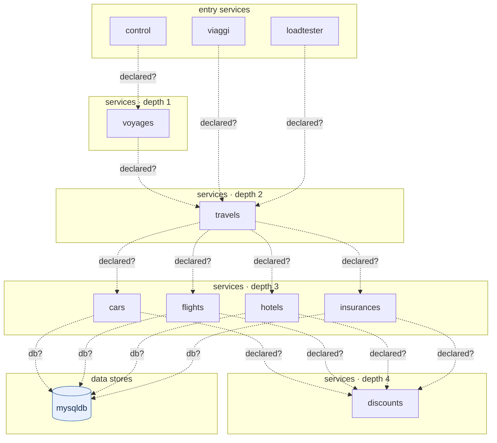

## stacks
- go (LLM, from 10 .go files)   <-- skipped (LLM tier)
- javascript (LLM, from 3 .js/.jsx/.ts/.tsx files)   <-- skipped (LLM tier)

## ledger sections
- k8s-workload = 16
- env-address = 25
- workload-env = 25
- k8s-service = 11
- service-root = 18
- TOTAL = 95 | files with syntax errors = 0

## graph
- after merge: 11 nodes / 16 edges | after normalize: 11 nodes / 16 edges | unresolved code edges = 0
- persistence services: []

## nodes (kind, layer)
- cars  [service, L3]
- control  [service, L0]
- discounts  [service, L4]
- flights  [service, L3]
- hotels  [service, L3]
- insurances  [service, L3]
- loadtester  [service, L0]
- mysqldb  [db, L5]
- travels  [service, L2]
- viaggi  [service, L0]
- voyages  [service, L1]

## edges (type, confidence, provenance ref)
- cars -> discounts  (sync-http, inferred)  code: travel_agency.yaml
- cars -> mysqldb  (db, inferred)  code: travel_agency.yaml
- control -> voyages  (sync-http, inferred)  code: travel_control.yaml
- flights -> discounts  (sync-http, inferred)  code: travel_agency.yaml
- flights -> mysqldb  (db, inferred)  code: travel_agency.yaml
- hotels -> discounts  (sync-http, inferred)  code: travel_agency.yaml
- hotels -> mysqldb  (db, inferred)  code: travel_agency.yaml
- insurances -> discounts  (sync-http, inferred)  code: travel_agency.yaml
- insurances -> mysqldb  (db, inferred)  code: travel_agency.yaml
- loadtester -> travels  (sync-http, inferred)  code: travel_loadtester.yaml
- travels -> cars  (sync-http, inferred)  code: travel_agency.yaml
- travels -> flights  (sync-http, inferred)  code: travel_agency.yaml
- travels -> hotels  (sync-http, inferred)  code: travel_agency.yaml
- travels -> insurances  (sync-http, inferred)  code: travel_agency.yaml
- viaggi -> travels  (sync-http, inferred)  code: travel_portal.yaml
- voyages -> travels  (sync-http, inferred)  code: travel_portal.yaml

## unresolved (source hint / raw target / file:line), first 40

## alias questions (name [origin] seen in | candidates)
- none

## alias answers applied
- none

## mermaid

