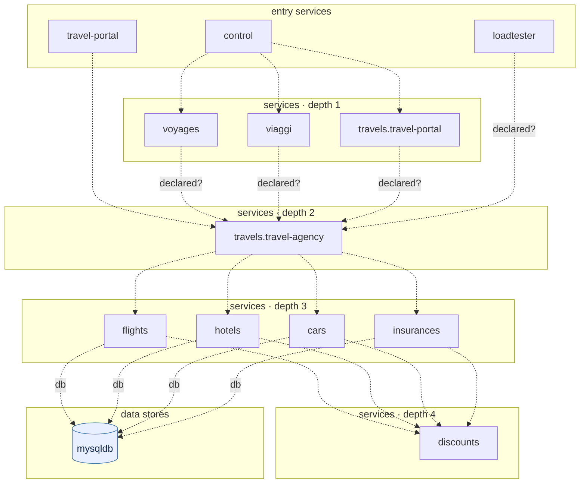

## stacks
- go (GENERIC, from 10 .go files, go.mod; tree-sitter grammar)
- javascript (GENERIC, from 3 .js/.mjs/.cjs/.jsx files; tree-sitter grammar)

## ledger sections
- config = 79
- http-server = 12
- http-client = 18
- persistence = 5
- k8s-namespace = 3
- k8s-workload = 16
- env-address = 27
- workload-env = 27
- k8s-service = 11
- service-root = 18
- module-deps = 8
- TOTAL = 224 | files with syntax errors = 0

## graph
- after merge: 13 nodes / 20 edges | after normalize: 13 nodes / 20 edges | unresolved code edges = 17
- persistence services: [flights, hotels, cars, insurances]

## nodes (kind, layer)
- cars  [service, L3]
- control  [service, L0]
- discounts  [service, L4]
- flights  [service, L3]
- hotels  [service, L3]
- insurances  [service, L3]
- loadtester  [service, L0]
- mysqldb  [db, L5]
- travel-portal  [service, L0]
- travels.travel-agency  [service, L2]
- travels.travel-portal  [service, L1]
- viaggi  [service, L1]
- voyages  [service, L1]

## edges (type, confidence, provenance ref)
- cars -> discounts  (sync-http, documented)  code: travel_agency/cars/cars.go:81
- cars -> mysqldb  (db, documented)  code: travel_agency/cars/cars.go:86
- control -> travels.travel-portal  (sync-http, documented)  code: travel_control/travel_control.go:42
- control -> viaggi  (sync-http, documented)  code: travel_control/travel_control.go:42
- control -> voyages  (sync-http, documented)  code: travel_control/travel_control.go:42
- flights -> discounts  (sync-http, documented)  code: travel_agency/flights/flights.go:82
- flights -> mysqldb  (db, documented)  code: travel_agency/flights/flights.go:87
- hotels -> discounts  (sync-http, documented)  code: travel_agency/hotels/hotels.go:88
- hotels -> mysqldb  (db, documented)  code: travel_agency/hotels/hotels.go:93
- insurances -> discounts  (sync-http, documented)  code: travel_agency/insurances/insurances.go:81
- insurances -> mysqldb  (db, documented)  code: travel_agency/insurances/insurances.go:86
- loadtester -> travels.travel-agency  (sync-http, inferred)  code: travel_loadtester.yaml
- travel-portal -> travels.travel-agency  (sync-http, documented)  code: travel_portal/travel_portal.go:134
- travels.travel-agency -> cars  (sync-http, documented)  code: travel_agency/travels/travels.go:108
- travels.travel-agency -> flights  (sync-http, documented)  code: travel_agency/travels/travels.go:100
- travels.travel-agency -> hotels  (sync-http, documented)  code: travel_agency/travels/travels.go:104
- travels.travel-agency -> insurances  (sync-http, documented)  code: travel_agency/travels/travels.go:112
- travels.travel-portal -> travels.travel-agency  (sync-http, inferred)  code: travel_portal.yaml
- viaggi -> travels.travel-agency  (sync-http, inferred)  code: travel_portal.yaml
- voyages -> travels.travel-agency  (sync-http, inferred)  code: travel_portal.yaml

## unresolved (source hint / raw target / file:line), first 40
- travel-portal  =>  null   @ travel_portal/travel_portal.go:411
- travel-portal  =>  null   @ travel_portal/travel_portal.go:418
- travel-portal  =>  null   @ travel_portal/travel_portal.go:439
- flights  =>  null   @ travel_agency/flights/flights.go:199
- hotels  =>  null   @ travel_agency/hotels/hotels.go:200
- cars  =>  null   @ travel_agency/cars/cars.go:199
- travels.travel-agency  =>  null   @ travel_agency/travels/travels.go:154
- travels.travel-agency  =>  null   @ travel_agency/travels/travels.go:157
- travels.travel-agency  =>  null   @ travel_agency/travels/travels.go:203
- travels.travel-agency  =>  null   @ travel_agency/travels/travels.go:222
- travels.travel-agency  =>  null   @ travel_agency/travels/travels.go:241
- travels.travel-agency  =>  null   @ travel_agency/travels/travels.go:260
- insurances  =>  null   @ travel_agency/insurances/insurances.go:199
- control  =>  null   @ travel_control/travel_control.go:82
- control  =>  null   @ travel_control/travel_control.go:84
- control  =>  null   @ travel_control/travel_control.go:145
- control  =>  null   @ travel_control/travel_control.go:147

## alias questions (name [origin] seen in | candidates)
- travels.travel-portal  [graph]  looks like the same service as `travel-portal` (one name is the other with a prefix or suffix); both stay on the graph until you say   | candidates: travel-portal

## alias answers applied
- none

## mermaid

## 規則觸發
計數＝該規則改變了多少個不同的東西（邊、節點、名稱、檔案；同一個東西重複碰到算一次）；括號內最多列 5 個例子。
- rule 1: 16 (align travel-loadtester=loadtester; align travel-control=control; not-preadded travel-portal; not-preadded mysql; node voyages)
- rule 2: 3 (name travel_loadtester=travel-loadtester; name travel_portal=travel-portal; name travel_control=travel-control)
- rule 3: 0
- rule 4: 0
- rule 5: 1 (not-a-host LISTEN_ADDRESS=:8000)
- rule 6: 0
- rule 7: 0
- rule 8: 0
- rule 9: 0
- rule 10: 0
- rule 11: 0
- rule 12: 0
- rule 13: 0
- rule 14: 15 (edge voyages->travels.travel-agency; edge viaggi->travels.travel-agency; edge travels.travel-portal->travels.travel-agency; edge loadtester->travels.travel-agency; edge cars->discounts)
- rule 15: 0
- rule 16: 0
- rule 17: 0
- rule 18: 0
- rule 19: 10 (version travels=travels.travel-portal; version mysqldb-v1=mysqldb; version cars-v1=cars; version discounts-v1=discounts; version flights-v1=flights)
- rule 20: 12 (scoped DISCOUNTS_SERVICE=discounts @flights; scoped MYSQL_SERVICE=mysqldb @flights; scoped DISCOUNTS_SERVICE=discounts @hotels; scoped MYSQL_SERVICE=mysqldb @hotels; scoped DISCOUNTS_SERVICE=discounts @cars)
- rule 21: 0
- rule 22: 0
- rule 23: 0
- rule 24: 0
- rule 25: 0
- rule 26: 0
- rule 27: 0
- rule 28: 0
- rule 29: 0
- rule 30: 0
- rule 31: 0
- rule 32: 0
- rule 33: 0
- rule 34: 0
- rule 35: 0
- rule 36: 10 (ns-strip travels.travel-agency; ns-strip discounts.travel-agency; ns-strip mysqldb.travel-agency; ns-strip flights.travel-agency; ns-strip hotels.travel-agency)
- rule 37: 0
- rule 38: 0
- rule 39: 0
- rule 40: 0
- rule 41: 0
- rule 42: 0
- rule 43: 0
- rule 44: 1 (k8s-image travels=travels.travel-agency)
- rule 45: 0
- rule 46: 0
- rule 51: 1 (browser travel_control/html/js/d3.v5.min.js:2)
- rule 54: 6 (applied travel_agency.yaml -n travel-agency; applied travel_portal.yaml -n travel-portal; applied travel_control.yaml -n travel-control; qualify travels in [travel-portal, travel-agency]; unplaceable travels-v2)
- rule 55: 4 (list PORTAL_SERVICES voyages; list PORTAL_SERVICES viaggi; list PORTAL_SERVICES travels; read-list PORTAL_SERVICES @control 3)
