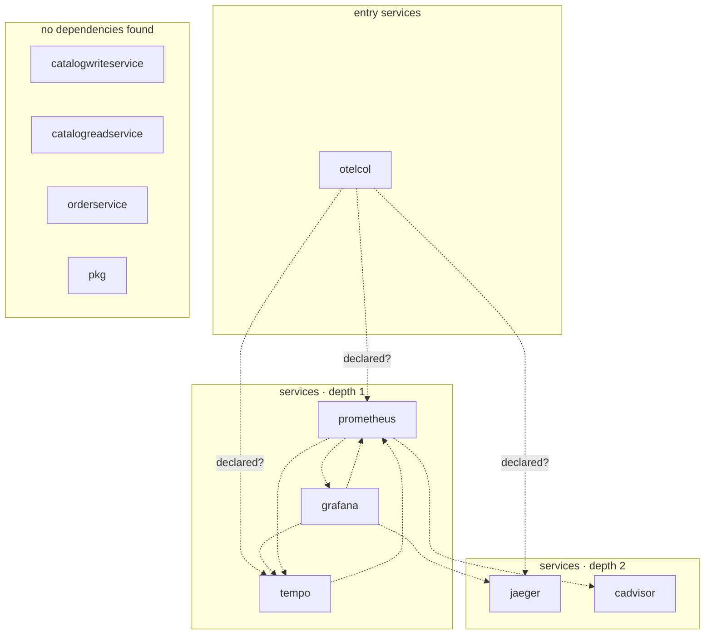

## stacks
- go (GENERIC, from 533 .go files, go.mod; tree-sitter grammar)
- javascript (GENERIC, from 1 .js/.mjs/.cjs/.jsx files, package.json; tree-sitter grammar)

## ledger sections
- http-server = 10
- persistence = 8
- config = 4
- url = 21
- compose-service = 23
- compose-mount = 11
- compose-dependency = 7
- service-root = 4
- module-deps = 4
- TOTAL = 92 | files with syntax errors = 0

## graph
- after merge: 10 nodes / 10 edges | after normalize: 10 nodes / 10 edges | unresolved code edges = 0
- persistence services: [catalogwriteservice, pkg]

## nodes (kind, layer)
- cadvisor  [service, L2]
- catalogreadservice  [service, L3]
- catalogwriteservice  [service, L3]
- grafana  [service, L1]
- jaeger  [service, L2]
- orderservice  [service, L3]
- otelcol  [service, L0]
- pkg  [service, L3]
- prometheus  [service, L1]
- tempo  [service, L1]

## edges (type, confidence, provenance ref)
- grafana -> jaeger  (sync-http, documented)  code: deployments/docker-compose/monitoring/grafana.yaml
- grafana -> prometheus  (sync-http, documented)  code: deployments/docker-compose/docker-compose.infrastructure-collector.yaml#depends_on
- grafana -> tempo  (sync-http, documented)  code: deployments/docker-compose/docker-compose.infrastructure-collector.yaml#depends_on
- otelcol -> jaeger  (sync-http, inferred)  code: deployments/docker-compose/docker-compose.infrastructure-collector.yaml#depends_on
- otelcol -> prometheus  (sync-http, inferred)  code: deployments/docker-compose/docker-compose.infrastructure-collector.yaml#depends_on
- otelcol -> tempo  (sync-http, inferred)  code: deployments/docker-compose/docker-compose.infrastructure-collector.yaml#depends_on
- prometheus -> cadvisor  (sync-http, documented)  code: deployments/docker-compose/monitoring/prometheus.yml
- prometheus -> grafana  (sync-http, documented)  code: deployments/docker-compose/monitoring/prometheus.yml
- prometheus -> tempo  (sync-http, documented)  code: deployments/docker-compose/monitoring/prometheus.yml
- tempo -> prometheus  (sync-http, documented)  code: deployments/docker-compose/otelcollector/tempo.yaml

## unresolved (source hint / raw target / file:line), first 40

## alias questions (name [origin] seen in | candidates)
- none

## alias answers applied
- none

## mermaid

## 規則觸發
計數＝該規則改變了多少個不同的東西（邊、節點、名稱、檔案；同一個東西重複碰到算一次）；括號內最多列 5 個例子。
- rule 1: 0
- rule 2: 0
- rule 3: 0
- rule 4: 0
- rule 5: 1 (not-a-host PROMETHEUS_SERVER_URL=http:${PROMETHEUS_ADDR})
- rule 6: 0
- rule 7: 3 (node prometheus; node tempo; node jaeger)
- rule 8: 0
- rule 9: 0
- rule 10: 13 (drop devcontainer (.devcontainer); drop rabbitmq (deployments/docker-compose); drop cadvisor (deployments/docker-compose); drop prometheus (deployments/docker-compose); drop otelcol (deployments/docker-compose))
- rule 11: 0
- rule 12: 0
- rule 13: 0
- rule 14: 0
- rule 15: 0
- rule 16: 0
- rule 17: 0
- rule 18: 0
- rule 19: 0
- rule 20: 0
- rule 21: 0
- rule 22: 0
- rule 23: 0
- rule 24: 0
- rule 25: 0
- rule 26: 0
- rule 27: 0
- rule 28: 0
- rule 29: 0
- rule 30: 0
- rule 31: 1 (hidden .devcontainer/Dockerfile)
- rule 32: 0
- rule 33: 0
- rule 34: 0
- rule 35: 5 (inferred otelcol->prometheus; inferred otelcol->tempo; inferred otelcol->jaeger; inferred grafana->prometheus; inferred grafana->tempo)
- rule 36: 0
- rule 37: 0
- rule 38: 0
- rule 39: 0
- rule 40: 0
- rule 41: 0
- rule 42: 21 (ignore /internal/services/catalogwriteservice/internal/shared/data/dbcontext/catalogs_dbcontext_test.go/; ignore /internal/services/orderservice/internal/orders/exceptions/domain_exceptions/order_domain_errors_test.go/; ignore /internal/pkg/postgresmessaging/messagepersistence/postgres_message_service_test.go/; ignore /internal/pkg/postgresgorm/repository/gorm_generic_repository_test.go/; ignore /internal/pkg/postgresgorm/gorm_options_test.go/)
- rule 43: 0
- rule 44: 0
- rule 45: 0
- rule 46: 0
- rule 47: 0
- rule 48: 0
- rule 49: 0
- rule 50: 0
- rule 51: 0
- rule 52: 0
- rule 53: 0
- rule 54: 0
- rule 55: 0
- rule 56: 4 (mount deployments/docker-compose/otelcollector/otelcol-observability.yml=otelcol; mount deployments/docker-compose/otelcollector/tempo.yaml=tempo; mount deployments/docker-compose/monitoring/grafana.yaml=grafana; mount deployments/docker-compose/monitoring/prometheus.yml=prometheus)
- rule 57: 0
- rule 58: 0
- rule 59: 0
- rule 60: 8 (mounted deployments/docker-compose/otelcollector/otelcol-observability.yml otelcol; mounted deployments/docker-compose/otelcollector/tempo.yaml prometheus; mounted deployments/docker-compose/monitoring/grafana.yaml prometheus; mounted deployments/docker-compose/monitoring/grafana.yaml jaeger; mounted deployments/docker-compose/monitoring/grafana.yaml tempo)
- rule 61: 0
