## stacks
- go (LLM, from 53 .go files)   <-- skipped (LLM tier)
- python (GENERIC, from .py sources)

## ledger sections
- import = 3
- url = 1
- k8s-service = 58
- k8s-workload = 51
- k8s-namespace = 1
- compose-service = 24
- compose-alias = 11
- compose-dependency = 22
- TOTAL = 171 | files with syntax errors = 0

## graph
- after merge: 23 nodes / 22 edges | after normalize: 23 nodes / 22 edges | unresolved code edges = 1
- persistence services: []

## nodes (kind, layer)
- attractions  [service, L0]
- consul  [service, L1]
- frontend  [service, L0]
- geo  [service, L0]
- memcached-profile  [service, L1]
- memcached-rate  [service, L1]
- memcached-reserve  [service, L1]
- memcached-review  [service, L1]
- mongodb-attractions  [db, L2]
- mongodb-geo  [db, L2]
- mongodb-profile  [db, L2]
- mongodb-rate  [db, L2]
- mongodb-recommendation  [db, L2]
- mongodb-reservation  [db, L2]
- mongodb-review  [db, L2]
- mongodb-user  [db, L2]
- profile  [service, L0]
- rate  [service, L0]
- recommendation  [service, L0]
- reservation  [service, L0]
- review  [service, L0]
- search  [service, L0]
- user  [service, L0]

## edges (type, confidence, provenance ref)
- attractions -> consul  (sync-http, inferred)  code: docker-compose.yml#depends_on
- attractions -> mongodb-attractions  (db, inferred)  code: docker-compose.yml#depends_on
- frontend -> consul  (sync-http, inferred)  code: docker-compose.yml#depends_on
- geo -> consul  (sync-http, inferred)  code: docker-compose.yml#depends_on
- geo -> mongodb-geo  (db, inferred)  code: docker-compose.yml#depends_on
- profile -> consul  (sync-http, inferred)  code: docker-compose.yml#depends_on
- profile -> memcached-profile  (sync-http, inferred)  code: docker-compose.yml#depends_on
- profile -> mongodb-profile  (db, inferred)  code: docker-compose.yml#depends_on
- rate -> consul  (sync-http, inferred)  code: docker-compose.yml#depends_on
- rate -> memcached-rate  (sync-http, inferred)  code: docker-compose.yml#depends_on
- rate -> mongodb-rate  (db, inferred)  code: docker-compose.yml#depends_on
- recommendation -> consul  (sync-http, inferred)  code: docker-compose.yml#depends_on
- recommendation -> mongodb-recommendation  (db, inferred)  code: docker-compose.yml#depends_on
- reservation -> consul  (sync-http, inferred)  code: docker-compose.yml#depends_on
- reservation -> memcached-reserve  (sync-http, inferred)  code: docker-compose.yml#depends_on
- reservation -> mongodb-reservation  (db, inferred)  code: docker-compose.yml#depends_on
- review -> consul  (sync-http, inferred)  code: docker-compose.yml#depends_on
- review -> memcached-review  (sync-http, inferred)  code: docker-compose.yml#depends_on
- review -> mongodb-review  (db, inferred)  code: docker-compose.yml#depends_on
- search -> consul  (sync-http, inferred)  code: docker-compose.yml#depends_on
- user -> consul  (sync-http, inferred)  code: docker-compose.yml#depends_on
- user -> mongodb-user  (db, inferred)  code: docker-compose.yml#depends_on

## unresolved (source hint / raw target / file:line), first 40
- null  =>  http://localhost:5000/review   @ test.py:7

## alias questions (name [origin] seen in | candidates)
- memcached-profile  [graph]  looks like the same service as `profile` (one name is the other with a prefix or suffix); both stay on the graph until you say   | candidates: profile
- memcached-review  [graph]  looks like the same service as `review` (one name is the other with a prefix or suffix); both stay on the graph until you say   | candidates: review

## alias answers applied
- none

## mermaid

```mermaid
flowchart TB
%% DepWeaver — microservice dependency graph
%% solid arrow = observed at runtime (Istio) · dashed = declared in code/doc only
%% node shape: [service] ([gateway]) [(db)] {{queue}} [/external/]
  subgraph layer0 ["entry services"]
    direction LR
    frontend["frontend"]
    profile["profile"]
    search["search"]
    geo["geo"]
    rate["rate"]
    review["review"]
    attractions["attractions"]
    recommendation["recommendation"]
    user["user"]
    reservation["reservation"]
  end
  subgraph layer1 ["services · depth 1"]
    direction LR
    consul["consul"]
    memcached_profile["memcached-profile"]
    memcached_rate["memcached-rate"]
    memcached_review["memcached-review"]
    memcached_reserve["memcached-reserve"]
  end
  subgraph layer2 ["data stores"]
    direction LR
    mongodb_profile[("mongodb-profile")]:::db
    mongodb_geo[("mongodb-geo")]:::db
    mongodb_rate[("mongodb-rate")]:::db
    mongodb_review[("mongodb-review")]:::db
    mongodb_attractions[("mongodb-attractions")]:::db
    mongodb_recommendation[("mongodb-recommendation")]:::db
    mongodb_user[("mongodb-user")]:::db
    mongodb_reservation[("mongodb-reservation")]:::db
  end
  frontend -. declared? .-> consul
  profile -. db? .-> mongodb_profile
  profile -. declared? .-> memcached_profile
  profile -. declared? .-> consul
  search -. declared? .-> consul
  geo -. db? .-> mongodb_geo
  geo -. declared? .-> consul
  rate -. db? .-> mongodb_rate
  rate -. declared? .-> memcached_rate
  rate -. declared? .-> consul
  review -. db? .-> mongodb_review
  review -. declared? .-> memcached_review
  review -. declared? .-> consul
  attractions -. db? .-> mongodb_attractions
  attractions -. declared? .-> consul
  recommendation -. db? .-> mongodb_recommendation
  recommendation -. declared? .-> consul
  user -. db? .-> mongodb_user
  user -. declared? .-> consul
  reservation -. db? .-> mongodb_reservation
  reservation -. declared? .-> memcached_reserve
  reservation -. declared? .-> consul
classDef db fill:#e8f0ff,stroke:#3a6ea5,color:#13294b;

```

