## stacks
- go (GENERIC, from 53 .go files, go.mod; tree-sitter grammar)
- python (GENERIC, from .py sources)

## ledger sections
- persistence = 8
- config = 6
- grpc = 1
- url = 27
- registry-name = 10
- http-server = 9
- registry-ref = 11
- http-client = 3
- import = 3
- k8s-service = 58
- k8s-workload = 51
- k8s-namespace = 1
- compose-service = 24
- compose-alias = 11
- compose-dependency = 22
- compose-port = 11
- TOTAL = 256 | files with syntax errors = 0

## graph
- after merge: 23 nodes / 31 edges | after normalize: 23 nodes / 31 edges | unresolved code edges = 6
- persistence services: [recommendation, attractions, rate, geo, reservation, user, profile, review]

## nodes (kind, layer)
- attractions  [service, L1]
- consul  [service, L3]
- frontend  [service, L0]
- geo  [service, L2]
- memcached-profile  [service, L2]
- memcached-rate  [service, L3]
- memcached-reserve  [service, L2]
- memcached-review  [service, L2]
- mongodb-attractions  [db, L4]
- mongodb-geo  [db, L4]
- mongodb-profile  [db, L4]
- mongodb-rate  [db, L4]
- mongodb-recommendation  [db, L4]
- mongodb-reservation  [db, L4]
- mongodb-review  [db, L4]
- mongodb-user  [db, L4]
- profile  [service, L1]
- rate  [service, L2]
- recommendation  [service, L1]
- reservation  [service, L1]
- review  [service, L1]
- search  [service, L1]
- user  [service, L1]

## edges (type, confidence, provenance ref)
- attractions -> consul  (sync-http, inferred)  code: docker-compose.yml#depends_on
- attractions -> mongodb-attractions  (db, documented)  code: docker-compose.yml#depends_on
- frontend -> attractions  (sync-http, documented)  code: services/frontend/server.go:88
- frontend -> consul  (sync-http, inferred)  code: docker-compose.yml#depends_on
- frontend -> profile  (sync-http, documented)  code: services/frontend/server.go:68
- frontend -> recommendation  (sync-http, documented)  code: services/frontend/server.go:72
- frontend -> reservation  (sync-http, documented)  code: services/frontend/server.go:80
- frontend -> review  (sync-http, documented)  code: services/frontend/server.go:84
- frontend -> search  (sync-http, documented)  code: services/frontend/server.go:64
- frontend -> user  (sync-http, documented)  code: services/frontend/server.go:76
- geo -> consul  (sync-http, inferred)  code: docker-compose.yml#depends_on
- geo -> mongodb-geo  (db, documented)  code: docker-compose.yml#depends_on
- profile -> consul  (sync-http, inferred)  code: docker-compose.yml#depends_on
- profile -> memcached-profile  (sync-http, inferred)  code: docker-compose.yml#depends_on
- profile -> mongodb-profile  (db, documented)  code: docker-compose.yml#depends_on
- rate -> consul  (sync-http, inferred)  code: docker-compose.yml#depends_on
- rate -> memcached-rate  (sync-http, inferred)  code: docker-compose.yml#depends_on
- rate -> mongodb-rate  (db, documented)  code: docker-compose.yml#depends_on
- recommendation -> consul  (sync-http, inferred)  code: docker-compose.yml#depends_on
- recommendation -> mongodb-recommendation  (db, documented)  code: docker-compose.yml#depends_on
- reservation -> consul  (sync-http, inferred)  code: docker-compose.yml#depends_on
- reservation -> memcached-reserve  (sync-http, inferred)  code: docker-compose.yml#depends_on
- reservation -> mongodb-reservation  (db, documented)  code: docker-compose.yml#depends_on
- review -> consul  (sync-http, inferred)  code: docker-compose.yml#depends_on
- review -> memcached-review  (sync-http, inferred)  code: docker-compose.yml#depends_on
- review -> mongodb-review  (db, documented)  code: docker-compose.yml#depends_on
- search -> consul  (sync-http, inferred)  code: docker-compose.yml#depends_on
- search -> geo  (sync-http, documented)  code: services/search/server.go:70
- search -> rate  (sync-http, documented)  code: services/search/server.go:73
- user -> consul  (sync-http, inferred)  code: docker-compose.yml#depends_on
- user -> mongodb-user  (db, documented)  code: docker-compose.yml#depends_on

## unresolved (source hint / raw target / file:line), first 40
- dialer  =>  null   @ dialer/dialer.go:55
- registry  =>  null   @ registry/registry.go:89
- reservation  =>  null   @ services/reservation/server.go:123
- reservation  =>  null   @ services/reservation/server.go:158
- review  =>  null   @ services/review/server.go:121
- null  =>  http://localhost:5000/review   @ test.py:7

## alias questions (name [origin] seen in | candidates)
- memcached-profile  [graph]  looks like the same service as `profile` (one name is the other with a prefix or suffix); both stay on the graph until you say   | candidates: profile
- memcached-review  [graph]  looks like the same service as `review` (one name is the other with a prefix or suffix); both stay on the graph until you say   | candidates: review
- dialer  [code]  the module directory of grpc at dialer/dialer.go:55 — no service on the graph has this name   | candidates: -
- registry  [code]  the module directory of url at registry/registry.go:89 — no service on the graph has this name   | candidates: -

## alias answers applied
- none

## mermaid

```mermaid
flowchart TB
%% DepWeaver — microservice dependency graph
%% solid arrow = observed at runtime (Istio) · dashed = declared in code/doc only
%% node shape: [service] ([gateway]) [(db)] {{queue}} [/external/]
  subgraph layer0 ["entry services"]
    direction LR
    frontend["frontend"]
  end
  subgraph layer1 ["services · depth 1"]
    direction LR
    review["review"]
    attractions["attractions"]
    search["search"]
    profile["profile"]
    recommendation["recommendation"]
    user["user"]
    reservation["reservation"]
  end
  subgraph layer2 ["services · depth 2"]
    direction LR
    geo["geo"]
    rate["rate"]
    memcached_profile["memcached-profile"]
    memcached_review["memcached-review"]
    memcached_reserve["memcached-reserve"]
  end
  subgraph layer3 ["services · depth 3"]
    direction LR
    consul["consul"]
    memcached_rate["memcached-rate"]
  end
  subgraph layer4 ["data stores"]
    direction LR
    mongodb_profile[("mongodb-profile")]:::db
    mongodb_geo[("mongodb-geo")]:::db
    mongodb_rate[("mongodb-rate")]:::db
    mongodb_review[("mongodb-review")]:::db
    mongodb_attractions[("mongodb-attractions")]:::db
    mongodb_recommendation[("mongodb-recommendation")]:::db
    mongodb_user[("mongodb-user")]:::db
    mongodb_reservation[("mongodb-reservation")]:::db
  end
  frontend -.-> review
  frontend -.-> attractions
  frontend -.-> search
  frontend -.-> profile
  frontend -.-> recommendation
  frontend -.-> user
  frontend -.-> reservation
  search -.-> geo
  search -.-> rate
  frontend -. declared? .-> consul
  profile -. db .-> mongodb_profile
  profile -. declared? .-> memcached_profile
  profile -. declared? .-> consul
  search -. declared? .-> consul
  geo -. db .-> mongodb_geo
  geo -. declared? .-> consul
  rate -. db .-> mongodb_rate
  rate -. declared? .-> memcached_rate
  rate -. declared? .-> consul
  review -. db .-> mongodb_review
  review -. declared? .-> memcached_review
  review -. declared? .-> consul
  attractions -. db .-> mongodb_attractions
  attractions -. declared? .-> consul
  recommendation -. db .-> mongodb_recommendation
  recommendation -. declared? .-> consul
  user -. db .-> mongodb_user
  user -. declared? .-> consul
  reservation -. db .-> mongodb_reservation
  reservation -. declared? .-> memcached_reserve
  reservation -. declared? .-> consul
classDef db fill:#e8f0ff,stroke:#3a6ea5,color:#13294b;

```

## 規則觸發
計數＝該規則改變了多少個不同的東西（邊、節點、名稱、檔案；同一個東西重複碰到算一次）；括號內最多列 5 個例子。
- rule 1: 0
- rule 2: 0
- rule 3: 0
- rule 4: 0
- rule 5: 0
- rule 6: 0
- rule 7: 13 (node consul; node mongodb-profile; node memcached-profile; node mongodb-geo; node mongodb-rate)
- rule 8: 0
- rule 9: 0
- rule 10: 51 (drop mongodb-profile (knative); drop mongodb-user (knative); drop jaeger (knative); drop mongodb-recommendation (knative); drop memcached-profile (knative))
- rule 11: 1 (k8s-over-compose 24 compose names ignored)
- rule 12: 0
- rule 13: 0
- rule 14: 0
- rule 15: 0
- rule 16: 0
- rule 17: 0
- rule 18: 0
- rule 19: 0
- rule 20: 0
- rule 21: 0
- rule 22: 0
- rule 23: 0
- rule 24: 0
- rule 25: 0
- rule 26: 0
- rule 27: 0
- rule 28: 0
- rule 29: 0
- rule 30: 0
- rule 31: 1 (hidden .bingo/go.mod)
- rule 32: 0
- rule 33: 0
- rule 34: 0
- rule 35: 22 (inferred frontend->consul; inferred profile->mongodb-profile; inferred profile->memcached-profile; inferred profile->consul; inferred search->consul)
- rule 36: 11 (cluster-suffix consul.hotel-res.svc.cluster.local; cluster-suffix jaeger.hotel-res.svc.cluster.local; cluster-suffix mongodb-geo.hotel-res.svc.cluster.local; cluster-suffix mongodb-profile.hotel-res.svc.cluster.local; cluster-suffix memcached-profile.hotel-res.svc.cluster.local)
- rule 37: 11 (hostname user-memcached=memcached-rate; hostname user-memcached=memcached-profile; hostname user-memcached=memcached-reserve; hostname geo-db=mongodb-geo; hostname profile-db=mongodb-profile)
- rule 38: 0
- rule 39: 0
- rule 40: 0
- rule 41: 0
- rule 42: 0
- rule 43: 0
- rule 44: 18 (dir cmd/recommendation/db.go=recommendation; dir cmd/attractions/db.go=attractions; dir cmd/rate/db.go=rate; dir cmd/geo/db.go=geo; dir cmd/reservation/db.go=reservation)
- rule 45: 0
- rule 46: 0
- rule 47: 9 (nameref services/recommendation/server.go:77 name; nameref services/attractions/server.go:96 name; nameref services/rate/server.go:78 name; nameref services/geo/server.go:81 name; nameref services/reservation/server.go:79 name)
- rule 48: 0
- rule 49: 9 (registered frontend => srv-review = review; registered frontend => srv-attractions = attractions; registered frontend => srv-search = search; registered frontend => srv-profile = profile; registered frontend => srv-recommendation = recommendation)
- rule 50: 0
- rule 51: 0
- rule 52: 58 (render helm-chart/hotelreservation/charts/consul/templates/deployment.yaml; render helm-chart/hotelreservation/charts/consul/templates/service.yaml; render helm-chart/hotelreservation/charts/frontend/templates/configmap.yaml; render helm-chart/hotelreservation/charts/frontend/templates/deployment.yaml; render helm-chart/hotelreservation/charts/frontend/templates/service.yaml)
- rule 53: 0
- rule 54: 0
- rule 55: 0
- rule 56: 0
- rule 57: 0
- rule 58: 0
- rule 59: 0
- rule 60: 0
- rule 61: 0
