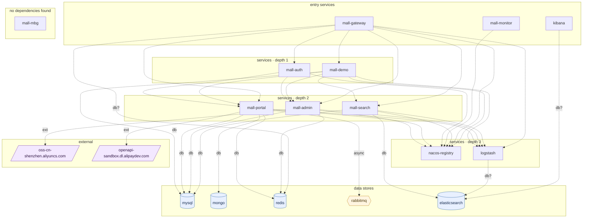

## stacks
- java/spring (FRAMEWORK, from pom.xml)

## ledger sections
- name-constant = 12
- url-metadata = 10
- url = 12
- jpa = 4
- config = 202
- http-server = 200
- name-ref = 34
- rabbit-consume = 1
- feign = 5
- compose-service = 15
- compose-alias = 7
- compose-dependency = 16
- env-address = 1
- workload-env = 1
- k8s-namespace = 1
- k8s-service = 6
- k8s-workload = 6
- service-root = 9
- module-deps = 9
- TOTAL = 551 | files with syntax errors = 0

## graph
- after merge: 18 nodes / 36 edges | after normalize: 18 nodes / 36 edges | unresolved code edges = 7
- persistence services: [mall-admin, mall-portal, mall-demo, mall-search]

## nodes (kind, layer)
- elasticsearch  [db, L4]
- kibana  [service, L0]
- logstash  [service, L3]
- mall-admin  [service, L2]
- mall-auth  [service, L1]
- mall-demo  [service, L1]
- mall-gateway  [service, L0]
- mall-mbg  [service, L6]
- mall-monitor  [service, L0]
- mall-portal  [service, L2]
- mall-search  [service, L2]
- mongo  [db, L4]
- mysql  [db, L4]
- nacos-registry  [service, L3]
- openapi-sandbox.dl.alipaydev.com  [external, L5]
- oss-cn-shenzhen.aliyuncs.com  [external, L5]
- rabbitmq  [queue, L4]
- redis  [db, L4]

## edges (type, confidence, provenance ref)
- kibana -> elasticsearch  (db, inferred)  code: document/docker/docker-compose-env.yml
- logstash -> elasticsearch  (db, inferred)  code: document/docker/docker-compose-env.yml#depends_on
- mall-admin -> logstash  (sync-http, documented)  code: config/admin/mall-admin-prod.yaml
- mall-admin -> mysql  (db, documented)  code: config/admin/mall-admin-prod.yaml
- mall-admin -> nacos-registry  (sync-http, documented)  code: mall-admin/src/main/resources/application-prod.yml
- mall-admin -> oss-cn-shenzhen.aliyuncs.com  (external, documented)  code: mall-admin/src/main/resources/application.yml
- mall-admin -> redis  (db, documented)  code: config/admin/mall-admin-prod.yaml
- mall-auth -> mall-admin  (sync-http, documented)  code: mall-auth/src/main/java/com/macro/mall/auth/service/UmsAdminService.java:16
- mall-auth -> mall-portal  (sync-http, documented)  code: mall-auth/src/main/java/com/macro/mall/auth/service/UmsMemberService.java:14
- mall-auth -> nacos-registry  (sync-http, documented)  code: mall-auth/src/main/resources/application-prod.yml
- mall-demo -> logstash  (sync-http, documented)  code: config/demo/mall-demo-prod.yaml
- mall-demo -> mall-admin  (sync-http, documented)  code: mall-demo/src/main/java/com/macro/mall/demo/service/FeignAdminService.java:13
- mall-demo -> mall-portal  (sync-http, documented)  code: mall-demo/src/main/java/com/macro/mall/demo/service/FeignPortalService.java:12
- mall-demo -> mall-search  (sync-http, documented)  code: mall-demo/src/main/java/com/macro/mall/demo/service/FeignSearchService.java:11
- mall-demo -> mysql  (db, documented)  code: config/demo/mall-demo-prod.yaml
- mall-demo -> nacos-registry  (sync-http, documented)  code: mall-demo/src/main/resources/application-prod.yml
- mall-gateway -> logstash  (sync-http, documented)  code: config/gateway/mall-gateway-prod.yaml
- mall-gateway -> mall-admin  (sync-http, documented)  code: mall-gateway/src/main/resources/application.yml
- mall-gateway -> mall-auth  (sync-http, documented)  code: mall-gateway/src/main/resources/application.yml
- mall-gateway -> mall-demo  (sync-http, documented)  code: mall-gateway/src/main/resources/application.yml
- mall-gateway -> mall-portal  (sync-http, documented)  code: mall-gateway/src/main/resources/application.yml
- mall-gateway -> mall-search  (sync-http, documented)  code: mall-gateway/src/main/resources/application.yml
- mall-gateway -> nacos-registry  (sync-http, documented)  code: document/docker/docker-compose-app.yml#depends_on
- mall-gateway -> redis  (db, inferred)  code: config/gateway/mall-gateway-prod.yaml
- mall-monitor -> nacos-registry  (sync-http, documented)  code: mall-monitor/src/main/resources/application-prod.yml
- mall-portal -> logstash  (sync-http, documented)  code: config/portal/mall-portal-prod.yaml
- mall-portal -> mongo  (db, documented)  code: config/portal/mall-portal-prod.yaml
- mall-portal -> mysql  (db, documented)  code: config/portal/mall-portal-prod.yaml
- mall-portal -> nacos-registry  (sync-http, documented)  code: mall-portal/src/main/resources/application-prod.yml
- mall-portal -> openapi-sandbox.dl.alipaydev.com  (external, documented)  code: config/portal/mall-portal-prod.yaml
- mall-portal -> rabbitmq  (async, documented)  code: config/portal/mall-portal-prod.yaml
- mall-portal -> redis  (db, documented)  code: config/portal/mall-portal-prod.yaml
- mall-search -> elasticsearch  (db, documented)  code: config/search/mall-search-prod.yaml
- mall-search -> logstash  (sync-http, documented)  code: config/search/mall-search-prod.yaml
- mall-search -> mysql  (db, documented)  code: config/search/mall-search-prod.yaml
- mall-search -> nacos-registry  (sync-http, documented)  code: document/docker/docker-compose-app.yml#depends_on

## unresolved (source hint / raw target / file:line), first 40
- mall-admin  =>  http://   @ mall-admin/src/main/java/com/macro/mall/service/impl/OssServiceImpl.java:66
- mall-admin  =>  http://   @ mall-admin/src/main/java/com/macro/mall/service/impl/OssServiceImpl.java:93
- mall-admin  =>  http://39.98.190.128:8080/aliyun/oss/callback   @ mall-admin/src/main/resources/application.yml:-1
- mall-portal  =>  http://192.168.3.101:8060/#/pages/money/paySuccess   @ config/portal/mall-portal-prod.yaml:-1
- mall-admin  =>  http://39.98.190.128:8080/aliyun/oss/callback   @ config/admin/mall-admin-dev.yaml:-1
- mall-admin  =>  http://39.98.190.128:8080/aliyun/oss/callback   @ config/admin/mall-admin-prod.yaml:-1
- mall-admin  =>  http://192.168.3.101:9090   @ config/admin/mall-admin-prod.yaml:-1

## alias questions (name [origin] seen in | candidates)
- none

## alias answers applied
- none

## mermaid

