## stacks
- javascript (LLM, from 151 .js/.jsx/.ts/.tsx files)   <-- skipped (LLM tier)
- python/web (FRAMEWORK, from requirements.txt)
- go (LLM, from 15 .go files)   <-- skipped (LLM tier)
- csharp (LLM, from 12 .cs files)   <-- skipped (LLM tier)
- java/spring (FRAMEWORK, from build.gradle)
- rust (LLM, from 7 .rs files)   <-- skipped (LLM tier)
- php (LLM, from 6 .php files)   <-- skipped (LLM tier)
- ruby (LLM, from 1 .rb files)   <-- skipped (LLM tier)

## ledger sections
- url = 15
- config = 75
- http-client = 1
- compose-service = 42
- compose-dependency = 70
- env-address = 1
- workload-env = 1
- service-root = 30
- TOTAL = 235 | files with syntax errors = 0

## graph
- after merge: 35 nodes / 71 edges | after normalize: 35 nodes / 71 edges | unresolved code edges = 39
- persistence services: []

## nodes (kind, layer)
- accounting  [service, L0]
- ad  [service, L5]
- agent  [service, L2]
- astronomy-db  [db, L9]
- cart  [service, L6]
- chatbot  [service, L1]
- checkout  [service, L5]
- currency  [service, L6]
- email  [service, L6]
- firepit  [service, L10]
- flagd  [service, L7]
- flagd-ui  [service, L1]
- fraud-detection  [service, L0]
- frontend  [service, L4]
- frontend-proxy  [service, L0]
- frontendtests  [service, L0]
- grafana  [service, L1]
- image-provider  [service, L5]
- jaeger  [service, L8]
- kafka  [queue, L9]
- load-generator  [service, L1]
- mcp  [service, L3]
- opamp-server  [service, L8]
- opensearch  [service, L8]
- otel-collector  [service, L7]
- otel-ebpf-profiler  [service, L0]
- payment  [service, L6]
- product-catalog  [service, L6]
- prometheus  [service, L10]
- quote  [service, L5]
- recommendation  [service, L5]
- shipping  [service, L6]
- telemetry-docs  [service, L1]
- valkey-cart  [service, L7]
- vcr  [service, L3]

## edges (type, confidence, provenance ref)
- accounting -> kafka  (async, documented)  code: compose.full.yaml
- accounting -> otel-collector  (sync-http, documented)  code: compose.full.yaml
- ad -> flagd  (sync-http, documented)  code: compose.yaml
- ad -> otel-collector  (sync-http, documented)  code: compose.yaml
- agent -> flagd  (sync-http, documented)  code: compose.agent.yaml
- agent -> mcp  (sync-http, documented)  code: compose.agent.yaml
- agent -> otel-collector  (sync-http, documented)  code: compose.agent.yaml
- agent -> product-catalog  (sync-http, documented)  code: compose.agent.yaml
- agent -> vcr  (sync-http, documented)  code: src/agent/src/agents/patch_vcr.py:47
- cart -> flagd  (sync-http, documented)  code: compose.yaml
- cart -> opamp-server  (sync-http, documented)  code: compose.observability.yaml
- cart -> otel-collector  (sync-http, documented)  code: compose.yaml
- cart -> valkey-cart  (sync-http, documented)  code: compose.yaml
- chatbot -> agent  (sync-http, documented)  code: compose.agent.yaml
- chatbot -> opamp-server  (sync-http, documented)  code: compose.agent.yaml
- checkout -> cart  (sync-http, documented)  code: compose.yaml
- checkout -> currency  (sync-http, documented)  code: compose.yaml
- checkout -> email  (sync-http, documented)  code: compose.yaml
- checkout -> flagd  (sync-http, documented)  code: compose.yaml
- checkout -> kafka  (async, documented)  code: compose.full.yaml
- checkout -> otel-collector  (sync-http, documented)  code: compose.yaml
- checkout -> payment  (sync-http, documented)  code: compose.yaml
- checkout -> product-catalog  (sync-http, documented)  code: compose.yaml
- checkout -> shipping  (sync-http, documented)  code: compose.yaml
- currency -> otel-collector  (sync-http, documented)  code: compose.yaml
- email -> otel-collector  (sync-http, documented)  code: compose.yaml
- flagd-ui -> flagd  (sync-http, documented)  code: compose.yaml
- flagd-ui -> otel-collector  (sync-http, documented)  code: compose.yaml
- fraud-detection -> kafka  (async, documented)  code: compose.full.yaml
- fraud-detection -> otel-collector  (sync-http, documented)  code: compose.full.yaml
- frontend -> ad  (sync-http, documented)  code: compose.yaml
- frontend -> cart  (sync-http, documented)  code: compose.yaml
- frontend -> checkout  (sync-http, documented)  code: compose.yaml
- frontend -> currency  (sync-http, documented)  code: compose.yaml
- frontend -> flagd  (sync-http, documented)  code: compose.yaml
- frontend -> image-provider  (sync-http, documented)  code: compose.yaml
- frontend -> otel-collector  (sync-http, documented)  code: compose.yaml
- frontend -> product-catalog  (sync-http, documented)  code: compose.yaml
- frontend -> quote  (sync-http, documented)  code: compose.yaml
- frontend -> recommendation  (sync-http, documented)  code: compose.yaml
- frontend -> shipping  (sync-http, documented)  code: compose.yaml
- frontend-proxy -> chatbot  (sync-http, documented)  code: compose.agent.yaml
- frontend-proxy -> flagd-ui  (sync-http, documented)  code: compose.yaml
- frontend-proxy -> frontend  (sync-http, documented)  code: compose.yaml
- frontend-proxy -> grafana  (sync-http, documented)  code: compose.observability.yaml
- frontend-proxy -> jaeger  (sync-http, documented)  code: compose.observability.yaml
- frontend-proxy -> load-generator  (sync-http, documented)  code: compose.yaml
- frontend-proxy -> opamp-server  (sync-http, documented)  code: compose.observability.yaml
- frontend-proxy -> telemetry-docs  (sync-http, documented)  code: compose.yaml
- frontendtests -> frontend  (sync-http, documented)  code: compose.tests.yaml
- image-provider -> otel-collector  (sync-http, documented)  code: compose.yaml
- load-generator -> agent  (sync-http, documented)  code: compose.agent.yaml
- load-generator -> flagd  (sync-http, documented)  code: compose.yaml
- load-generator -> frontend  (sync-http, documented)  code: compose.yaml
- mcp -> frontend  (sync-http, documented)  code: compose.agent.yaml
- otel-collector -> jaeger  (sync-http, documented)  code: compose.observability.yaml
- otel-collector -> opamp-server  (sync-http, documented)  code: compose.observability.yaml
- otel-collector -> opensearch  (sync-http, documented)  code: compose.observability.yaml
- otel-ebpf-profiler -> otel-collector  (sync-http, documented)  code: compose.profiling.yaml
- payment -> flagd  (sync-http, documented)  code: compose.yaml
- payment -> otel-collector  (sync-http, documented)  code: compose.yaml
- product-catalog -> astronomy-db  (db, documented)  code: compose.yaml
- product-catalog -> flagd  (sync-http, documented)  code: compose.yaml
- product-catalog -> opamp-server  (sync-http, documented)  code: compose.observability.yaml
- product-catalog -> otel-collector  (sync-http, documented)  code: compose.yaml
- quote -> otel-collector  (sync-http, documented)  code: compose.yaml
- recommendation -> flagd  (sync-http, documented)  code: compose.yaml
- recommendation -> otel-collector  (sync-http, documented)  code: compose.yaml
- recommendation -> product-catalog  (sync-http, documented)  code: compose.yaml
- shipping -> flagd  (sync-http, documented)  code: compose.yaml
- shipping -> otel-collector  (sync-http, documented)  code: compose.yaml

## unresolved (source hint / raw target / file:line), first 40
- load-generator  =>  http://   @ src/load-generator/locustfile.py:95
- load-generator  =>  http://   @ src/load-generator/locustfile.py:245
- chatbot  =>  http://   @ src/chatbot/src/chat_interface/chat_interface.py:151
- agent  =>  http://   @ src/agent/src/agents/agents.py:45
- null  =>  DELETE   @ src/shared/tools.py:93
- null  =>  http://   @ src/shared/tools.py:42
- null  =>  http://   @ src/shared/tools.py:56
- null  =>  http://   @ src/shared/tools.py:76
- null  =>  http://   @ src/shared/tools.py:89
- null  =>  http://   @ src/shared/tools.py:105
- null  =>  http://   @ src/shared/tools.py:118
- null  =>  http://   @ src/shared/tools.py:135
- null  =>  http://   @ src/shared/tools.py:156
- null  =>  http://   @ src/shared/tools.py:169
- null  =>  http://   @ src/shared/tools.py:187
- null  =>  otel-collector   @ .env:-1
- null  =>  http://${OTEL_COLLECTOR_HOST}:${OTEL_COLLECTOR_PORT_GRPC}   @ .env:-1
- null  =>  http://localhost:8080/otlp-http/v1/traces   @ .env:-1
- null  =>  http://email:${EMAIL_PORT}   @ .env:-1
- null  =>  frontend   @ .env:-1
- null  =>  image-provider   @ .env:-1
- null  =>  http://frontend-proxy   @ .env:-1
- null  =>  load-generator   @ .env:-1
- null  =>  http://quote:${QUOTE_PORT}   @ .env:-1
- null  =>  http://shipping:${SHIPPING_PORT}   @ .env:-1
- null  =>  flagd   @ .env:-1
- null  =>  flagd-ui   @ .env:-1
- null  =>  kafka   @ .env:-1
- null  =>  astronomy-db   @ .env:-1
- null  =>  grafana   @ .env:-1
- null  =>  jaeger   @ .env:-1
- null  =>  opensearch   @ .env:-1
- null  =>  prometheus   @ .env:-1
- null  =>  chatbot   @ .env:-1
- null  =>  https://local-llm.com   @ .env:-1
- null  =>  http://${OTEL_COLLECTOR_HOST}:${OTEL_COLLECTOR_PORT_HTTP}   @ .env:-1
- null  =>  opamp-server   @ .env:-1
- null  =>  firepit   @ .env:-1
- null  =>  telemetry-docs   @ .env:-1

## alias questions (name [origin] seen in | candidates)
- frontend-proxy  [graph]  looks like the same service as `frontend` (one name is the other with a prefix or suffix); both stay on the graph until you say   | candidates: frontend
- frontendtests  [graph]  looks like the same service as `frontend` (one name is the other with a prefix or suffix); both stay on the graph until you say   | candidates: frontend
- DELETE  [code]  http-client at src/shared/tools.py:93   | candidates: -
- otel-collector  [code]  config at .env   | candidates: -
- frontend  [code]  config at .env   | candidates: frontendtests, frontend-proxy
- image-provider  [code]  config at .env   | candidates: -
- load-generator  [code]  config at .env   | candidates: ad
- flagd  [code]  config at .env   | candidates: flagd-ui
- flagd-ui  [code]  config at .env   | candidates: flagd
- kafka  [code]  config at .env   | candidates: -
- astronomy-db  [code]  config at .env   | candidates: -
- grafana  [code]  config at .env   | candidates: -
- jaeger  [code]  config at .env   | candidates: -
- opensearch  [code]  config at .env   | candidates: -
- prometheus  [code]  config at .env   | candidates: -
- chatbot  [code]  config at .env   | candidates: -
- opamp-server  [code]  config at .env   | candidates: -
- firepit  [code]  config at .env   | candidates: -
- telemetry-docs  [code]  config at .env   | candidates: -

## alias answers applied
- none

## mermaid

```mermaid
flowchart TB
%% DepWeaver — microservice dependency graph
%% solid arrow = observed at runtime (Istio) · dashed = declared in code/doc only
%% node shape: [service] ([gateway]) [(db)] {{queue}} [/external/]
  subgraph layer0 ["entry services"]
    direction LR
    otel_ebpf_profiler["otel-ebpf-profiler"]
    frontend_proxy["frontend-proxy"]
    frontendtests["frontendtests"]
    accounting["accounting"]
    fraud_detection["fraud-detection"]
  end
  subgraph layer1 ["services · depth 1"]
    direction LR
    load_generator["load-generator"]
    flagd_ui["flagd-ui"]
    telemetry_docs["telemetry-docs"]
    grafana["grafana"]
    chatbot["chatbot"]
  end
  subgraph layer2 ["services · depth 2"]
    direction LR
    agent["agent"]
  end
  subgraph layer3 ["services · depth 3"]
    direction LR
    mcp["mcp"]
    vcr["vcr"]
  end
  subgraph layer4 ["services · depth 4"]
    direction LR
    frontend["frontend"]
  end
  subgraph layer5 ["services · depth 5"]
    direction LR
    ad["ad"]
    checkout["checkout"]
    image_provider["image-provider"]
    quote["quote"]
    recommendation["recommendation"]
  end
  subgraph layer6 ["services · depth 6"]
    direction LR
    cart["cart"]
    currency["currency"]
    email["email"]
    payment["payment"]
    product_catalog["product-catalog"]
    shipping["shipping"]
  end
  subgraph layer7 ["services · depth 7"]
    direction LR
    flagd["flagd"]
    valkey_cart["valkey-cart"]
    otel_collector["otel-collector"]
  end
  subgraph layer8 ["services · depth 8"]
    direction LR
    jaeger["jaeger"]
    opensearch["opensearch"]
    opamp_server["opamp-server"]
  end
  subgraph layer9 ["data stores"]
    direction LR
    astronomy_db[("astronomy-db")]:::db
    kafka{{"kafka"}}:::queue
  end
  subgraph layer10 ["no dependencies found"]
    direction LR
    firepit["firepit"]
    prometheus["prometheus"]
  end
  agent -.-> vcr
  otel_ebpf_profiler -.-> otel_collector
  ad -.-> otel_collector
  ad -.-> flagd
  cart -.-> valkey_cart
  cart -.-> otel_collector
  cart -.-> flagd
  checkout -.-> cart
  checkout -.-> currency
  checkout -.-> email
  checkout -.-> payment
  checkout -.-> product_catalog
  checkout -.-> shipping
  checkout -.-> otel_collector
  checkout -.-> flagd
  currency -.-> otel_collector
  email -.-> otel_collector
  frontend -.-> ad
  frontend -.-> cart
  frontend -.-> checkout
  frontend -.-> currency
  frontend -.-> product_catalog
  frontend -.-> quote
  frontend -.-> recommendation
  frontend -.-> shipping
  frontend -.-> otel_collector
  frontend -.-> image_provider
  frontend -.-> flagd
  frontend_proxy -.-> frontend
  frontend_proxy -.-> load_generator
  frontend_proxy -.-> flagd_ui
  frontend_proxy -.-> telemetry_docs
  image_provider -.-> otel_collector
  load_generator -.-> frontend
  load_generator -.-> flagd
  payment -.-> otel_collector
  payment -.-> flagd
  product_catalog -.-> otel_collector
  product_catalog -.-> flagd
  product_catalog -. db .-> astronomy_db
  quote -.-> otel_collector
  recommendation -.-> product_catalog
  recommendation -.-> otel_collector
  recommendation -.-> flagd
  shipping -.-> otel_collector
  shipping -.-> flagd
  flagd_ui -.-> otel_collector
  flagd_ui -.-> flagd
  frontendtests -.-> frontend
  frontend_proxy -.-> jaeger
  frontend_proxy -.-> grafana
  frontend_proxy -.-> opamp_server
  otel_collector -.-> jaeger
  otel_collector -.-> opensearch
  otel_collector -.-> opamp_server
  cart -.-> opamp_server
  product_catalog -.-> opamp_server
  agent -.-> otel_collector
  agent -.-> product_catalog
  agent -.-> mcp
  agent -.-> flagd
  mcp -.-> frontend
  chatbot -.-> agent
  chatbot -.-> opamp_server
  frontend_proxy -.-> chatbot
  load_generator -.-> agent
  accounting -.-> otel_collector
  accounting -. async .-> kafka
  fraud_detection -.-> otel_collector
  fraud_detection -. async .-> kafka
  checkout -. async .-> kafka
classDef db fill:#e8f0ff,stroke:#3a6ea5,color:#13294b;
classDef queue fill:#fff5e0,stroke:#c08a1e,color:#4a370a;

```

