## stacks
- typescript (GENERIC, from 137 .ts/.tsx/.mts/.cts files, package.json; tree-sitter grammar)
- python/web (FRAMEWORK, from requirements.txt)
- csharp (GENERIC, from 12 .cs files; tree-sitter grammar)
- go (GENERIC, from 12 .go files, go.mod; tree-sitter grammar)
- javascript (GENERIC, from 10 .js/.mjs/.cjs/.jsx files, package.json; tree-sitter grammar)
- java/spring (FRAMEWORK, from build.gradle)
- rust (LLM, from 7 .rs files)   <-- skipped (LLM tier)
- php (GENERIC, from 6 .php files, composer.json; tree-sitter grammar)
- kotlin (GENERIC, from 3 .kt/.kts files, build.gradle.kts; tree-sitter grammar)
- ruby (LLM, from 1 .rb files)   <-- skipped (LLM tier)

## ledger sections
- http-client = 17
- config = 105
- import = 160
- url = 28
- persistence = 2
- grpc = 1
- name-constant = 4
- name-ref = 4
- compose-service = 41
- compose-mount = 16
- compose-dependency = 69
- env-address = 96
- workload-env = 96
- service-root = 30
- module-deps = 15
- TOTAL = 684 | files with syntax errors = 52

## graph
- after merge: 34 nodes / 84 edges | after normalize: 34 nodes / 84 edges | unresolved code edges = 49
- persistence services: [accounting]

## nodes (kind, layer)
- accounting  [service, L0]
- ad  [service, L1]
- agent  [service, L1]
- astronomy-db  [db, L3]
- cart  [service, L1]
- chatbot  [service, L1]
- checkout  [service, L1]
- currency  [service, L1]
- email  [service, L1]
- firepit  [service, L2]
- flagd  [service, L1]
- flagd-ui  [service, L1]
- fraud-detection  [service, L0]
- frontend  [service, L1]
- frontend-proxy  [service, L1]
- grafana  [service, L2]
- image-provider  [service, L1]
- jaeger  [service, L1]
- kafka  [queue, L3]
- load-generator  [service, L1]
- local-llm.com  [external, L4]
- mcp  [service, L1]
- opamp-server  [service, L2]
- opensearch  [service, L5]
- otel-collector  [service, L1]
- otel-ebpf-profiler  [service, L0]
- payment  [service, L1]
- product-catalog  [service, L1]
- prometheus  [service, L2]
- quote  [service, L1]
- recommendation  [service, L1]
- shipping  [service, L1]
- telemetry-docs  [service, L1]
- valkey-cart  [service, L2]

## edges (type, confidence, provenance ref)
- accounting -> astronomy-db  (db, documented)  code: src/accounting/Consumer.cs:22
- accounting -> kafka  (async, documented)  code: src/accounting/Consumer.cs:42
- accounting -> otel-collector  (sync-http, documented)  code: compose.full.yaml#depends_on
- ad -> flagd  (sync-http, documented)  code: compose.yaml#depends_on
- ad -> otel-collector  (sync-http, documented)  code: compose.yaml#depends_on
- agent -> flagd  (sync-http, documented)  code: src/agent/src/agents/feature_flags.py:16
- agent -> frontend  (sync-http, inferred)  code: compose.agent.yaml
- agent -> local-llm.com  (external, inferred)  code: compose.agent.yaml
- agent -> mcp  (sync-http, documented)  code: src/agent/src/agents/agents.py:45
- agent -> otel-collector  (sync-http, documented)  code: compose.agent.yaml#depends_on
- cart -> flagd  (sync-http, documented)  code: compose.yaml#depends_on
- cart -> opamp-server  (sync-http, documented)  code: src/cart/src/Program.cs:103
- cart -> otel-collector  (sync-http, documented)  code: compose.yaml#depends_on
- cart -> valkey-cart  (sync-http, documented)  code: src/cart/src/Program.cs:33
- chatbot -> agent  (sync-http, documented)  code: src/chatbot/src/chat_interface/chat_interface.py:151
- chatbot -> opamp-server  (sync-http, documented)  code: compose.agent.yaml#depends_on
- chatbot -> otel-collector  (sync-http, inferred)  code: compose.agent.yaml
- checkout -> cart  (sync-http, documented)  code: src/checkout/main.go:228
- checkout -> currency  (sync-http, documented)  code: src/checkout/main.go:233
- checkout -> email  (sync-http, documented)  code: src/checkout/main.go:238
- checkout -> flagd  (sync-http, documented)  code: compose.yaml#depends_on
- checkout -> kafka  (async, documented)  code: src/checkout/main.go:248
- checkout -> otel-collector  (sync-http, documented)  code: compose.yaml#depends_on
- checkout -> payment  (sync-http, documented)  code: src/checkout/main.go:243
- checkout -> product-catalog  (sync-http, documented)  code: src/checkout/main.go:223
- checkout -> shipping  (sync-http, documented)  code: src/checkout/main.go:218
- currency -> otel-collector  (sync-http, documented)  code: compose.yaml#depends_on
- email -> flagd  (sync-http, inferred)  code: compose.yaml
- email -> otel-collector  (sync-http, documented)  code: compose.yaml#depends_on
- flagd -> otel-collector  (sync-http, inferred)  code: compose.yaml
- flagd-ui -> otel-collector  (sync-http, documented)  code: compose.yaml#depends_on
- fraud-detection -> flagd  (sync-http, inferred)  code: compose.full.yaml
- fraud-detection -> kafka  (async, documented)  code: src/fraud-detection/src/main/kotlin/frauddetection/main.kt:50
- fraud-detection -> otel-collector  (sync-http, documented)  code: compose.full.yaml#depends_on
- frontend -> ad  (sync-http, documented)  code: compose.yaml#depends_on
- frontend -> cart  (sync-http, documented)  code: compose.yaml#depends_on
- frontend -> checkout  (sync-http, documented)  code: compose.yaml#depends_on
- frontend -> currency  (sync-http, documented)  code: compose.yaml#depends_on
- frontend -> flagd  (sync-http, documented)  code: compose.yaml#depends_on
- frontend -> otel-collector  (sync-http, documented)  code: compose.yaml#depends_on
- frontend -> product-catalog  (sync-http, documented)  code: compose.yaml#depends_on
- frontend -> recommendation  (sync-http, documented)  code: compose.yaml#depends_on
- frontend -> shipping  (sync-http, documented)  code: compose.yaml#depends_on
- frontend-proxy -> chatbot  (sync-http, documented)  code: compose.agent.yaml#depends_on
- frontend-proxy -> firepit  (sync-http, documented)  code: src/frontend-proxy/envoy.tmpl.yaml
- frontend-proxy -> flagd  (sync-http, documented)  code: src/frontend-proxy/envoy.tmpl.yaml
- frontend-proxy -> flagd-ui  (sync-http, documented)  code: compose.yaml#depends_on
- frontend-proxy -> frontend  (sync-http, documented)  code: compose.yaml#depends_on
- frontend-proxy -> grafana  (sync-http, documented)  code: compose.observability.yaml#depends_on
- frontend-proxy -> image-provider  (sync-http, documented)  code: src/frontend-proxy/envoy.tmpl.yaml
- frontend-proxy -> jaeger  (sync-http, documented)  code: compose.observability.yaml#depends_on
- frontend-proxy -> load-generator  (sync-http, documented)  code: compose.yaml#depends_on
- frontend-proxy -> opamp-server  (sync-http, documented)  code: compose.observability.yaml#depends_on
- frontend-proxy -> otel-collector  (sync-http, documented)  code: src/frontend-proxy/envoy.tmpl.yaml
- frontend-proxy -> telemetry-docs  (sync-http, documented)  code: compose.yaml#depends_on
- image-provider -> otel-collector  (sync-http, documented)  code: compose.yaml#depends_on
- jaeger -> otel-collector  (sync-http, inferred)  code: compose.observability.yaml
- jaeger -> prometheus  (sync-http, inferred)  code: compose.observability.yaml
- kafka -> otel-collector  (sync-http, inferred)  code: compose.full.yaml
- load-generator -> agent  (sync-http, documented)  code: src/load-generator/locustfile.py:138
- load-generator -> flagd  (sync-http, documented)  code: src/load-generator/locustfile.py:95
- load-generator -> frontend-proxy  (sync-http, inferred)  code: compose.yaml
- load-generator -> otel-collector  (sync-http, inferred)  code: compose.yaml
- mcp -> frontend  (sync-http, documented)  code: compose.agent.yaml#depends_on
- mcp -> otel-collector  (sync-http, inferred)  code: compose.agent.yaml
- otel-collector -> astronomy-db  (db, inferred)  code: compose.yaml
- otel-collector -> frontend-proxy  (sync-http, inferred)  code: compose.yaml
- otel-collector -> image-provider  (sync-http, inferred)  code: compose.yaml
- otel-collector -> kafka  (async, documented)  code: compose.observability.yaml
- otel-ebpf-profiler -> otel-collector  (sync-http, documented)  code: compose.profiling.yaml#depends_on
- payment -> flagd  (sync-http, documented)  code: compose.yaml#depends_on
- payment -> otel-collector  (sync-http, documented)  code: compose.yaml#depends_on
- product-catalog -> astronomy-db  (db, documented)  code: src/product-catalog/main.go:68
- product-catalog -> flagd  (sync-http, documented)  code: compose.yaml#depends_on
- product-catalog -> opamp-server  (sync-http, documented)  code: compose.observability.yaml#depends_on
- product-catalog -> otel-collector  (sync-http, documented)  code: compose.yaml#depends_on
- quote -> otel-collector  (sync-http, documented)  code: compose.yaml#depends_on
- recommendation -> flagd  (sync-http, documented)  code: compose.yaml#depends_on
- recommendation -> otel-collector  (sync-http, documented)  code: compose.yaml#depends_on
- recommendation -> product-catalog  (sync-http, documented)  code: compose.yaml#depends_on
- shipping -> flagd  (sync-http, documented)  code: compose.yaml#depends_on
- shipping -> otel-collector  (sync-http, documented)  code: compose.yaml#depends_on
- shipping -> quote  (sync-http, inferred)  code: compose.yaml
- telemetry-docs -> otel-collector  (sync-http, inferred)  code: compose.yaml

## unresolved (source hint / raw target / file:line), first 40
- frontend  =>  null   @ src/frontend/utils/Request.ts:21
- frontend  =>  null   @ src/frontend/components/ProductCard/ProductCard.tsx:16
- frontend  =>  null   @ src/frontend/gateways/http/Shipping.gateway.ts:31
- react-native-app  =>  null   @ src/react-native-app/utils/Request.ts:28
- load-generator  =>  http://   @ src/load-generator/locustfile.py:95
- load-generator  =>  http://   @ src/load-generator/locustfile.py:245
- chatbot  =>  http://   @ src/chatbot/src/chat_interface/chat_interface.py:151
- agent  =>  http://   @ src/agent/src/agents/agents.py:45
- null  =>  http://   @ src/shared/tools.py:42
- null  =>  http://   @ src/shared/tools.py:56
- null  =>  http://   @ src/shared/tools.py:76
- null  =>  http://   @ src/shared/tools.py:89
- null  =>  http://   @ src/shared/tools.py:105
- null  =>  http://   @ src/shared/tools.py:118
- null  =>  http://   @ src/shared/tools.py:135
- null  =>  http://   @ src/shared/tools.py:156
- null  =>  http://   @ src/shared/tools.py:169
- null  =>  http://   @ src/shared/tools.py:187
- cart  =>  null   @ src/cart/src/cartstore/ValkeyCartStore.cs:206
- checkout  =>  null   @ src/checkout/main.go:474
- checkout  =>  null   @ src/checkout/main.go:499
- checkout  =>  null   @ src/checkout/main.go:609
- checkout  =>  null   @ src/checkout/main.go:636
- null  =>  otel-collector   @ .env:-1
- null  =>  http://${OTEL_COLLECTOR_HOST}:${OTEL_COLLECTOR_PORT_GRPC}   @ .env:-1
- null  =>  http://localhost:8080/otlp-http/v1/traces   @ .env:-1
- null  =>  http://email:${EMAIL_PORT}   @ .env:-1
- null  =>  frontend   @ .env:-1
- null  =>  image-provider   @ .env:-1
- null  =>  http://frontend-proxy   @ .env:-1
- null  =>  load-generator   @ .env:-1
- null  =>  http://quote:${QUOTE_PORT}   @ .env:-1
- null  =>  http://shipping:${SHIPPING_PORT}   @ .env:-1
- null  =>  flagd   @ .env:-1
- null  =>  flagd-ui   @ .env:-1
- null  =>  kafka   @ .env:-1
- null  =>  astronomy-db   @ .env:-1
- null  =>  grafana   @ .env:-1
- null  =>  jaeger   @ .env:-1
- null  =>  opensearch   @ .env:-1

## alias questions (name [origin] seen in | candidates)
- frontend-proxy  [graph]  looks like the same service as `frontend` (one name is the other with a prefix or suffix); both stay on the graph until you say   | candidates: frontend
- react-native-app  [code]  the module directory of http-client at src/react-native-app/utils/Request.ts:28 — no service on the graph has this name   | candidates: -
- otel-collector  [code]  config at .env   | candidates: -
- frontend  [code]  config at .env   | candidates: frontend-proxy
- image-provider  [code]  config at .env   | candidates: -
- load-generator  [code]  config at .env   | candidates: ad
- flagd  [code]  config at .env   | candidates: flagd-ui
- flagd-ui  [code]  config at .env   | candidates: flagd
- kafka  [code]  config at .env   | candidates: -
- astronomy-db  [code]  config at .env   | candidates: -
- grafana  [code]  config at .env   | candidates: -
- jaeger  [code]  config at .env   | candidates: -
- opensearch  [code]  config at .env   | candidates: -
- prometheus  [code]  config at .env   | candidates: -
- mcp  [code]  config at .env   | candidates: -
- agent  [code]  config at .env   | candidates: -
- chatbot  [code]  config at .env   | candidates: -
- opamp-server  [code]  config at .env   | candidates: -
- firepit  [code]  config at .env   | candidates: -
- telemetry-docs  [code]  config at .env   | candidates: -

## alias answers applied
- none

## mermaid

```mermaid
flowchart TB
%% DepWeaver — microservice dependency graph
%% solid arrow = observed at runtime (Istio) · dashed = declared in code/doc only
%% node shape: [service] ([gateway]) [(db)] {{queue}} [/external/]
  subgraph layer0 ["entry services"]
    direction LR
    otel_ebpf_profiler["otel-ebpf-profiler"]
    accounting["accounting"]
    fraud_detection["fraud-detection"]
  end
  subgraph layer1 ["services · depth 1"]
    direction LR
    ad["ad"]
    cart["cart"]
    checkout["checkout"]
    currency["currency"]
    email["email"]
    frontend["frontend"]
    frontend_proxy["frontend-proxy"]
    image_provider["image-provider"]
    load_generator["load-generator"]
    payment["payment"]
    product_catalog["product-catalog"]
    quote["quote"]
    recommendation["recommendation"]
    shipping["shipping"]
    flagd["flagd"]
    flagd_ui["flagd-ui"]
    telemetry_docs["telemetry-docs"]
    otel_collector["otel-collector"]
    jaeger["jaeger"]
    agent["agent"]
    mcp["mcp"]
    chatbot["chatbot"]
  end
  subgraph layer2 ["services · depth 2"]
    direction LR
    firepit["firepit"]
    valkey_cart["valkey-cart"]
    grafana["grafana"]
    prometheus["prometheus"]
    opamp_server["opamp-server"]
  end
  subgraph layer3 ["data stores"]
    direction LR
    astronomy_db[("astronomy-db")]:::db
    kafka{{"kafka"}}:::queue
  end
  subgraph layer4 ["external"]
    direction LR
    local_llm_com[/"local-llm.com"/]:::external
  end
  subgraph layer5 ["no dependencies found"]
    direction LR
    opensearch["opensearch"]
  end
  load_generator -.-> flagd
  load_generator -.-> agent
  chatbot -.-> agent
  agent -.-> flagd
  agent -.-> mcp
  accounting -. db .-> astronomy_db
  accounting -. async .-> kafka
  cart -.-> valkey_cart
  cart -.-> opamp_server
  checkout -.-> shipping
  checkout -.-> product_catalog
  checkout -.-> cart
  checkout -.-> currency
  checkout -.-> email
  checkout -.-> payment
  checkout -. async .-> kafka
  product_catalog -. db .-> astronomy_db
  fraud_detection -. async .-> kafka
  otel_ebpf_profiler -.-> otel_collector
  ad -.-> otel_collector
  ad -.-> flagd
  cart -.-> otel_collector
  cart -.-> flagd
  checkout -.-> otel_collector
  checkout -.-> flagd
  currency -.-> otel_collector
  email -.-> otel_collector
  frontend -.-> ad
  frontend -.-> cart
  frontend -.-> checkout
  frontend -.-> currency
  frontend -.-> product_catalog
  frontend -.-> recommendation
  frontend -.-> shipping
  frontend -.-> otel_collector
  frontend -.-> flagd
  frontend_proxy -.-> frontend
  frontend_proxy -.-> load_generator
  frontend_proxy -.-> flagd_ui
  frontend_proxy -.-> telemetry_docs
  image_provider -.-> otel_collector
  payment -.-> otel_collector
  payment -.-> flagd
  product_catalog -.-> otel_collector
  product_catalog -.-> flagd
  quote -.-> otel_collector
  recommendation -.-> product_catalog
  recommendation -.-> otel_collector
  recommendation -.-> flagd
  shipping -.-> otel_collector
  shipping -.-> flagd
  flagd_ui -.-> otel_collector
  frontend_proxy -.-> jaeger
  frontend_proxy -.-> grafana
  frontend_proxy -.-> opamp_server
  product_catalog -.-> opamp_server
  agent -.-> otel_collector
  mcp -.-> frontend
  chatbot -.-> opamp_server
  frontend_proxy -.-> chatbot
  accounting -.-> otel_collector
  fraud_detection -.-> otel_collector
  frontend_proxy -.-> otel_collector
  frontend_proxy -.-> image_provider
  frontend_proxy -.-> flagd
  frontend_proxy -.-> firepit
  email -. declared? .-> flagd
  load_generator -. declared? .-> frontend_proxy
  load_generator -. declared? .-> otel_collector
  shipping -. declared? .-> quote
  flagd -. declared? .-> otel_collector
  telemetry_docs -. declared? .-> otel_collector
  otel_collector -. declared? .-> frontend_proxy
  otel_collector -. declared? .-> image_provider
  otel_collector -. db? .-> astronomy_db
  jaeger -. declared? .-> prometheus
  jaeger -. declared? .-> otel_collector
  otel_collector -. async .-> kafka
  agent -. ext? .-> local_llm_com
  agent -. declared? .-> frontend
  mcp -. declared? .-> otel_collector
  chatbot -. declared? .-> otel_collector
  fraud_detection -. declared? .-> flagd
  kafka -. declared? .-> otel_collector
classDef db fill:#e8f0ff,stroke:#3a6ea5,color:#13294b;
classDef queue fill:#fff5e0,stroke:#c08a1e,color:#4a370a;
classDef external fill:#f3e8ff,stroke:#7a3fb0,color:#2e1440;

```

## 規則觸發
計數＝該規則改變了多少個不同的東西（邊、節點、名稱、檔案；同一個東西重複碰到算一次）；括號內最多列 5 個例子。
- rule 1: 0
- rule 2: 1 (climb src/cart/src)
- rule 3: 0
- rule 4: 13 (table OTEL_COLLECTOR_HOST=otel-collector; table FRONTEND_PROXY_ADDR=frontend-proxy; table FRONTEND_HOST=frontend; table IMAGE_PROVIDER_HOST=image-provider; table FLAGD_HOST=flagd)
- rule 5: 34 (env OTEL_COLLECTOR_HOST=otel-collector; env FLAGD_HOST=flagd; env FRONTEND_HOST=frontend; env LOCUST_WEB_HOST=load-generator; env GRAFANA_HOST=grafana)
- rule 6: 0
- rule 7: 1 (env flagd-ui.PHX_HOST=localhost)
- rule 8: 16 (config-signal AD_ADDR; config-signal CART_ADDR; config-signal CHECKOUT_ADDR; config-signal CURRENCY_ADDR; config-signal ENVOY_ADDR)
- rule 9: 0
- rule 10: 0
- rule 11: 35 (not-preadded tools; not-preadded react-native-app; node otel-ebpf-profiler; node firepit; node ad)
- rule 12: 0
- rule 13: 0
- rule 14: 76 (edge otel-ebpf-profiler->otel-collector; edge ad->flagd; edge ad->otel-collector; edge cart->flagd; edge cart->valkey-cart)
- rule 15: 0
- rule 16: 0
- rule 17: 0
- rule 18: 0
- rule 19: 0
- rule 20: 31 (scoped FLAGD_HOST=flagd @load-generator; scoped AGENT_ENDPOINT=agent @load-generator; scoped AGENT_ENDPOINT=agent @chatbot; scoped LLM_BASE_URL=local-llm.com @agent; scoped FLAGD_HOST=flagd @agent)
- rule 21: 0
- rule 22: 2 (dead src/agent/run.py:24; dead src/mcp/run.py:21)
- rule 23: 0
- rule 24: 94 (forward otel-ebpf-profiler.OTEL_COLLECTOR_HOST=otel-collector; forward ad.FLAGD_HOST=flagd; interp ad.OTEL_EXPORTER_OTLP_ENDPOINT=otel-collector; forward cart.FLAGD_HOST=flagd; forward cart.VALKEY_ADDR=valkey-cart)
- rule 25: 0
- rule 26: 0
- rule 27: 0
- rule 28: 3 (kt-file src/fraud-detection/build.gradle.kts; kt-file src/fraud-detection/settings.gradle.kts; kt-file src/fraud-detection/src/main/kotlin/frauddetection/main.kt)
- rule 29: 0
- rule 30: 0
- rule 31: 1 (skip-compose compose.tests.yaml)
- rule 32: 1 (connstr DB_CONNECTION_STRING)
- rule 33: 1 (drop vcr.local)
- rule 34: 12 (url http://${OTEL_COLLECTOR_HOST}; url http://${FRONTEND_HOST}; url http://${IMAGE_PROVIDER_HOST}; url http://${FLAGD_HOST}; url http://${FLAGD_UI_HOST})
- rule 35: 69 (documented otel-ebpf-profiler->otel-collector; documented ad->otel-collector; documented ad->flagd; documented cart->valkey-cart; documented cart->otel-collector)
- rule 36: 2 (keep-dotted local-llm.com; external-env agent->local-llm.com)
- rule 37: 0
- rule 38: 0
- rule 39: 0
- rule 40: 12 (cs-file src/accounting/Log.cs; cs-file src/accounting/Entities.cs; cs-file src/accounting/Helpers.cs; cs-file src/accounting/Consumer.cs; cs-file src/accounting/Program.cs)
- rule 41: 0
- rule 42: 7 (ignore /src/frontend/cypress/e2e/Checkout.cy.ts/; ignore /src/frontend/cypress/e2e/ProductDetail.cy.ts/; ignore /src/frontend/cypress/e2e/Home.cy.ts/; ignore /src/frontend/cypress/e2e/CheckoutPaymentFailure.cy.ts/; ignore /src/checkout/money/money_test.go/)
- rule 43: 0
- rule 44: 8 (nested genproto=frontend; map genproto=frontend; nested genproto=checkout; map genproto=checkout; nested genproto=product-catalog)
- rule 45: 2 (accept mcp_endpoint=mcp; accept agent_endpoint=agent)
- rule 46: 0
- rule 47: 9 (urlref src/shared/tools.py:46 url; urlref src/shared/tools.py:66 url; urlref src/shared/tools.py:79 url; urlref src/shared/tools.py:108 url; urlref src/shared/tools.py:121 url)
