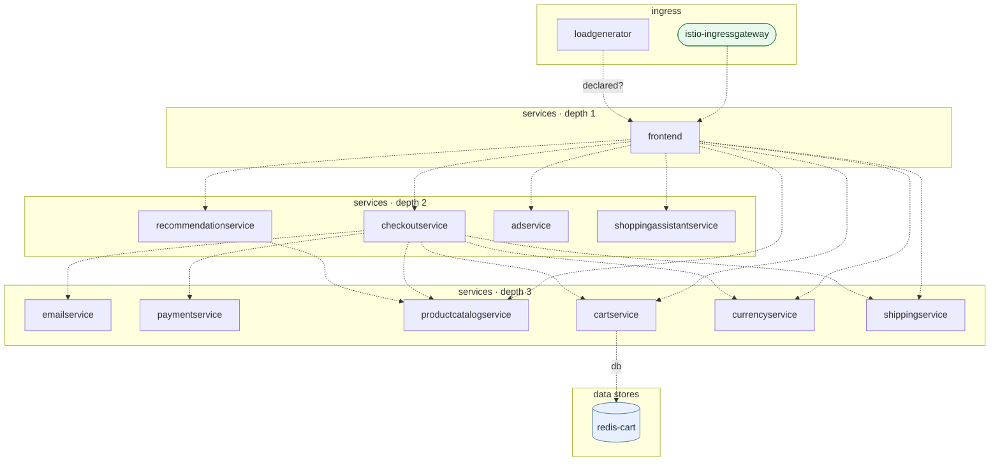

## stacks
- go (GENERIC, from 24 .go files, go.mod; tree-sitter grammar)
- python/web (FRAMEWORK, from requirements.txt)
- csharp (GENERIC, from 8 .cs files; tree-sitter grammar)
- javascript (GENERIC, from 6 .js/.mjs/.cjs/.jsx files, package.json; tree-sitter grammar)
- java (GENERIC, from build.gradle)

## ledger sections
- config = 98
- http-client = 4
- grpc = 3
- registry-ref = 1
- url = 2
- import = 85
- http-server = 1
- persistence = 1
- name-ref = 4
- k8s-namespace = 1
- k8s-workload = 52
- k8s-service = 52
- env-address = 75
- workload-env = 75
- ingress-route = 2
- k8s-gateway = 1
- service-root = 12
- module-deps = 11
- TOTAL = 480 | files with syntax errors = 0

## graph
- after merge: 14 nodes / 18 edges | after normalize: 14 nodes / 18 edges | unresolved code edges = 8
- persistence services: [cartservice]

## nodes (kind, layer)
- adservice  [service, L2]
- cartservice  [service, L3]
- checkoutservice  [service, L2]
- currencyservice  [service, L3]
- emailservice  [service, L3]
- frontend  [service, L1]
- istio-ingressgateway  [gateway, L0]
- loadgenerator  [service, L0]
- paymentservice  [service, L3]
- productcatalogservice  [service, L3]
- recommendationservice  [service, L2]
- redis-cart  [db, L4]
- shippingservice  [service, L3]
- shoppingassistantservice  [service, L2]

## edges (type, confidence, provenance ref)
- cartservice -> redis-cart  (db, documented)  code: src/cartservice/src/Startup.cs:29
- checkoutservice -> cartservice  (sync-http, documented)  code: src/checkoutservice/main.go:113
- checkoutservice -> currencyservice  (sync-http, documented)  code: src/checkoutservice/main.go:114
- checkoutservice -> emailservice  (sync-http, documented)  code: src/checkoutservice/main.go:115
- checkoutservice -> paymentservice  (sync-http, documented)  code: src/checkoutservice/main.go:116
- checkoutservice -> productcatalogservice  (sync-http, documented)  code: src/checkoutservice/main.go:112
- checkoutservice -> shippingservice  (sync-http, documented)  code: src/checkoutservice/main.go:111
- frontend -> adservice  (sync-http, documented)  code: src/frontend/main.go:138
- frontend -> cartservice  (sync-http, documented)  code: src/frontend/main.go:134
- frontend -> checkoutservice  (sync-http, documented)  code: src/frontend/main.go:136
- frontend -> currencyservice  (sync-http, documented)  code: src/frontend/main.go:133
- frontend -> productcatalogservice  (sync-http, documented)  code: src/frontend/main.go:132
- frontend -> recommendationservice  (sync-http, documented)  code: src/frontend/main.go:135
- frontend -> shippingservice  (sync-http, documented)  code: src/frontend/main.go:137
- frontend -> shoppingassistantservice  (sync-http, documented)  code: src/frontend/main.go:139
- istio-ingressgateway -> frontend  (sync-http, documented)  code: istio-manifests/frontend-gateway.yaml
- loadgenerator -> frontend  (sync-http, inferred)  code: helm-chart/templates/loadgenerator.yaml
- recommendationservice -> productcatalogservice  (sync-http, documented)  code: src/recommendationservice/recommendation_server.py:131

## unresolved (source hint / raw target / file:line), first 40
- frontend  =>  null   @ src/frontend/packaging_info.go:54
- frontend  =>  null   @ src/frontend/handlers.go:472
- productcatalogservice  =>  null   @ src/productcatalogservice/server.go:211
- checkoutservice  =>  null   @ src/checkoutservice/main.go:214
- checkoutservice  =>  null   @ src/checkoutservice/main.go:316
- checkoutservice  =>  null   @ src/checkoutservice/main.go:388
- cartservice  =>  null   @ src/cartservice/src/cartstore/RedisCartStore.cs:40
- cartservice  =>  null   @ src/cartservice/src/cartstore/RedisCartStore.cs:90

## alias questions (name [origin] seen in | candidates)
- none

## alias answers applied
- none

## mermaid

## 規則觸發
計數＝該規則改變了多少個不同的東西（邊、節點、名稱、檔案；同一個東西重複碰到算一次）；括號內最多列 5 個例子。
- rule 1: 13 (node emailservice; node checkoutservice; node recommendationservice; node frontend; node paymentservice)
- rule 2: 1 (climb src/cartservice/src)
- rule 3: 0
- rule 4: 0
- rule 5: 0
- rule 6: 0
- rule 7: 0
- rule 8: 0
- rule 9: 0
- rule 10: 1 (drop opentelemetrycollector (kustomize/components/google-cloud-operations))
- rule 11: 0
- rule 12: 0
- rule 13: 0
- rule 14: 16 (edge checkoutservice->productcatalogservice; edge checkoutservice->shippingservice; edge checkoutservice->paymentservice; edge checkoutservice->emailservice; edge checkoutservice->currencyservice)
- rule 15: 0
- rule 16: 0
- rule 17: 0
- rule 18: 0
- rule 19: 0
- rule 20: 16 (scoped PRODUCT_CATALOG_SERVICE_ADDR=productcatalogservice @frontend; scoped CURRENCY_SERVICE_ADDR=currencyservice @frontend; scoped CART_SERVICE_ADDR=cartservice @frontend; scoped RECOMMENDATION_SERVICE_ADDR=recommendationservice @frontend; scoped CHECKOUT_SERVICE_ADDR=checkoutservice @frontend)
- rule 21: 0
- rule 22: 0
- rule 23: 0
- rule 24: 0
- rule 25: 0
- rule 26: 0
- rule 27: 0
- rule 28: 0
- rule 29: 0
- rule 30: 0
- rule 31: 0
- rule 32: 0
- rule 33: 0
- rule 34: 0
- rule 35: 0
- rule 36: 0
- rule 37: 0
- rule 38: 0
- rule 39: 0
- rule 40: 8 (cs-file src/cartservice/src/cartstore/ICartStore.cs; cs-file src/cartservice/src/cartstore/SpannerCartStore.cs; cs-file src/cartservice/src/cartstore/AlloyDBCartStore.cs; cs-file src/cartservice/src/cartstore/RedisCartStore.cs; cs-file src/cartservice/src/Startup.cs)
- rule 41: 0
- rule 42: 5 (ignore /src/frontend/validator/validator_test.go/; ignore /src/frontend/money/money_test.go/; ignore /src/productcatalogservice/product_catalog_test.go/; ignore /src/checkoutservice/money/money_test.go/; ignore /src/shippingservice/shippingservice_test.go/)
- rule 43: 0
- rule 44: 0
- rule 45: 0
- rule 46: 0
- rule 47: 3 (urlref src/frontend/main.go:229 addr; valueref src/paymentservice/index.js:48 collectorUrl; valueref src/currencyservice/server.js:62 collectorUrl)
- rule 52: 21 (render helm-chart/templates/adservice.yaml; render helm-chart/templates/cartservice.yaml; render helm-chart/templates/checkoutservice.yaml; render helm-chart/templates/common.yaml; render helm-chart/templates/currencyservice.yaml)
- rule 56: 3 (istio asm-ingress/asm-ingressgateway -> frontend; istio frontend-gateway -> frontend; edge istio-ingressgateway->frontend)
