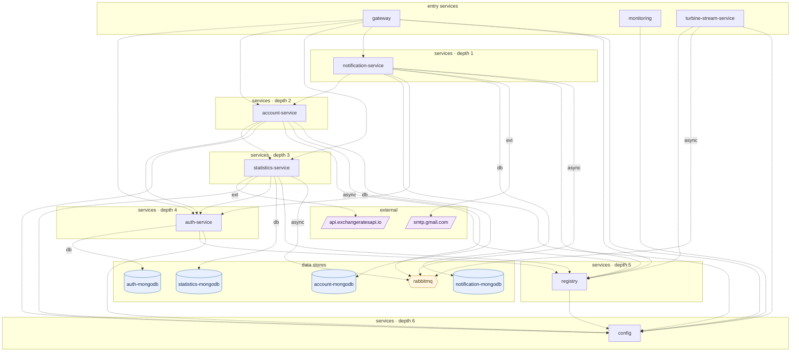

## stacks
- java/spring (FRAMEWORK, from pom.xml)
- javascript (GENERIC, from 8 .js/.mjs/.cjs/.jsx files; tree-sitter grammar)

## ledger sections
- jpa = 4
- http-server = 16
- name-ref = 11
- feign = 5
- name-constant = 2
- config = 60
- compose-service = 28
- compose-dependency = 8
- service-root = 10
- module-deps = 9
- TOTAL = 153 | files with syntax errors = 0

## graph
- after merge: 16 nodes / 33 edges | after normalize: 16 nodes / 33 edges | unresolved code edges = 0
- persistence services: [statistics-service, account-service, notification-service, auth-service]

## nodes (kind, layer)
- account-mongodb  [db, L7]
- account-service  [service, L2]
- api.exchangeratesapi.io  [external, L8]
- auth-mongodb  [db, L7]
- auth-service  [service, L4]
- config  [service, L6]
- gateway  [service, L0]
- monitoring  [service, L0]
- notification-mongodb  [db, L7]
- notification-service  [service, L1]
- rabbitmq  [queue, L7]
- registry  [service, L5]
- smtp.gmail.com  [external, L8]
- statistics-mongodb  [db, L7]
- statistics-service  [service, L3]
- turbine-stream-service  [service, L0]

## edges (type, confidence, provenance ref)
- account-service -> account-mongodb  (db, documented)  code: config/src/main/resources/shared/account-service.yml
- account-service -> auth-service  (sync-http, documented)  code: account-service/src/main/java/com/piggymetrics/account/client/AuthServiceClient.java:9
- account-service -> config  (sync-http, documented)  code: account-service/src/main/resources/bootstrap.yml
- account-service -> rabbitmq  (async, documented)  code: config/src/main/resources/shared/application.yml
- account-service -> registry  (sync-http, documented)  code: config/src/main/resources/shared/application.yml
- account-service -> statistics-service  (sync-http, documented)  code: account-service/src/main/java/com/piggymetrics/account/client/StatisticsServiceClient.java:10
- auth-service -> auth-mongodb  (db, documented)  code: config/src/main/resources/shared/auth-service.yml
- auth-service -> config  (sync-http, documented)  code: docker-compose.yml#depends_on
- auth-service -> registry  (sync-http, documented)  code: config/src/main/resources/shared/application.yml
- gateway -> account-service  (sync-http, documented)  code: config/src/main/resources/shared/gateway.yml
- gateway -> auth-service  (sync-http, documented)  code: config/src/main/resources/shared/gateway.yml
- gateway -> config  (sync-http, documented)  code: docker-compose.yml#depends_on
- gateway -> notification-service  (sync-http, documented)  code: config/src/main/resources/shared/gateway.yml
- gateway -> registry  (sync-http, documented)  code: config/src/main/resources/shared/application.yml
- gateway -> statistics-service  (sync-http, documented)  code: config/src/main/resources/shared/gateway.yml
- monitoring -> config  (sync-http, documented)  code: docker-compose.yml#depends_on
- notification-service -> account-service  (sync-http, documented)  code: notification-service/src/main/java/com/piggymetrics/notification/client/AccountServiceClient.java:9
- notification-service -> auth-service  (sync-http, documented)  code: config/src/main/resources/shared/notification-service.yml
- notification-service -> config  (sync-http, documented)  code: notification-service/src/main/resources/bootstrap.yml
- notification-service -> notification-mongodb  (db, documented)  code: config/src/main/resources/shared/notification-service.yml
- notification-service -> rabbitmq  (async, documented)  code: config/src/main/resources/shared/application.yml
- notification-service -> registry  (sync-http, documented)  code: config/src/main/resources/shared/application.yml
- notification-service -> smtp.gmail.com  (external, documented)  code: config/src/main/resources/shared/notification-service.yml
- registry -> config  (sync-http, documented)  code: registry/src/main/resources/bootstrap.yml
- statistics-service -> api.exchangeratesapi.io  (external, documented)  code: statistics-service/src/main/java/com/piggymetrics/statistics/client/ExchangeRatesClient.java:10
- statistics-service -> auth-service  (sync-http, documented)  code: config/src/main/resources/shared/statistics-service.yml
- statistics-service -> config  (sync-http, documented)  code: statistics-service/src/main/resources/bootstrap.yml
- statistics-service -> rabbitmq  (async, documented)  code: config/src/main/resources/shared/application.yml
- statistics-service -> registry  (sync-http, documented)  code: config/src/main/resources/shared/application.yml
- statistics-service -> statistics-mongodb  (db, documented)  code: config/src/main/resources/shared/statistics-service.yml
- turbine-stream-service -> config  (sync-http, documented)  code: turbine-stream-service/src/main/resources/bootstrap.yml
- turbine-stream-service -> rabbitmq  (async, documented)  code: config/src/main/resources/shared/application.yml
- turbine-stream-service -> registry  (sync-http, documented)  code: config/src/main/resources/shared/application.yml

## unresolved (source hint / raw target / file:line), first 40

## alias questions (name [origin] seen in | candidates)
- none

## alias answers applied
- none

## mermaid

## 規則觸發
計數＝該規則改變了多少個不同的東西（邊、節點、名稱、檔案；同一個東西重複碰到算一次）；括號內最多列 5 個例子。
- rule 1: 0
- rule 2: 0
- rule 3: 42 (spring-yml config/src/main/resources/shared/gateway.yml; spring-yml config/src/main/resources/shared/auth-service.yml; spring-yml config/src/main/resources/shared/notification-service.yml; spring-yml config/src/main/resources/shared/statistics-service.yml; spring-yml config/src/main/resources/shared/account-service.yml)
- rule 4: 1 (table rates.url=https://api.exchangeratesapi.io)
- rule 5: 9 (key zuul.routes.account-service.serviceid=account-service; key zuul.routes.statistics-service.serviceid=statistics-service; key zuul.routes.notification-service.serviceid=notification-service; key spring.data.mongodb.host=auth-mongodb; key spring.data.mongodb.host=notification-mongodb)
- rule 6: 0
- rule 7: 0
- rule 8: 10 (feign-bean-id rates-client; config-signal server.port; config-signal spring.data.mongodb.username; config-signal spring.data.mongodb.password; config-signal spring.data.mongodb.database)
- rule 9: 4 (jpa statistics-service/src/main/java/com/piggymetrics/statistics/repository/DataPointRepository.java; jpa account-service/src/main/java/com/piggymetrics/account/repository/AccountRepository.java; jpa notification-service/src/main/java/com/piggymetrics/notification/repository/RecipientRepository.java; jpa auth-service/src/main/java/com/piggymetrics/auth/repository/UserRepository.java)
- rule 10: 0
- rule 11: 14 (node rabbitmq; node config; node registry; node gateway; node auth-service)
- rule 12: 0
- rule 13: 0
- rule 14: 0
- rule 15: 0
- rule 16: 0
- rule 17: 0
- rule 18: 0
- rule 19: 0
- rule 20: 0
- rule 21: 0
- rule 22: 0
- rule 23: 24 (keep statistics-service eureka.client.; keep account-service eureka.client.; keep notification-service eureka.client.; keep turbine-stream-service eureka.client.; keep registry eureka.client.)
- rule 24: 0
- rule 25: 0
- rule 26: 0
- rule 27: 0
- rule 28: 0
- rule 29: 0
- rule 30: 0
- rule 31: 0
- rule 32: 0
- rule 33: 0
- rule 34: 0
- rule 35: 8 (inferred registry->config; inferred gateway->config; inferred auth-service->config; inferred account-service->config; inferred statistics-service->config)
- rule 36: 0
- rule 37: 0
- rule 38: 0
- rule 39: 0
- rule 40: 0
- rule 41: 0
- rule 42: 0
- rule 43: 0
- rule 44: 1 (map mongodb=auth-mongodb)
- rule 45: 0
- rule 46: 0
- rule 51: 6 (browser gateway/src/main/resources/static/js/main.js:871; browser gateway/src/main/resources/static/js/login.js:1; browser gateway/src/main/resources/static/js/lib/jquery.min.js:2; browser gateway/src/main/resources/static/js/lib/extrascripts.js:97; browser gateway/src/main/resources/static/js/launch.js:17)
