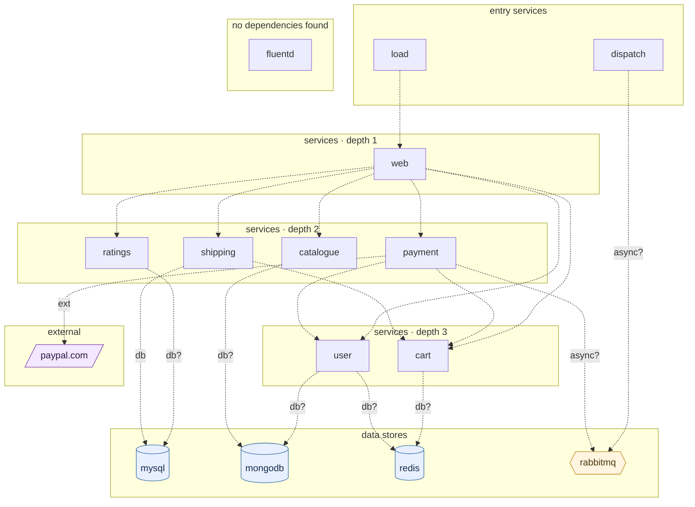

## stacks
- java/spring (FRAMEWORK, from pom.xml)
- php (LLM, from 11 .php files)   <-- skipped (LLM tier)
- javascript (LLM, from 7 .js/.jsx/.ts/.tsx files)   <-- skipped (LLM tier)
- python/web (FRAMEWORK, from requirements.txt)
- go (LLM, from 1 .go files)   <-- skipped (LLM tier)

## ledger sections
- http-server = 12
- url = 12
- jpa = 4
- config = 8
- import = 28
- http-client = 1
- env-address = 11
- compose-service = 18
- compose-dependency = 16
- workload-env = 2
- k8s-namespace = 1
- k8s-workload = 3
- k8s-service = 11
- service-root = 13
- module-deps = 3
- TOTAL = 143 | files with syntax errors = 0

## graph
- after merge: 15 nodes / 19 edges | after normalize: 15 nodes / 19 edges | unresolved code edges = 0
- persistence services: [shipping]

## nodes (kind, layer)
- cart  [service, L3]
- catalogue  [service, L2]
- dispatch  [service, L0]
- fluentd  [service, L6]
- load  [service, L0]
- mongodb  [db, L4]
- mysql  [db, L4]
- payment  [service, L2]
- paypal.com  [external, L5]
- rabbitmq  [queue, L4]
- ratings  [service, L2]
- redis  [db, L4]
- shipping  [service, L2]
- user  [service, L3]
- web  [service, L1]

## edges (type, confidence, provenance ref)
- cart -> redis  (db, inferred)  code: docker-compose.yaml#depends_on
- catalogue -> mongodb  (db, inferred)  code: docker-compose.yaml#depends_on
- dispatch -> rabbitmq  (async, inferred)  code: docker-compose.yaml#depends_on
- load -> web  (sync-http, documented)  code: docker-compose-load.yaml#depends_on
- payment -> cart  (sync-http, documented)  code: payment/payment.py:24
- payment -> paypal.com  (external, documented)  code: payment/payment.py:84
- payment -> rabbitmq  (async, inferred)  code: docker-compose.yaml#depends_on
- payment -> user  (sync-http, documented)  code: payment/payment.py:25
- ratings -> mysql  (db, inferred)  code: docker-compose.yaml#depends_on
- shipping -> cart  (sync-http, documented)  code: shipping/src/main/java/com/instana/robotshop/shipping/Controller.java:24
- shipping -> mysql  (db, documented)  code: shipping/src/main/java/com/instana/robotshop/shipping/JpaConfig.java:16
- user -> mongodb  (db, inferred)  code: docker-compose.yaml#depends_on
- user -> redis  (db, inferred)  code: docker-compose.yaml#depends_on
- web -> cart  (sync-http, documented)  code: web/default.conf.template:69
- web -> catalogue  (sync-http, documented)  code: docker-compose.yaml#depends_on
- web -> payment  (sync-http, documented)  code: docker-compose.yaml#depends_on
- web -> ratings  (sync-http, documented)  code: web/default.conf.template:81
- web -> shipping  (sync-http, documented)  code: docker-compose.yaml#depends_on
- web -> user  (sync-http, documented)  code: docker-compose.yaml#depends_on

## unresolved (source hint / raw target / file:line), first 40

## alias questions (name [origin] seen in | candidates)
- none

## alias answers applied
- none

## mermaid

