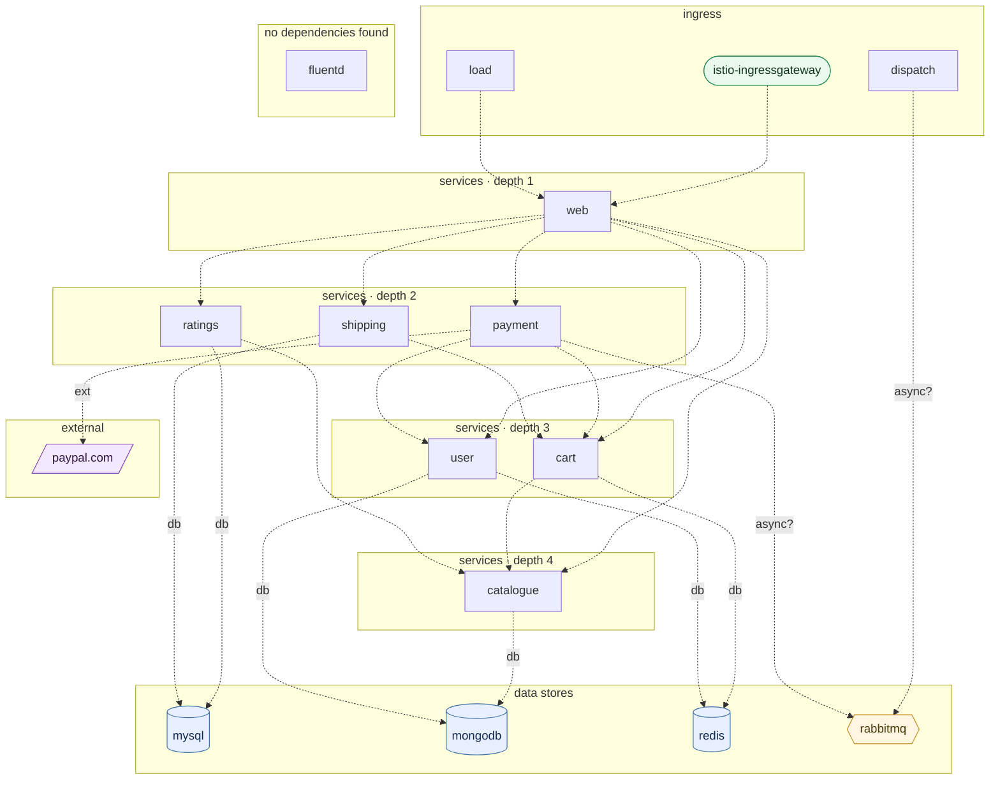

## stacks
- java/spring (FRAMEWORK, from pom.xml)
- php (GENERIC, from 11 .php files, composer.json; tree-sitter grammar)
- javascript (GENERIC, from 7 .js/.mjs/.cjs/.jsx files, package.json; tree-sitter grammar)
- python/web (FRAMEWORK, from requirements.txt)
- go (GENERIC, from 1 .go files; tree-sitter grammar)

## ledger sections
- http-server = 34
- url = 12
- jpa = 4
- config = 44
- persistence = 6
- http-client = 3
- import = 28
- registry-ref = 1
- env-address = 11
- k8s-workload = 15
- k8s-service = 12
- k8s-namespace = 2
- compose-service = 18
- compose-dependency = 16
- workload-env = 2
- k8s-gateway = 1
- ingress-route = 1
- service-root = 13
- module-deps = 6
- TOTAL = 229 | files with syntax errors = 0

## graph
- after merge: 16 nodes / 22 edges | after normalize: 16 nodes / 22 edges | unresolved code edges = 1
- persistence services: [shipping, ratings, user, cart, catalogue, dispatch]

## nodes (kind, layer)
- cart  [service, L3]
- catalogue  [service, L4]
- dispatch  [service, L0]
- fluentd  [service, L7]
- istio-ingressgateway  [gateway, L0]
- load  [service, L0]
- mongodb  [db, L5]
- mysql  [db, L5]
- payment  [service, L2]
- paypal.com  [external, L6]
- rabbitmq  [queue, L5]
- ratings  [service, L2]
- redis  [db, L5]
- shipping  [service, L2]
- user  [service, L3]
- web  [service, L1]

## edges (type, confidence, provenance ref)
- cart -> catalogue  (sync-http, documented)  code: cart/server.js:362
- cart -> redis  (db, documented)  code: docker-compose.yaml#depends_on
- catalogue -> mongodb  (db, documented)  code: catalogue/server.js:158
- dispatch -> rabbitmq  (async, inferred)  code: docker-compose.yaml#depends_on
- istio-ingressgateway -> web  (sync-http, documented)  code: K8s/Istio/gateway.yaml
- load -> web  (sync-http, documented)  code: docker-compose-load.yaml#depends_on
- payment -> cart  (sync-http, documented)  code: payment/payment.py:24
- payment -> paypal.com  (external, documented)  code: payment/payment.py:84
- payment -> rabbitmq  (async, inferred)  code: docker-compose.yaml#depends_on
- payment -> user  (sync-http, documented)  code: payment/payment.py:25
- ratings -> catalogue  (sync-http, documented)  code: ratings/html/src/Kernel.php:76
- ratings -> mysql  (db, documented)  code: docker-compose.yaml#depends_on
- shipping -> cart  (sync-http, documented)  code: shipping/src/main/java/com/instana/robotshop/shipping/Controller.java:24
- shipping -> mysql  (db, documented)  code: shipping/src/main/java/com/instana/robotshop/shipping/JpaConfig.java:16
- user -> mongodb  (db, documented)  code: user/server.js:273
- user -> redis  (db, documented)  code: docker-compose.yaml#depends_on
- web -> cart  (sync-http, documented)  code: web/default.conf.template:69
- web -> catalogue  (sync-http, documented)  code: docker-compose.yaml#depends_on
- web -> payment  (sync-http, documented)  code: docker-compose.yaml#depends_on
- web -> ratings  (sync-http, documented)  code: web/default.conf.template:81
- web -> shipping  (sync-http, documented)  code: docker-compose.yaml#depends_on
- web -> user  (sync-http, documented)  code: docker-compose.yaml#depends_on

## unresolved (source hint / raw target / file:line), first 40
- ratings  =>  null   @ ratings/html/src/Service/CatalogueService.php:32

## alias questions (name [origin] seen in | candidates)
- none

## alias answers applied
- none

## mermaid

## 規則觸發
計數＝該規則改變了多少個不同的東西（邊、節點、名稱、檔案；同一個東西重複碰到算一次）；括號內最多列 5 個例子。
- rule 1: 12 (not-preadded web; not-preadded payment; not-preadded dispatch; not-preadded ratings; not-preadded user)
- rule 2: 0
- rule 3: 0
- rule 4: 6 (table CATALOGUE_HOST=catalogue; table USER_HOST=user; table CART_HOST=cart; table SHIPPING_HOST=shipping; table PAYMENT_HOST=payment)
- rule 5: 7 (env CATALOGUE_HOST=catalogue; env USER_HOST=user; env CART_HOST=cart; env SHIPPING_HOST=shipping; env PAYMENT_HOST=payment)
- rule 6: 6 (url http://${CATALOGUE_HOST}:8080/; url http://${USER_HOST}:8080/; url http://${CART_HOST}:8080/; url http://${SHIPPING_HOST}:8080/; url http://${PAYMENT_HOST}:8080/)
- rule 7: 4 (env load.HOST=web; node web; node redis; node rabbitmq)
- rule 8: 0
- rule 9: 2 (jpa shipping/src/main/java/com/instana/robotshop/shipping/City.java; jpa shipping/src/main/java/com/instana/robotshop/shipping/Code.java)
- rule 10: 1 (drop payment-fix (K8s/Istio))
- rule 11: 1 (k8s-over-compose 13 compose names ignored)
- rule 12: 0
- rule 13: 0
- rule 14: 1 (edge load->web)
- rule 15: 0
- rule 16: 0
- rule 17: 0
- rule 18: 10 (dockerfile-env CATALOGUE_HOST=catalogue; dockerfile-env USER_HOST=user; dockerfile-env CART_HOST=cart; dockerfile-env SHIPPING_HOST=shipping; dockerfile-env PAYMENT_HOST=payment)
- rule 19: 0
- rule 20: 8 (scoped CART_ENDPOINT=cart @shipping; scoped DB_HOST=mysql @shipping; scoped CATALOGUE_HOST=catalogue @web; scoped USER_HOST=user @web; scoped CART_HOST=cart @web)
- rule 21: 0
- rule 22: 0
- rule 23: 0
- rule 24: 0
- rule 25: 0
- rule 26: 0
- rule 27: 0
- rule 28: 0
- rule 29: 0
- rule 30: 0
- rule 31: 0
- rule 32: 0
- rule 33: 0
- rule 34: 0
- rule 35: 13 (documented load->web; inferred catalogue->mongodb; inferred user->mongodb; inferred user->redis; inferred cart->redis)
- rule 36: 1 (cluster-suffix web.robot-shop.svc.cluster.local)
- rule 37: 0
- rule 38: 0
- rule 39: 0
- rule 40: 0
- rule 41: 0
- rule 42: 0
- rule 43: 0
- rule 44: 15 (compose-only web=web; compose-only payment=payment; compose-only dispatch=dispatch; compose-only ratings=ratings; nested html=ratings)
- rule 45: 0
- rule 46: 0
- rule 47: 5 (valueref user/server.js:273 mongoURL; hostref cart/server.js:362 catalogueHost; valueref cart/server.js:391 redisHost; valueref catalogue/server.js:158 mongoURL; urlref payment/payment.py:84 PAYMENT_GATEWAY)
- rule 48: 3 (default CATALOGUE_URL=catalogue; usesite MONGO_URL=mongodb; usesite REDIS_HOST=redis)
- rule 51: 8 (browser web/static/js/controller.js:103; browser web/static/js/controller.js:117; browser web/static/js/controller.js:204; browser web/static/js/controller.js:222; browser web/static/js/controller.js:288)
- rule 52: 28 (render K8s/helm/templates/cart-deployment.yaml; render K8s/helm/templates/cart-service.yaml; render K8s/helm/templates/catalogue-deployment.yaml; render K8s/helm/templates/catalogue-service.yaml; render K8s/helm/templates/clusterrole.yaml)
- rule 56: 2 (istio robotshop-gateway -> web.robot-shop.svc.cluster.local; edge istio-ingressgateway->web)
